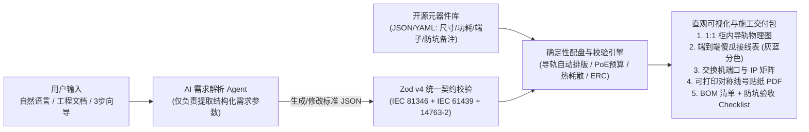

# 04_开源傻瓜化电箱配盘 Agent 与强弱电 Zod v4 统一契约规范 (ElecPal v3 Architecture)

> **定位与核心愿景**：  
> 本文档定义 `apps/elecpal` 从早期“手写 JSON 的弱电/单线图 CAD 工具”向 **“Open-Core 商业化电箱配盘 Agent 平台（自然语言 / 工程文档 → 直观物理配盘与施工交付包）”** 演进的顶层架构、国际标准对齐方案与 Zod v4 数据契约规范。  
> **开源与商业边界**：**仅 `@aquaponics/schema`（Zod v4 统一契约与开放元器件规格标准）开源**，用于建立行业数据事实源与接入外部生态；**`elecpal` Web 平台、确定性排版引擎与 Agent 服务保持闭源运营**，支持平台广告位、元器件/成套厂采购导流及高级导出增值变现。  
> **版本与状态**：`Version 1.2.0 (含厂商规格书AI入库机制)` | **生效时间**：`2026-11-18T14:17:00.000Z` (严格遵循 ISO 8601 UTC)  
> **对齐的工程规范样本**：`04_中央PLC智能主控制柜` · `05_水质调理边缘控制箱` · `06_温室立柱微气候边缘控制箱` · `09_全厂视频监控PoE网络布线`

---

## 1. 为什么必须重构：现状与“傻瓜化 Agent”的差距

当前 `elecpal`（v1/v2）围绕 `workshop_01_sample.json` 构建，存在 4 个结构性局限：
1. **重逻辑、轻施工**：现有视图（单线图 `Sheet1SLD`、PLC 表 `Sheet2PLC`、RS-485 表 `Sheet3RS485`）面向专业电气工程师，缺少现场电工照着就能拧螺丝的 **1:1 DIN 导轨物理排布图** 与 **端到端傻瓜接线表**。
2. **新弱电架构缺失**：04/05/06/09 规范中已落地的 **`PoE+ (802.3at)` 边缘箱去 220V 供电**、**24 口交换机端口固化矩阵**、**带灯熔断端子（`SAKSI 4N LD`）**、**灰蓝分色端子排**、**非导轨器件底板固定** 等实战要素，在当前 Schema 中均未建模。
3. **门槛过高**：要求用户面对数百行 JSON 编辑，不符合普通用户/施工人员的使用习惯。
4. **商业化与生态边界不清晰**：早期未区分“开放标准”与“平台壁垒”。新架构明确 **仅开源 Zod v4 契约吸引生态**，平台保留云端存档、品牌广告位与商业变现能力。

---

## 2. Agent 核心架构原则：AI 理解意图，确定性引擎保障安全

为了让用户通过**自然语言**或**上传工程文档**就能直观得到可施工的配盘方案，系统严格执行 **“AI 语义翻译层 + 确定性工程引擎”** 分离架构：

> [!IMPORTANT]
> **工程安全与商业化红线**：
> 1. **严禁 AI 直接编造电气参数**：空开额定电流、线径、导轨毫米坐标、PoE 功率余量必须由确定性算法计算，并由 Zod `.superRefine()` 强制校验；
> 2. **Open-Core 架构隔离**：开源的 Zod v4 契约放在独立包（`@aquaponics/schema/electrical`）中保持完全中立；闭源的 `elecpal` 平台保留用户体系、云端项目存储（Firebase / Cloudflare D1），并可合理嵌入广告位（如元器件品牌推荐、成套配盘厂家对接、BOM 采购返佣链接）及高阶导出权益。

---

## 3. 国际标准对齐（不重造轮子）

为兼顾“底层专业严谨”与“前台傻瓜易懂”，Zod v4 契约直接对齐以下 4 项国际标准，**前台隐藏术语、底层严格遵循**：

| 国际标准 | 对应工程领域 | 在本契约中的落地映射 |
| :--- | :--- | :--- |
| **IEC 81346-1 / -2** | 工业系统结构化与设备参照代号 | 采用 **三维度模型**： • `=` 功能面（如 `=WATER_MON`、`=VIDEO`、`=PUMP_CTRL`） • `+` 位置面（如 `+AP-CTRL+R3` 表示主柜第 3 根导轨） • `-` 产品字母码（`-F` 保护/熔断、`-Q` 主开关、`-K` 继电器、`-A` 控制器/电源/交换机/PoE分离器、`-B` 传感器/摄像头、`-X` 端子排、`-W` 线缆） |
| **IEC 61439-1 / -2 / -3** *(对应 GB/T 7251)* | 低压成套开关设备和控制设备 | 映射箱体安全与散热契约：$U_e$（工作电压）、$I_{nA}$（柜体总电流）、$RDF$（分散系数）、`IP` 等级、柜内总热耗散（`total_heat_loss_w`）与散热方式（自然对流 / 强迫排风）。 |
| **ISO/IEC 14763-2** *(及 TIA-606-C)* | 综合布线管理与标识 | 规范弱电与网线连接模型：`Endpoint A <-> Endpoint B` 对称互指线号（如 `[AP-CTRL:P09] <-> [AP-EDGE-01:PoE]`），支持一键生成可打印线号贴纸。 |
| **IEC 62714 (AutomationML)** | 跨工具工程数据交换 | **借鉴模型思想，弃用 XML 格式**：以 Zod v4 + 原生 `z.toJSONSchema()` 作为 Web/Agent 原生数据格式；未来如需对接 EPLAN / TIA Portal，可独立编写 CAEX 导出器。 |

---

## 4. Zod v4 统一契约分层设计 (`@aquaponics/schema/electrical`)

建议将现有单一的 `packages/schema/src/electrical/index.ts` 重构为 4 个职责清晰的模块（保留旧版 `PlantWideTopologySchema` 兼容导出）：

### 4.1 开源元器件库契约 (`catalog.ts`)
所有强弱电器件不再硬编码在组件代码中，而是抽象为开源社区可 PR 扩展的标准元器件定义：
* **基础标识**：`part_id`、`brand`、`model`、`iec_class`（`F | Q | K | A | B | X | W`）、`category`
* **物理规格**：`dimensions_mm: { width, height, depth }`、`mount_type`（`z.discriminatedUnion`: `'din_rail' | 'plate_screw' | 'shelf_tray' | 'door_cutout'`）、`clearance_mm`（如左右散热间隙 `30mm`）
* **电气与热特性**：`supply_type`（`380VAC | 220VAC | 24VDC | 12VDC | PoE_802_3at | PoE_802_3bt | passive`）、`rated_power_w`、`heat_dissipation_w`
* **接线端子定义**：`terminals[]`（端子号、信号类型、极性/颜色建议，如 `24V+ 灰`、`0V 蓝`、`RS485_A+`、`PE 黄绿`）
* **经验教训字段**：`install_notes: string[]`（例如：`"拨码开关必须置 D 禁用 VLAN 隔离"`、`"无导轨卡扣，须底板螺丝固定"`）
* **核验与商业元数据**：`verification_status`（`draft | vendor_confirmed | verified`）、`source_evidence`（高危字段在原规格书 PDF 的页码与原文摘录）、`commercial_meta`（可选的厂商官网/采购链接/认证推广标识 `is_sponsored`）

### 4.2 强电动力配电契约 (`power.ts`)
覆盖 380V/220V 总柜、分箱与电机负载（继承现有契约能力）：
* 总进线断路器、电表/CT 互感器、浪涌保护器（SPD）
* 动力分支回路（`pump_motor` / `blower_motor` 等）、D/C 型脱扣曲线、RCD 漏保（`30mA/0.1s` 人身保护 vs `100mA/0.3s` 动力防误跳 vs `ALARM_ONLY` 生命维生设备）
* VFD 变频器控制端子与电缆载流量 / 末端压降（$\le 5.0\%$）校验

### 4.3 弱电与边缘网络契约 (`weak-edge.ts`)
补齐 05/06/09 规范的现代边缘智能化场景：
* **供电链路**：`24VDC 开关电源`、`在线式 UPS`、`PoE+ 隔离分离器`（含单口功率上限校验，如 `802.3at <= 25.5W` / 分离器 `24W`）
* **PoE 交换机与端口矩阵**：总 PoE 预算（如 `360W`）、端口分配表（`Port 01~24` / `Uplink` / `SFP`）、拨码工作模式（`default_open | vlan_isolated | extend`）
* **边缘总线与终端**：`Modbus-TCP` 耦合器（如 `GL20`）、串口服务器（`USR-DR302`）、光电隔离 485 Hub、末端传感器（`Slave ID`、量程、协议）与摄像头（主/子码流、`visibility: internal_ops | public_trace`）
* **线缆与对称线号**：`YJV | RVV | RVSP | Cat5e_STP | Cat6_STP | Fiber`，强制包含 `from` / `to` 端点与三段式线号编码

### 4.4 物理配盘与施工交付契约 (`cabinet.ts`)
面向现场落地的“傻瓜化”核心数据结构：
* **箱体机械规格**：外廓尺寸（mm）、底座高度、IP 等级、散热风道（进风百叶 / 顶置轴流风扇）
* **箱体开孔清单**：底板/侧板开孔规格与数量（如 `PG13.5`、`PG16`、`PG21` 葛兰头对应穿入线缆）
* **分层物理布局（`zones`）**：
  * 托盘层（`shelf_tray`，如交换机/NVR/工控机承重托板）
  * 导轨层（`din_rails[]`，记录导轨 ID、可用长度 `usable_width_mm`、以及从左到右有序排列的元器件实例列表）
  * 底板直装区（`plate_mounts[]`，用于无导轨卡扣设备）
* **端到端傻瓜接线表（`wiring_connections[]`）**：精确到 `源设备端子 -> 线色/线号 -> 目标端子排/熔断端子`
* **出厂与现场验收项（`checklist[]`）**：自动汇总所选器件关联的 `install_notes` 与安全红线检查项

---

## 5. Zod v4 自动化安全校验规则 (`.superRefine()`)

在契约解析阶段，内置以下**零容忍工程红线**，任何人机生成的方案都必须通过：
1. **导轨物理空间不溢出**：$\sum (\text{器件宽度} + \text{左右间隙}) \le \text{导轨可用长度}$；
2. **PoE+ 供电不超载**：单口 PoE 分离器下挂设备总功耗 $\le$ 分离器与标准上限（如 `24W / 25.5W`）；交换机所有 PoE 端口总功耗 $\le$ 交换机总预算（如 `360W`）；
3. **24V 传感器熔断保护强制检查**：外接现场水下/户外 24V 传感器必须经过独立熔断端子（`-F`，如 `SAKSI 4N LD`），禁止直接并联主电源；
4. **强弱电隔离红线**：同一箱体内若同时存在 220V/380V 强电与 24V/网络弱电，必须显式声明隔离边界或独立接地（PE $\le 1\,\Omega$）；纯 PoE 边缘箱禁止接入未声明的 220V 执行器直驱；
5. **时间与标识规范**：所有工程元数据时间戳严格校验 `YYYY-MM-DDTHH:mm:ss.sssZ`（ISO 8601 UTC）。

---

## 6. 用户交互与 Agent 呈现形态设计

### 6.1 两种“傻瓜化”入口
1. **自然语言 / 文档对话入口**：
   * 例如输入：*“帮我配一个水产养殖区边缘控制箱，要接 4 个水质探头（pH/EC/水温/氨氮），用主柜 PoE+ 供电不拉 220V，预留 8 路干触点给二期水泵控制。”*
   * 或直接拖入一份工程规范 Markdown。
   * Agent 自动解析出配置，调用 Zod v4 校验与布局引擎，**实时在右侧渲染 5 个直观视图**。
2. **3 步向导模板入口（无需打字）**：
   * **选母版**（中央控制主柜 / 水质 PoE 边缘箱 / 立柱微气候箱 / 自定义空箱）→ **调数量** → **一键导出施工包**。

### 6.2 直观呈现视图（替代旧版纯单线图）
1. **柜内 1:1 物理配盘图（Cabinet Layout）**：按真实毫米比例绘制箱体、托盘、DIN 导轨和每个元器件（带品牌型号与宽度标尺），一眼看出怎么装、哪颗器件要拧底板螺丝。
2. **傻瓜接线图与端子排表（Wiring Guide）**：灰蓝分色展示端子排，悬停任意探头或网线直接高亮两端接法。
3. **PoE 与总线端口矩阵（Network & Bus Matrix）**：直观展示 24 口交换机每个口插谁、IP 是多少、Modbus 从站地址是否冲突。
4. **可打印施工包（Printable Pack）**：一键导出 **线号贴纸 PDF** + **底板开孔图** + **带防坑提醒的 BOM 清单** + **验收 Checklist**。

### 6.3 厂商自助入驻：规格书 AI 解析入库与安全门禁
为低成本扩充元器件 SKU 并形成 B 端广告/采购导流入口，平台支持厂商自助上传产品 PDF 规格书，但**严禁 AI 解析后直接上架生产库**，必须经过 3 道安全闸门：
1. **状态机隔离（`draft` → `vendor_confirmed` → `verified`）**：AI 按 `catalog.ts` 契约抽取草稿，经 Zod v4 校验通过后，必须由厂商在可视化表单中核对关键参数并“确认提交”（明确数据责任归属），再经平台审核/白名单放行上架。
2. **高危字段原文溯源**：对**供电电压、额定功耗、外廓尺寸、安装方式、端子定义** 5 类关键字段，AI 必须附带 PDF 页码与原文摘录（`source_evidence`），方便 10 秒快速复核。
3. **选型中立与广告分离**：配盘引擎首先按电气与物理指标做硬筛选；在同等满足技术规格的候选中，才允许将合作厂商 SKU 优先展示并明确标注 `Sponsored / 优选推荐` 标识，保证选型专业公信力。

---

## 7. Open-Core 分期落地路线

1. **Phase 1（Zod v4 开源契约与标准库落地）**：
   - 在 `packages/schema/src/electrical/` 拆出 `catalog.ts`、`power.ts`、`weak-edge.ts`、`cabinet.ts`，作为独立开源的数据契约规范；
   - 使用 `z.toJSONSchema()` 导出标准 Schema，方便外部厂商、社区和第三方 Agent 对接；
   - 将 04、05、06、09 四份规范转化为 4 个标准 JSON Fixture，跑通全部 `.superRefine()` 校验。
2. **Phase 2（闭源平台升级：确定性排版引擎与物理视图）**：
   - 在 `apps/elecpal`（闭源）实现 DIN 导轨自动排布与 PoE/热耗散计算；
   - 新增 `CabinetLayoutView`（1:1 物理配盘视图）与 `WiringGuidePanel`（傻瓜接线与贴纸导出）；
   - 在界面与 BOM 导出中预留**广告展示位 / 品牌选型推荐位**（如正泰、明纬、汇川、成套柜代工入口），保留 Firebase / D1 云端项目存档。
3. **Phase 3（Agent 对话、厂商入驻与商业化运营）**：
   - 接入自然语言 / Markdown 文档解析 Agent，实现“一句话配盘 + 增量修改（如*‘再加 2 路摄像头，看看交换机功率够不够’*）”；
   - 上线**厂商规格书 PDF AI 解析入库后台**（含高危字段原文溯源与确认发布流）；
   - 打通“免费傻瓜配盘（含广告/优选推荐/基础导出）+ 付费专业施工包/去广告/厂家定制导流”的商业闭环。
