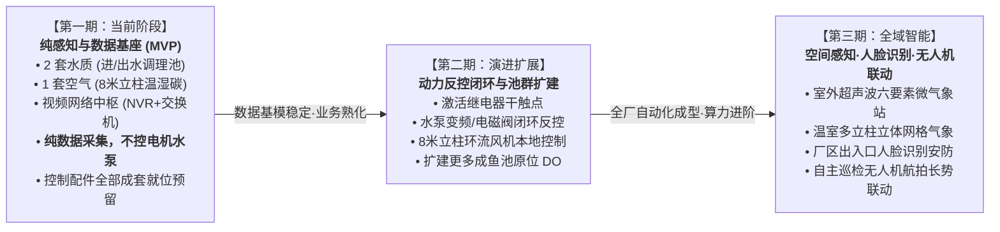
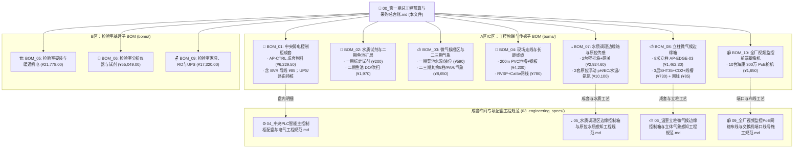

# 第一期数据采集与自动控制硬件采购总台账与工程施工清单 (Phase 1 Master Procurement Ledger & Labor)

> 💡 **架构重构与定位说明 (BOM 树状总控台账)**：  
> 本文档是数字化农业工厂（鱼菜共生智能工业体系）第一期的**【全厂总工程预算与采购总台账】**。  
> 遵循 **SSOT（Single Source of Truth，单一真实事实源）** 设计哲学，本文档作为总览枢纽，仅保留总体资金流动向、分类小计看板、施工定额与核心交付验收 Checklist。  
> 各专业领域细致入微的订货 SKU、厂家型号、电气接线图与安装规范，全部独立分流至专门的子 BOM 文档，杜绝单一大文档混杂混乱。  
>
> **版本与时间**：`Version 3.0.0 (三账分明全口径 SSOT 审计升级版)` | **适用分期**：`Phase 1 (实采) + Phase 2/3 (预留池)` | **台账状态**：`Active`  
> **生效时间**：`2026-11-11T15:15:00.000Z` (严格遵循 ISO 8601 UTC)

---

---

## 🎯 一、 项目实施阶段演进路线图 (Phased Implementation Strategy)

依据现场实际工程节奏与业务边界，数字化农业工厂建设遵循**“纯感知先行、自动化闭环渐进、空间AI立体联动”**的三步走战略：



### 1. 第一期（当前阶段）：纯感知与数据基座验证期 (Phase 1 MVP)
* **核心业务定位**：**纯传感器数据采集（Pure Data Sensing & Ingestion Only）**，**严禁接入或控制电机、水泵、空压机等强电设备**！
* **感知物理落地边界**：
  * **「2 套水质感知」**：进水调理池（`AP-EDGE-01`，距主柜 40m）与出水调理池（`AP-EDGE-02`，距主柜 20m）的原位自适应浮动水质监测（pH / EC / 水温 / 氨氮），详见 👉 [BOM_07](./boms/BOM_07_水质调理区边缘控制箱与水质感知采购清单.md)；
  * **「1 套空气微气候」**：大棚内 8 米高耸承重立柱（`AP-EDGE-03`，距主柜 30m）的 3 层温湿度（1.5m / 4.0m / 7.5m）逆温层监测与作物冠层 NDIR 红外 CO2 监测，详见 👉 [BOM_08](./boms/BOM_08_立柱微气候与动力边缘控制箱采购清单.md)；
  * **「视频与网络中枢」**：中央控制柜（`AP-CTRL`）内部的 **24 口全千兆 PoE+ 交换机（深桑科 `GPS424 V3`，24GE PoE+2GE+2SFP，360W，拨码置 `D` 默认模式；一期 `Port 16` 可选级联利旧海康 `DS-XS06-P` 分流或直接接入 16+ 路枪机）**、**利旧海康 `DS-7816N-Q2` 16路 NVR（含现有双 4TB 酷鹰盘，共 8TB，配 `NDR-75-12` 导轨电源+尾线 ¥66.55）** 与倍控 `N100` 工控机全量就位。10 台海康枪机主码流（H.265）进 NVR 本地循环存 20~30 天；子码流（`720p / 5 fps / H.264 / ~320 kbps`）由工控机在内存盘 `tmpfs` 切成 30s HLS 段传 Cloudflare R2 实现云端回放与伪直播（**一期不跑 YOLO**）。
  * **「驻厂品控检验室（一期同步落地）」**：`5.0m × 8.0m × 3.5m` 双室隔离检验室硬装机电（[BOM_05](./boms/BOM_05_检验室硬装与暖通机电工程清单.md)）、分析仪器与试剂（[BOM_06](./boms/BOM_06_检验室分析仪器与理化试剂设备清单.md)）、实验台柜与 RO/UPS 辅助设施（[BOM_09](./boms/BOM_09_检验室实验家具与纯水UPS辅助设施清单.md)），全口径独立核算 **¥ 94,147.00**。
* **“配件超前装配、留待未来使用”策略**：
  * 主控制柜及边缘控制箱内采购的 16 套超薄中间继电器、漏电开关、分级保险端子等控制构件，**在一期配盘时全部物理装配就位并完成柜内引线**；
  * **一期运行纪律**：端子排引脚**暂不接入外部水泵或电机的接触器线圈（触点无源悬空）**，PLC 程序仅执行只读数据轮询，确保现场绝无误动作风险；
  * **工程价值**：一次性完成钣金制作与内部打线，避免二期开启反控时“二次进场破柜、动火打孔、重新穿线”的巨大破坏与停工损失！

### 2. 第二期：动力反控闭环与池群扩容期 (Phase 2 Automation)
* **控制闭环激活**：将预留的继电器干触点接入现场动力箱，接管 1 号/2 号水循环泵、调理池脉冲加酸加药泵、补水电磁阀、以及 8 米立柱上的环流风机；
* **电费与能耗监测改造 (旧电表柜接入)**：在**「大棚旧有的电表控制柜」**内加装威胜 380V 三相智能电表与开口式 CT 互感器，通过一根 RVSP 屏蔽双绞线将 Modbus-RTU 信号拉回中央控制柜，实现全厂用电量计量与阶梯电费分析（严禁装入中央柜）；
* **养殖水体扩建**：扩建更多成鱼池深水荧光法 DO 探头与防干烧液位浮球，实现养殖水体全域在线健康监测。

### 3. 第三期：空间多维感知、人脸识别与无人机智能联动 (Phase 3 Spatial & AI)
* **室外全天候微气象站**：部署室外超声波六要素气象站（风速风向、雨雪硬触点、日照辐射），与温室天窗电机硬线联动实现暴雨大风秒级闭窗避灾；
* **厂区出入口人脸识别安防**：在厂区大门、中控化验室与防疫通道加装工业级人脸识别抓拍一体机与人员道闸，直接接入既有 32 路 NVR 与工控机，纳管人员进出与生物安全溯源；
* **农业巡检无人机机巢联动**：引入低空自主作业无人机系统，在棚内/棚外预留机巢起降坪，定时自主起飞航拍鱼池摄食活性、以及水培跑道植被冠层多光谱长势巡检，图像流回传工控机 AI 引擎进行病虫害与营养缺乏预警。

---
## 📊 二、 全厂第一期总投资全景概算看板 (三账分明全口径 SSOT)

> [!TIP]
> **重大工程变更与全口径审计说明**：
> 1. **ECO-01 降本**：取消高空双层金属桥架（原预算 ¥26,250），改为“浅表埋地 PVC 阻燃地槽 (100×60) + 钢桁架高挂”，节约 **¥ 24,210**；利旧既有海康 `DS-7816N-Q2` NVR + 双 4TB 盘（补配 ¥66.55 `NDR-75-12` 导轨电源，净省 ¥1,065.45）。
> 2. **三账分明口径**：全厂按 **A 区（一期工控物联实采：¥ 39,791.40）** + **B 区（一期驻厂检验室基建：¥ 94,147.00）** + **C 区（二/三期演进储备池：¥ 11,275.00，不计入一期实付）** 独立核算，**第一期全厂全口径总投资 = ¥ 133,938.40 元（约 13.39 万元）**，彻底消灭子 BOM 漏列与重复计价。

### 2.1 A 区：一期工控物联与弱电工程实采 (小计：¥ 39,791.40 / 约 3.98 万元)

| 分类编码 | 专业工程与物资类别 | 结算金额 (元) | 占 A 区比 | 详细子 BOM 专项文档与单一事实源入口 (SSOT Links) |
| :---: | :--- | :---: | :---: | :--- |
| **BOM-01** | **中央弱电控制柜 (AP-CTRL) 成套** | **¥ 6,229.50** | 15.65% | 👉 [BOM_01_控制中枢与动力配电采购清单.md](./boms/BOM_01_控制中枢与动力配电采购清单.md)<br>*(含 BVR 配线 ¥85；利旧 NVR+双4TB盘配 `NDR-75-12`；`GPS424 V3` 淘宝实核 ¥464；1kVA UPS/路由器暂按 ¥0 待核定)* |
| **BOM-02** | **水质校准试剂 (一期实采部分)** | **¥ 200.00** | 0.50% | 👉 [BOM_02_水质安全感知与调理区传感器采购清单.md](./boms/BOM_02_水质安全感知与调理区传感器采购清单.md)<br>*(仅 pH/EC/氨氮标定试剂 ¥200 归入一期；二期鱼池 DO/吹扫/浮球 ¥1,970 计入 C 区)* |
| **BOM-03** | **微气候根区温液 (一期实采部分)**| **¥ 590.00** | 1.48% | 👉 [BOM_03_微气候与气象感知硬件采购清单.md](./boms/BOM_03_微气候与气象感知硬件采购清单.md)<br>*(仅菜池根区水温+水培液位 ¥590 归入一期；其余 5 柱/PAR/气象站 ¥8,650 计入 C 区)* |
| **BOM-04** | **走线基础设施与长距弱电线缆** | **¥ 4,980.00** | 12.52% | 👉 [BOM_04_现场走线基础设施与长距线缆清单.md](./boms/BOM_04_现场走线基础设施与长距线缆清单.md)<br>*(含 ECO-01 地面阻燃地槽200m/防滑钢板 + 200m RVSP 屏蔽双绞线 + 305m Cat5e 网线)* |
| **BOM-07** | **水质调理区边缘控制箱与原位感知**| **¥ 13,364.60** | 33.59% | 👉 [BOM_07_水质调理区边缘控制箱与水质感知采购清单.md](./boms/BOM_07_水质调理区边缘控制箱与水质感知采购清单.md)<br>*(进/出水调理池 2 台壁挂箱 `AP-EDGE-01/02` + 2 套原位自适应浮动 pH/EC/水温/氨氮 + Cat6 网线)* |
| **BOM-08** | **立柱微气候边缘控制箱与首批传感**| **¥ 2,277.30** | 5.72% | 👉 [BOM_08_立柱微气候与动力边缘控制箱采购清单.md](./boms/BOM_08_立柱微气候与动力边缘控制箱采购清单.md)<br>*(8米立柱 `AP-EDGE-03` 边缘箱 + 3层 SHT35 温湿度 + 冠层 NDIR CO2 + 8米线槽 + Cat6 网线)* |
| **BOM-10** | **全厂视频监控前端摄像机** | **¥ 1,650.00** | 4.15% | 👉 [BOM_10_全厂视频监控前端摄像机采购清单.md](./boms/BOM_10_全厂视频监控前端摄像机采购清单.md)<br>*(10台海康 300万 PoE 防水枪机：7台4mm广角+3台6mm长焦；后台 NVR/交换机/12V电源归入 BOM-01)* |
| **LAB-01** | **现场施工人工工日定额 (暂估)** | **¥ 7,500.00** | 18.85% | 详见下方【第三节：施工工日定额表】(2名电工地槽、高挂、主柜与 3 台边缘箱安装调试共 13 工日) |
| **DEV-01** | **控制软件研发、梯形图与 AI Token**| **¥ 3,000.00** | 7.54% | PLC 梯形图控制逻辑编写、Modbus 采集驱动、D1/R2 物模型对接与农艺文献调研 (1500元/月 × 2月) |
| **A 区合计** | **一期工控物联与弱电工程实采总额** | **¥ 39,791.40** | **100.00%** | **硬件物资 ¥ 29,291.40 + 施工人工 ¥ 7,500.00 + 软件研发 ¥ 3,000.00（零重复计价）** |

### 2.2 B 区：一期驻厂检验室全口径建设 (小计：¥ 94,147.00 / 约 9.41 万元)

| 分类编码 | 专业工程与物资类别 | 结算金额 (元) | 占 B 区比 | 详细子 BOM 专项文档与单一事实源入口 (SSOT Links) |
| :---: | :--- | :---: | :---: | :--- |
| **BOM-05** | **检验室硬装、钢构阁楼与暖通机电** | **¥ 21,778.00** | 23.13% | 👉 [BOM_05_检验室硬装与暖通机电工程清单.md](./boms/BOM_05_检验室硬装与暖通机电工程清单.md)<br>*(5×8×3.5m 双室隔离、9mm 错缝欧松板环氧防水、双 1.5HP 空调、PP 格栅冲洗地面、8.5 工日人工)* |
| **BOM-06** | **检验室分析仪器与理化试剂设备** | **¥ 55,049.00** | 58.47% | 👉 [BOM_06_检验室分析仪器与理化试剂设备清单.md](./boms/BOM_06_检验室分析仪器与理化试剂设备清单.md)<br>*(普析 T6-1650F、农残仪、内校天平、爱拓糖度计、海尔 4℃ 留样箱、优普超纯水机、离心机与试剂)* |
| **BOM-09** | **检验室实验家具、RO 纯水与 UPS** | **¥ 17,320.00** | 18.40% | 👉 [BOM_09_检验室实验家具与纯水UPS辅助设施清单.md](./boms/BOM_09_检验室实验家具与纯水UPS辅助设施清单.md)<br>*(2.8m 边台×2、大理石减震台、PP 酸碱柜、全钢仪器柜+防潮箱、阁楼 RO 纯水、山特 C3K、拼装及搬运人工)* |
| **B 区合计** | **一期驻厂检验室建设全要素总额** | **¥ 94,147.00** | **100.00%** | **第一期全厂总投资（A 区 + B 区）= ¥ 133,938.40 元（约 13.39 万元）** |

### 2.3 C 区：二/三期演进储备池 (暂不计入一期实付，合计：¥ 11,275.00)

| 所属清单 | 演进储备项目说明 | 拟定实施阶段 | 预估金额 (元) | 备注说明 |
| :---: | :--- | :---: | :---: | :--- |
| **BOM-01 备忘** | 大棚旧电表控制柜三相电表与开口 CT | **Phase 2 (二期)** | **¥ 655.00** | 威胜三相多功能电表 + 3只开口 CT，严禁入主柜 |
| **BOM-02 预留** | 成鱼池荧光法 DO、吹扫空压机/阀与浮球 | **Phase 2 (二期)** | **¥ 1,970.00** | 养殖水体扩建与自动吹扫闭环阶段按需采购 |
| **BOM-03 预留** | 其余 5 柱 SHT35 + PAR 光量子 + 室外微气象站 | **Phase 2 / 3** | **¥ 8,650.00** | 多立柱立体网格气象与屋顶极端天气联动 |
| **C 区合计** | **二/三期硬件演进储备总额** | **Phase 2 + 3** | **¥ 11,275.00** | **不计入第一期当下实付预算** |

---

## 👷 三、 现场施工工日定额表 (¥ 7,500.00 / 约 13 工日)

现场施工由 2 名持特种作业操作证（低压电工作业）专业电工协同施工，工期预估 7~8 天：

| 施工分项 | 工作内容与验收标准 | 定额工日 | 施工安排 | 暂估人工费 (元) |
| :--- | :--- | :---: | :---: | :---: |
| **1. PVC 地槽开挖与过道防护** | 沿池壁浅开沟、PVC 100×60 地槽埋设铺设、底孔排涝打设、过道 3 块热镀锌花纹钢板固定 | 4 工日 | 2 人 × 2 天 | ¥ 2,200.00 |
| **2. 弱电线缆高空桁架扎带敷设**| RVSP 4×0.75 双绞线、Cat5e/Cat6 网线沿钢桁架/地槽敷设、防冷凝水 U 型滴水弯制作 | 3 工日 | 1 人 × 3 天 | ¥ 1,800.00 |
| **3. AP-CTRL 主控制柜就位与接线** | 柜体底座打膨胀螺栓固定、24 处底板 PG 接头防水穿线、内部端子排打标号冷压接线 | 2 工日 | 1 人 × 2 天 | ¥ 1,300.00 |
| **4. 边缘箱挂装与原位浮动传感安装**| `AP-EDGE-01~03` 三座边缘控制箱壁挂、调理池自适应浮动电极安装、8 米立柱垂直线槽与百叶探头抱箍固定 | 2 工日 | 1 人 × 2 天 | ¥ 1,200.00 |
| **5. 系统通电调试与接地演练** | 绝缘摇测、PE 接地电阻测试 ($\le 1.0\,\Omega$)、全厂 Modbus-TCP 轮询压测与断网断电保命演练 | 2 工日 | 2 人 × 1 天 | ¥ 1,000.00 |
| **合计** | **覆盖第一期全部地槽埋设、高空挂线、主柜与边缘箱成套就位、探头安装与联合调试** | **13 工日** | **约 7~8 天** | **¥ 7,500.00** |

---

## 📑 四、 专业子 BOM 对应表与采购询价指引

在向设备厂家、电气成套厂或电商平台批量询价下单时，请直接调取对应的专项 BOM 文档，各专业子清单保持完全解耦：



---

## ✅ 五、 第一期物资进场统一验货 Checklist

```markdown
- [ ] 1. 【核心工控设备防伪与发票】：
  - 汇川 PLC (Easy320-0808TN) / 扩展耦合器 (GL20-RTU-MOD + GL20-0808ETN)、倍控 N100 工控机、深桑科 GPS424 V3 交换机、有人 USR-DR302 网关、联测 pH/EC、山东塞恩氨氮三合一探头、仁科 SHT35/CO2。
  - 查验出厂合格证并统一收集 13% 增值税专用发票（注：威胜三相电表与成鱼池 DO 属二期，不在一期进场点验）。

- [ ] 2. 【AP-CTRL 主柜与 AP-EDGE-01~03 边缘箱验收】：
  - 主柜依照《04 号规范》执行出厂打压与 Modbus-TCP 轮询测试，核验 `GPS424 V3` 拨码开关处于 `D` 档且柜顶双排风扇常转；
  - 核验 3 座边缘箱均配明纬 `NDR-75-24`（24VDC）且不含 12V 误配电源，箱底防水格兰头锁紧良好。

- [ ] 3. 【走线槽抗压与线缆材质】：
  - 抽检 PVC 100×60 地槽壁厚 $\ge 1.8\,\text{mm}$ 阻燃合格，3 块 300×1000×3.0mm 热浸锌防滑花纹钢板边缘打磨钝化；
  - 确认 RVSP 4×0.75、Cat5e STP 与 Cat6 STP 网线线芯为高纯度无氧铜（屏蔽编织网致密）。

- [ ] 4. 【驻厂检验室（BOM_05/06/09）验收闭环】：
  - 分别遵照 `BOM_05`（3.5m 阁楼与双室环氧防水）、`BOM_09`（大理石减震台四脚落硬地、40L 防潮箱与 C3K UPS）及 `BOM_06`（仪器开机联机清单）执行进场验收。
```
