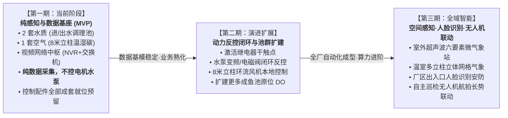
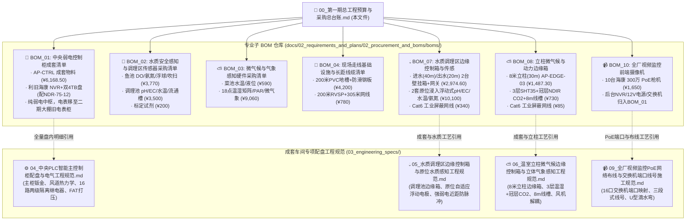

# 第一期数据采集与自动控制硬件采购总台账与工程施工清单 (Phase 1 Master Procurement Ledger & Labor)

> 💡 **架构重构与定位说明 (BOM 树状总控台账)**：  
> 本文档是数字化农业工厂（鱼菜共生智能工业体系）第一期的**【全厂总工程预算与采购总台账】**。  
> 遵循 **SSOT（Single Source of Truth，单一真实事实源）** 设计哲学，本文档作为总览枢纽，仅保留总体资金流动向、分类小计看板、施工定额与核心交付验收 Checklist。  
> 各专业领域细致入微的订货 SKU、厂家型号、电气接线图与安装规范，全部独立分流至专门的子 BOM 文档，杜绝单一大文档混杂混乱。  
>
> **版本与时间**：`Version 2.0.0 (BOM 分层架构升级版)` | **生效时间**：`2026-11-01T18:10:00.000Z` (严格遵循 ISO 8601 UTC)

---

---

## 🎯 一、 项目实施阶段演进路线图 (Phased Implementation Strategy)

依据现场实际工程节奏与业务边界，数字化农业工厂建设遵循**“纯感知先行、自动化闭环渐进、空间AI立体联动”**的三步走战略：



### 1. 第一期（当前阶段）：纯感知与数据基座验证期 (Phase 1 MVP)
* **核心业务定位**：**纯传感器数据采集（Pure Data Sensing & Ingestion Only）**，**严禁接入或控制电机、水泵、空压机等强电设备**！
* **感知物理落地边界**：
  * **「2 套水质感知」**：进水调理池（`AP-EDGE-01`，距主柜 40m）与出水调理池（`AP-EDGE-02`，距主柜 20m）的原位自适应浮动水质监测（pH / EC / 水温 / 氨氮），详见 👉 [BOM_07](./boms/BOM_07_水质调理区边缘控制箱与水质感知采购清单.md)；
  * **「1 套空气微气候」**：大棚内 8 米高耸承重立柱（`AP-EDGE-03`，距主柜 30m）的 3 层温湿度（1.5m / 4.0m / 7.5m）逆温层监测与作物冠层 NDIR 红外 CO2 监测，详见 👉 [BOM_08](./boms/BOM_08_立柱微气候与动力边缘控制箱采购清单.md)；
  * **「视频与网络中枢」**：中央控制柜（`AP-CTRL`）内部的 16 口全千兆 PoE 交换机（TP-Link `TL-SG2016MP` + `Port 16` 级联利旧海康 `DS-XS06-P` 分流）、**利旧海康 `DS-7816N-Q2` 16路 NVR（含现有双 4TB 酷鹰盘，共 8TB，配 `NDR-75-12` 导轨电源+尾线 ¥66.55）** 与倍控 `N100` 工控机全量就位。10 台海康枪机主码流（H.265）进 NVR 本地循环存 20~30 天；子码流（`720p / 5 fps / H.264 / ~320 kbps`）由工控机在内存盘 `tmpfs` 切成 30s HLS 段传 Cloudflare R2 实现云端回放与伪直播（**一期不跑 YOLO**）。
* **“配件超前装配、留待未来使用”策略**：
  * 主控制柜及边缘控制箱内采购的 16 套超薄中间继电器、漏电开关、分级保险端子等控制构件，**在一期配盘时全部物理装配就位并完成柜内引线**；
  * **一期运行纪律**：端子排引脚**暂不接入外部水泵或电机的接触器线圈（触点无源悬空）**，PLC 程序仅执行只读数据轮询，确保现场绝无误动作风险；
  * **工程价值**：一次性完成钣金制作与内部打线，避免二期开启反控时“二次进场破柜、动火打孔、重新穿线”的巨大破坏与停工损失！

### 2. 第二期：动力反控闭环与池群扩容期 (Phase 2 Automation)
* **控制闭环激活**：将预留的继电器干触点接入现场动力箱，接管 1 号/2 号水循环泵、调理池脉冲加酸加药泵、补水电磁阀、以及 8 米立柱上的环流风机；
* **电费与能耗监测改造 (旧电表柜接入)**：在**「大棚旧有的电表控制柜」**内加装威胜 380V 三相智能电表与开口式 CT 互感器，通过一根 RVSP 屏蔽双绞线将 Modbus-RTU 信号拉回中央控制柜，实现全厂用电量计量与阶梯电费分析（严禁装入中央柜）；
* **养殖水体扩建**：扩建更多成鱼池深水荧光法 DO 探头与防干烧液位浮球，实现养殖水体全域在线健康监测。

### 3. 第三期：空间多维感知、人脸识别与无人机智能联动 (Phase 3 Spatial & AI)
* **室外全天候微气象站**：部署室外超声波六要素气象站（风速风向、雨雪硬触点、日照辐射），与温室天窗电机硬线联动实现暴雨大风秒级闭窗避灾；
* **厂区出入口人脸识别安防**：在厂区大门、中控化验室与防疫通道加装工业级人脸识别抓拍一体机与人员道闸，直接接入既有 32 路 NVR 与工控机，纳管人员进出与生物安全溯源；
* **农业巡检无人机机巢联动**：引入低空自主作业无人机系统，在棚内/棚外预留机巢起降坪，定时自主起飞航拍鱼池摄食活性、以及水培跑道植被冠层多光谱长势巡检，图像流回传工控机 AI 引擎进行病虫害与营养缺乏预警。

---
## 📊 二、 第一期总投资概算看板 (全款核算：¥ 40,418.50 元 / 约 4.04 万元)

> [!TIP]
> **重大工程变更签证 (ECO-01：走线基础设施降本)**：
> 针对前期预算压力，取消原计划的高空双层热浸锌金属桥架（原预算 ¥26,250 元），变更为 **“浅表埋地 PVC 阻燃线槽 (100×60) 弱电干线专用地槽集中走线（监控网线与边缘数据网线同槽敷设）”** 方案，材料与施工人工直接节约 **¥ 24,210 元**；后续利用既有海康 `DS-7816N-Q2` 录像机及双 4TB 酷鹰硬盘（配 ¥66.55 `NDR-75-12` 导轨电源+尾线，净省 ¥1,065.45）并适配 10 台海康枪机，第一期总投资最终核定为 **¥ 40,418.50 元（约 4.04 万元）**！

| 分类编码 | 专业工程与物资类别 | 结算金额 (元) | 资金占比 | 详细子 BOM 专项文档与单一事实源入口 (SSOT Links) |
| :---: | :--- | :---: | :---: | :--- |
| **BOM-01** | **中央弱电控制柜 (AP-CTRL) 成套** | **¥ 6,168.50** | 15.26% | 👉 [BOM_01_控制中枢与动力配电采购清单.md](./boms/BOM_01_控制中枢与动力配电采购清单.md)<br>*(利旧海康 NVR+双4TB盘配 ¥66.55 `NDR-75-12` 导轨电源，净省 ¥1,065.45；Port 16 级联利旧海康 `DS-XS06-P`；电表移至二期旧柜)* |
| **BOM-02** | **水质安全感知与调理在线检测** | **¥ 7,470.00** | 18.48% | 👉 [BOM_02_水质安全感知与调理区传感器采购清单.md](./boms/BOM_02_水质安全感知与调理区传感器采购清单.md)<br>*(含鱼池 DO/氨氮三合一/浮球/吹扫气泵 + 调理池 pH/EC/Temp 流通槽 + 标定试剂)* |
| **BOM-03** | **立体微气候与气象感知硬件**| **¥ 9,650.00** | 23.88% | 👉 [BOM_03_微气候与气象感知硬件采购清单.md](./boms/BOM_03_微气候与气象感知硬件采购清单.md)<br>*(含菜池水温/液位 + 6柱18点位温湿度矩阵/PAR光量子/室外超声微气象站；立柱边缘箱 `AP-EDGE-03` 见 BOM-08)* |
| **BOM-10** | **全厂视频监控前端摄像机** | **¥ 1,650.00** | 4.08% | 👉 [BOM_10_全厂视频监控前端摄像机采购清单.md](./boms/BOM_10_全厂视频监控前端摄像机采购清单.md)<br>*(10台海康 300万 PoE 防水枪机：7台4mm广角+3台6mm长焦；后台 NVR/交换机/12V电源已归入 BOM-01)* |
| **BOM-04** | **走线基础设施与长距弱电线缆** | **¥ 4,980.00** | 12.32% | 👉 [BOM_04_现场走线基础设施与长距线缆清单.md](./boms/BOM_04_现场走线基础设施与长距线缆清单.md)<br>*(含 ECO-01 地面阻燃地槽200m/防滑钢板 + 200m RVSP 屏蔽双绞线 + 305m Cat5e 网线)* |
| **LAB-01** | **现场施工人工工日定额 (暂估)** | **¥ 7,500.00** | 18.56% | 详见下方【第二节：施工工日定额表】(2名电工浅槽开挖、高空扎带挂线、配盘打线、调试共 13 工日) |
| **DEV-01** | **控制软件研发、梯形图与 AI Token**| **¥ 3,000.00** | 7.42% | PLC 梯形图控制逻辑编写、Modbus 采集驱动、D1/R2 物模型对接与农艺文献调研 (1500元/月 × 2月) |
| **🎉 合计** | **第一期全厂落地总投资全要素总额** | **¥ 40,418.50** | **100.00%** | **全实付开票核算：约 4.04 万元 (硬件物资 2.99万 + 施工人工 0.75万 + 软件研发 0.30万)** |

---

## 👷 三、 现场施工工日定额表 (¥ 7,500.00 / 约 13 工日)

现场施工由 2 名持特种作业操作证（低压电工作业）专业电工协同施工，工期预估 7~8 天：

| 施工分项 | 工作内容与验收标准 | 定额工日 | 施工安排 | 暂估人工费 (元) |
| :--- | :--- | :---: | :---: | :---: |
| **1. PVC 地槽开挖与过道防护** | 沿池壁浅开沟、PVC 100×60 地槽埋设铺设、底孔排涝打设、过道 3 块热镀锌花纹钢板固定 | 4 工日 | 2 人 × 2 天 | ¥ 2,200.00 |
| **2. 弱电线缆高空桁架扎带敷设**| RVSP 4×0.75 双绞线、Cat5e 网线沿钢桁架拉直绑扎、探头引线穿 PVC 管下引至水面 | 3 工日 | 1 人 × 3 天 | ¥ 1,800.00 |
| **3. AP-CTRL 控制柜就位与接线** | 柜体底座打膨胀螺栓固定、24 处底板 PG 接头防水穿线、内部端子排打标号冷压接线 | 2 工日 | 1 人 × 2 天 | ¥ 1,300.00 |
| **4. 传感器流通槽与吹扫管路安装**| DO 浮动支架组装、PMMA 旁路流通槽快插安装、微型气泵储气罐与脉冲吹扫气管布设 | 2 工日 | 1 人 × 2 天 | ¥ 1,200.00 |
| **5. 系统通电调试与接地演练** | 绝缘摇测、PE 接地电阻测试 ($\le 1.0\,\Omega$)、全厂 Modbus 轮询压测与断网断电保命演练 | 2 工日 | 2 人 × 1 天 | ¥ 1,000.00 |
| **合计** | **覆盖第一期全部地槽埋设、高空挂线、控制柜成套就位、探头安装与联合调试** | **13 工日** | **约 7~8 天** | **¥ 7,500.00** |

---

## 📑 四、 专业子 BOM 对应表与采购询价指引

在向设备厂家、电气成套厂或电商平台批量询价下单时，请直接调取对应的专项 BOM 文档，各专业子清单保持完全解耦：



---

## ✅ 五、 第一期物资进场统一验货 Checklist

```markdown
- [ ] 1. 【核心设备防伪与发票】：
  - 汇川 PLC (Easy320-0808TN) / 扩展模块 (GL20-0808ETN)、倍控嵌入式工控机、威胜三相电表、深圳国数 316L DO 探头 (质保卡3年)、山东塞恩氨氮三合一探头。
  - 查验出厂合格证并统一收集 13% 增值税专用发票。

- [ ] 2. 【AP-CTRL 控制柜成套验收】：
  - 依照《04_中央PLC智能主控制柜配盘与电气工程规范》执行出厂打压与 Modbus 轮询测试；
  - 查验柜顶 2 台 150 抽风风机运转正常；柜门 5 处 Φ22.5mm 开孔无毛刺且避让门板内部加强筋；
  - 查验柜底 24 处阻燃尼龙防水接头 (PG13.5×16 + PG16×6 + PG21×2) 锁紧良好。

- [ ] 3. 【走线槽抗压与排水阻燃】：
  - 抽检 PVC 100×60 地槽壁厚 $\ge 1.8\,\text{mm}$，氧指数符合阻燃标准；
  - 检查 3 块 300×1000×3.0mm 热浸锌防滑花纹钢板平整度及边缘打磨钝化，防止划伤人车轮胎。

- [ ] 4. 【线缆材质与阻燃等级】：
  - 确认 RVSP 4×0.75 与 Cat5e STP 网线线芯为高纯度无氧铜（刮开铜丝截面无发白铝合金）；
  - 屏蔽编织网致密且含防拉伸抗扭阻燃填充物。
```
