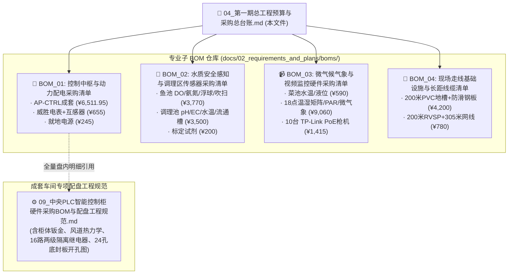

# 第一期数据采集与自动控制硬件采购总台账与工程施工清单 (Phase 1 Master Procurement Ledger & Labor)

> 💡 **架构重构与定位说明 (BOM 树状总控台账)**：  
> 本文档是数字化农业工厂（鱼菜共生智能工业体系）第一期的**【全厂总工程预算与采购总台账】**。  
> 遵循 **SSOT（Single Source of Truth，单一真实事实源）** 设计哲学，本文档作为总览枢纽，仅保留总体资金流动向、分类小计看板、施工定额与核心交付验收 Checklist。  
> 各专业领域细致入微的订货 SKU、厂家型号、电气接线图与安装规范，全部独立分流至专门的子 BOM 文档，杜绝单一大文档混杂混乱。  
>
> **版本与时间**：`Version 2.0.0 (BOM 分层架构升级版)` | **生效时间**：`2026-11-01T18:10:00.000Z` (严格遵循 ISO 8601 UTC)

---

## 📊 一、 第一期总投资概算看板 (全款核算：¥ 41,426.95 元 / 约 4.14 万元)

> [!TIP]
> **重大工程变更签证 (ECO-01：走线基础设施降本)**：
> 针对前期预算压力，取消原计划的高空双层热浸锌金属桥架（原预算 ¥26,250 元），变更为 **“浅表埋地 PVC 阻燃线槽 (100×60) + 弱电线缆借棚顶钢桁架扎带高挂”** 方案。材料与施工人工直接节约 **¥ 24,210 元**，第一期总投资由 6.62 万元大幅优化至 **约 4.14 万元**！

| 分类编码 | 专业工程与物资类别 | 结算金额 (元) | 资金占比 | 详细子 BOM 专项文档与单一事实源入口 (SSOT Links) |
| :---: | :--- | :---: | :---: | :--- |
| **BOM-01** | **控制中枢与动力配电感知** | **¥ 7,411.95** | 17.9% | 👉 [BOM_01_控制中枢与动力配电采购清单.md](./boms/BOM_01_控制中枢与动力配电采购清单.md)<br>*(核心控制柜全量配盘规范执行 👉 [09_中央PLC智能控制柜硬件采购BOM与配盘工程规范.md](./09_中央PLC智能控制柜硬件采购BOM与配盘工程规范.md))* |
| **BOM-02** | **水质安全感知与调理在线检测** | **¥ 7,470.00** | 18.0% | 👉 [BOM_02_水质安全感知与调理区传感器采购清单.md](./boms/BOM_02_水质安全感知与调理区传感器采购清单.md)<br>*(含鱼池 DO/氨氮三合一/浮球/吹扫气泵 + 调理池 pH/EC/Temp 流通槽 + 标定试剂)* |
| **BOM-03** | **立体微气候感知与视频监控前端**| **¥ 11,065.00** | 26.7% | 👉 [BOM_03_微气候气象与视频监控硬件采购清单.md](./boms/BOM_03_微气候气象与视频监控硬件采购清单.md)<br>*(含 6柱18点位温湿度矩阵/PAR光量子/超声微气象站 + 10台 TP-Link 300万工业枪机)* |
| **BOM-04** | **走线基础设施与长距弱电线缆** | **¥ 4,980.00** | 12.0% | 👉 [BOM_04_现场走线基础设施与长距线缆清单.md](./boms/BOM_04_现场走线基础设施与长距线缆清单.md)<br>*(含 ECO-01 地面阻燃地槽200m/防滑钢板 + 200m RVSP 屏蔽双绞线 + 305m Cat5e 网线)* |
| **LAB-01** | **现场施工人工工日定额 (暂估)** | **¥ 7,500.00** | 18.1% | 详见下方【第二节：施工工日定额表】(2名电工浅槽开挖、高空扎带挂线、配盘打线、调试共 13 工日) |
| **DEV-01** | **控制软件研发、梯形图与 AI Token**| **¥ 3,000.00** | 7.3% | PLC 梯形图控制逻辑编写、Modbus 采集驱动、D1/R2 物模型对接与农艺文献调研 (1500元/月 × 2月) |
| **🎉 合计** | **第一期全厂落地总投资全要素总额** | **¥ 41,426.95** | **100%** | **全实付开票核算：约 4.14 万元 (硬件物资 3.09万 + 施工人工 0.75万 + 软件研发 0.3万)** |

---

## 👷 二、 现场施工工日定额表 (¥ 7,500.00 / 约 13 工日)

现场施工由 2 名持特种作业操作证（低压电工作业）专业电工协同施工，工期预估 7~8 天：

| 施工分项 | 工作内容与验收标准 | 定额工日 | 施工安排 | 暂估人工费 (元) |
| :--- | :--- | :---: | :---: | :---: |
| **1. PVC 地槽开挖与过道防护** | 沿池壁浅开沟、PVC 100×60 地槽埋设铺设、底孔排涝打设、过道 3 块热镀锌花纹钢板固定 | 4 工日 | 2 人 × 2 天 | ¥ 2,200.00 |
| **2. 弱电线缆高空桁架扎带敷设**| RVSP 4×0.75 双绞线、Cat5e 网线沿钢桁架拉直绑扎、探头引线穿 PVC 管下引至水面 | 3 工日 | 1 人 × 3 天 | ¥ 1,800.00 |
| **3. AP-CTRL 控制柜就位与接线** | 柜体底座打膨胀螺栓固定、24 处底板 PG 接头防水穿线、内部端子排打标号冷压接线 | 2 工日 | 1 人 × 2 天 | ¥ 1,300.00 |
| **4. 传感器流通槽与吹扫管路安装**| DO 浮动支架组装、PMMA 旁路流通槽快插安装、微型气泵储气罐与脉冲吹扫气管布设 | 2 工日 | 1 人 × 2 天 | ¥ 1,200.00 |
| **5. 系统通电调试与接地演练** | 绝缘摇测、PE 接地电阻测试 ($\le 1.0\,\Omega$)、全厂 Modbus 轮询压测与断网断电保命演练 | 2 工日 | 2 人 × 1 天 | ¥ 1,000.00 |
| **合计** | **覆盖第一期全部地槽埋设、高空挂线、控制柜成套就位、探头安装与联合调试** | **13 工日** | **约 7~8 天** | **¥ 7,500.00** |

---

## 📑 三、 专业子 BOM 对应表与采购询价指引

在向设备厂家、电气成套厂或电商平台批量询价下单时，请直接调取对应的专项 BOM 文档，各专业子清单保持完全解耦：



---

## ✅ 四、 第一期物资进场统一验货 Checklist

```markdown
- [ ] 1. 【核心设备防伪与发票】：
  - 汇川 PLC (Easy320-0808TN) / 扩展模块 (GL20-0808ETN)、倍控嵌入式工控机、威胜三相电表、深圳国数 316L DO 探头 (质保卡3年)、山东塞恩氨氮三合一探头。
  - 查验出厂合格证并统一收集 13% 增值税专用发票。

- [ ] 2. 【AP-CTRL 控制柜成套验收】：
  - 依照《09_中央PLC智能控制柜硬件采购BOM与配盘工程规范》执行出厂打压与 Modbus 轮询测试；
  - 查验柜顶 2 台 150 抽风风机运转正常；柜门 5 处 Φ22.5mm 开孔无毛刺且避让门板内部加强筋；
  - 查验柜底 24 处阻燃尼龙防水接头 (PG13.5×16 + PG16×6 + PG21×2) 锁紧良好。

- [ ] 3. 【走线槽抗压与排水阻燃】：
  - 抽检 PVC 100×60 地槽壁厚 $\ge 1.8\,\text{mm}$，氧指数符合阻燃标准；
  - 检查 3 块 300×1000×3.0mm 热浸锌防滑花纹钢板平整度及边缘打磨钝化，防止划伤人车轮胎。

- [ ] 4. 【线缆材质与阻燃等级】：
  - 确认 RVSP 4×0.75 与 Cat5e STP 网线线芯为高纯度无氧铜（刮开铜丝截面无发白铝合金）；
  - 屏蔽编织网致密且含防拉伸抗扭阻燃填充物。
```
