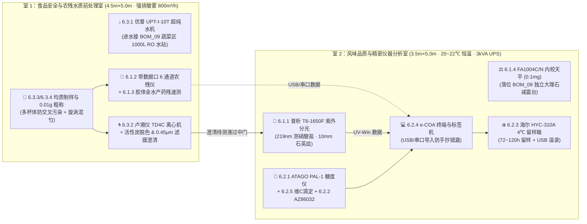

# 检验室分析仪器与理化试剂设备采购 BOM 清单 (BOM 06: QC Lab Instruments & Reagents)

> **定位与工程边界说明**：  
> 本清单是数字化农业工厂（鱼菜共生智能工业体系）品控与检验室（QA/QC Lab）**【第一期出厂放行与过程质检（IPQC/OQC）精密分析仪器、快检设备、制样设备与理化试剂耗材】** 专用采购 BOM（SSOT 单一事实源）。  
> 全量设备与耗材价格已通过 **淘宝 / 天猫 / 1688 / 京东** 真实电商零售与源头批发市场行情逐项穿透核实，并修正了旧版草案中的型号误写（如内校天平 `FA1004C/N` 与外校 `FA1004B` 区分）与偏低估价（如优普 `UPT-I-10T`、海尔 `HYC-310A`）。  
> 空间物理落位严格对齐最新 `5.0m × 8.0m × 3.5m` 双室物理隔离方案（见 `BOM_05` 与 3D 数字孪生模型）：
> - **室 1：食品安全与农残水质前处理室（`4.5m × 5.0m`）**：配备 800m³/h 强排酸雾风机与 PP 耐酸水槽，承担农残提取与快检、胶体金药残筛查、高速均质粉碎、离心分离与超纯水制取；
> - **室 2：风味品质与精密仪器分析室（`3.5m × 5.0m`）**：配备大 1.5 匹高精恒温变频空调（20~22℃ 恒温、无强排风扰动）与独立大理石减震台，承担紫外分光光度计硝酸盐测定、0.1mg 万分之一天平精密称量、ATAGO 糖度 Brix 测定、维生素 C 微量滴定、4℃ 留样观察与 e-COA 电子证书签发。
>
> **版本与状态**：`Version 1.1.1 (标准化元数据对齐版)` | **适用分期**：`Phase 1 (一期基建)` | **业务域**：`检验室仪器与试剂` | **台账状态**：`Active`  
> **生效时间**：`2026-11-11T15:10:00.000Z` (严格遵循 ISO 8601 UTC)  
> **关联硬装清单**：👉 [BOM_05_检验室硬装与暖通机电工程清单.md](./BOM_05_检验室硬装与暖通机电工程清单.md)（¥ 21,778.00）  
> **关联家具与辅助设施**：👉 [BOM_09_检验室实验家具与纯水UPS辅助设施清单.md](./BOM_09_检验室实验家具与纯水UPS辅助设施清单.md)（¥ 17,320.00）  
> **关联总台账**：👉 [00_第一期总工程预算与采购总台账.md](../00_第一期总工程预算与采购总台账.md)  
> **🎮 3D 空间模型**：👉 [prototype/lab_3d_viewer.html](../../../../prototype/lab_3d_viewer.html)

---

## 📊 一、 第一期检验室分析仪器与试剂预算概算看板 (淘宝/1688实核版)

| 分类编码 | 仪器设备与耗材类别 | 落位空间 | 实核预算 (元) | 占比 | 电商渠道实核区间与能力覆盖 |
| :---: | :--- | :---: | :---: | :---: | :--- |
| **6.1** | **安全红线光学与农残/药残核心仪器** | 室 1 / 室 2 | **¥ 20,039.00** | 36.40% | 淘宝/1688实核：普析 `T6-1650F`（含五联池）+ 带数据口 6 通道农残仪 + 胶体金水产药残速测 + `FA1004C/N` 0.1mg 自动内校分析天平 |
| **6.2** | **营养风味、水质标定与留样放行设备** | 室 2 | **¥ 14,650.00** | 26.61% | 淘宝/京东实核：ATAGO `PAL-1` + 衡欣 `AZ86032` 三探头全配 + 海尔 `HYC-310A` 4℃留样箱 + e-COA PC/标签机 + 维 C 滴定套组 |
| **6.3** | **超纯水与样品前处理制样通用设备** | 室 1 | **¥ 17,030.00** | 30.94% | 淘宝/1688实核：优普 `UPT-I-10T`（进水接蔬菜包装区 `BOM_09` `0.5T/h` RO 站）+ 卢湘仪 `TD4C` 原厂 + 多杯组织匀浆粉碎 + 0.01g 粗称/混匀 + 大龙移液枪 4 支 |
| **6.4** | **石英比色皿、玻璃量器与化学试剂耗材** | 室 1 / 室 2 | **¥ 3,330.00** | 6.05% | 1688/淘宝实核：10mm 紫外石英比色皿 + A 级容量瓶 + 国标硝酸盐/维 C 标样 + 活性炭/0.45μm 针头滤膜 + 留样盒与 PPE |
| **🎉 合计** | **检验室第一期分析仪器与试剂总额** | **全检验室** | **¥ 55,049.00** | **100.00%** | **实核真实落地总额约 5.50 万元（含高保真品牌正品与制样耗材；若超纯水机改用纯水进水国产平替款可省 ¥5,400~7,400）** |

> [!IMPORTANT]
> **【检验室第一期全口径投资闭环提示】**：  
> 驻厂检验室第一期落地需三份 BOM 协同：  
> 1. **硬装与暖通机电**（`BOM_05`）：`¥ 22,158.00`  
> 2. **实验家具、蔬菜区落地商用 `0.5T/h` RO 站与 3kVA UPS 护航设施**（`BOM_09`）：`¥ 19,150.00`  
> 3. **分析仪器与理化试剂设备**（本文件 `BOM_06`）：`¥ 55,049.00`  
> **检验室+公用纯水站一期实核总投资合计 = ¥ 96,357.00 元（约 9.64 万元）**。

---

## 🔬 二、 检验室空间-仪器拓扑与业务流转图



---

## 🛒 三、 详细仪器设备与试剂耗材采购清单 (淘宝 / 1688 实核)

### 3.1 安全红线光学与农残/药残核心仪器 (¥ 20,039.00)

| 序号 | 仪器设备名称 | 推荐品牌与型号 / 订货规格 | 资产编码建议 | 落位 | 数量 | 淘宝/1688 实核行情区间 | 核定单价 (元) | 合计金额 (元) | 关键技术参数、接口与采购避坑说明 |
| :---: | :--- | :--- | :--- | :---: | :---: | :--- | :---: | :---: | :--- |
| **6.1.1** | **双光束紫外可见分光光度计** | **北京普析 `T6-1650F` 新世纪**（紫外五联池双光束主机 + UV-Win 软件） | `SH01-QA-LAB-IN-01` | **室 2** | 1 台 | 淘宝专业店 **¥10,700~¥13,239**<br>*(前期加补实价 ¥13,239 含五联池)* | **¥ 13,239.00** | **¥ 13,239.00** | 190~1100nm，测硝酸盐 219nm（275nm校正）及亚硝酸盐 540nm；警惕淘宝几十元链接为定金/配件链接，下单需核实**含自动五联池+UV-Win通讯线+13%专票** |
| **6.1.2** | **多通道农药残留快速检测仪（可导数据款）** | **北京智云达 `ZYD-NP6` / 山东云唐 `YT-NY06`**（6 通道以上，带 USB/串口导出及热敏打印） | `SH01-QA-LAB-IN-02` | **室 1** | 1 台 | 淘宝/京东套机 **¥2,500~¥3,500**<br>*(1688 源头厂批发有折让)* | **¥ 2,800.00** | **¥ 2,800.00** | GB/T 5009.199 酶抑制率法；**选型硬性要求：必须含 USB/串口导出接口**，避开无接口基础款人工抄数风险；含首期试剂盒及比色皿 |
| **6.1.3** | **水产禁用药物胶体金速测套包** | **北京勤邦 / 中科基因** 胶体金试纸条（孔雀石绿、氯霉素、硝基呋喃代谢物） | `SH01-QA-LAB-MT-02` | **室 1** | 1 套<br>(约4~6盒) | 淘宝单项卡 **¥180~¥350/盒**(10~20次)<br>*(三合一复合卡约 ¥600~1,000/盒)* | **¥ 1,500.00** | **¥ 1,500.00** | 加州鲈出塘前 0 禁用药筛查（共约 100~120 次）；**避坑：硝基呋喃分 AOZ/AMOZ/SEM/AHD 四种代谢物，下单需核对靶标及效期** |
| **6.1.4** | **万分之一全自动内校精密分析天平** | **国产电磁力内校款 `FA1004C` / `FA1004N`**（如越平/良平/恒平，100g / 0.1mg，带 RS232） | `SH01-QA-LAB-IN-09` | **室 2**<br>(减震台) | 1 台 | 淘宝内校款 **¥2,200~¥3,500**<br>1688 批发 **¥1,800~¥2,600** | **¥ 2,500.00** | **¥ 2,500.00** | **重要型号纠偏**：实核国产规则中 **`FA1004B` 多为外校款**（¥1,500~2,300），**全自动内校型号须认准 `FA1004C` 或 `FA1004N` 且为电磁力传感器**；禁称湿菜泥！ |
| **小计** | | | | | | | | **¥ 20,039.00** | |

---

### 3.2 营养风味、水质标定与留样放行设备 (¥ 14,650.00)

| 序号 | 仪器设备名称 | 推荐品牌与型号 / 订货规格 | 资产编码建议 | 落位 | 数量 | 淘宝/1688 实核行情区间 | 核定单价 (元) | 合计金额 (元) | 关键技术参数、接口与采购避坑说明 |
| :---: | :--- | :--- | :--- | :---: | :---: | :--- | :---: | :---: | :--- |
| **6.2.1** | **高精度便携式数字折光糖度计** | **日本 ATAGO (爱拓) `PAL-1`**（货号 3810，0.0~53.0% Brix，IP65，官方授权正品） | `SH01-QA-LAB-IN-03` | **室 2** | 1 台 | 淘宝/天猫授权店 **¥1,700~¥2,150** | **¥ 1,800.00** | **¥ 1,800.00** | 精度 $\pm 0.2\%$ Brix，ATC 自动温补；**避坑：几百元低价均为山寨高仿**，需验明爱拓中国授权资质及出厂编码，超纯水每日校零 |
| **6.2.2** | **便携荧光法溶氧多参数水质分析仪** | **台湾衡欣 `AZ86032`**（荧光法 DO + pH + EC/盐度 + 水温三探头全配，3米长线箱装） | `SH01-QA-LAB-IN-13` | **室 2**<br>(全厂巡检) | 1 套 | 淘宝三探头全配 **¥2,000~¥3,000+**<br>1688 批发 **¥1,800~¥2,800** | **¥ 2,500.00** | **¥ 2,500.00** | **【水质生命线离线标定基准】**：荧光帽免加液免换膜；**避坑：部分低价仅单主机或单探头，下单务必确认含荧光DO+pH+EC三探头全配+3米线** |
| **6.2.3** | **4°C 检验室专业留样恒温冷藏箱** | **海尔生物医疗 `HYC-310A` / `HYC-310S`**（310L，2~8℃ 风冷，电热防雾门，USB 导数） | `SH01-QA-LAB-IN-04` | **室 2** | 1 台 | 京东/淘宝全新正品 **¥5,800~¥7,300**<br>*(主流成交 ¥5,900~¥6,300)* | **¥ 6,200.00** | **¥ 6,200.00** | 锁定 $4.0\pm 0.5^\circ\text{C}$ 容纳 40~50 盒 72~120h 留样；70~90kg 重货，下单须核对医疗器械经营资质、专票及大件送货入室运费 |
| **6.2.4** | **e-COA 放行数据终端与标签打印套组** | **商用台式机+24寸屏（i5/16G/512G） + 佳博 `GP-1324D` USB版 + 5000 张三防标签纸** | `SH01-QA-LAB-IT-01` | **室 2** | 1 套 | 商用 PC 套装 **¥3,000~¥4,500**<br>佳博 GP-1324D 淘宝 **¥350~¥450**(1688 ¥300~380) + 纸 **¥45** | **¥ 3,800.00** | **¥ 3,800.00** | 接入 UV-Win 与农残仪导数数据，签发 SHA-256 e-COA 并打印外箱防水防油防撕追溯码（按 PC ¥3,350 + GP-1324D ¥380 + 整箱纸 ¥70 实核） |
| **6.2.5** | **维生素 C 经典生化微量滴定套组** | **国产 `79-1` 磁力搅拌器 + 25mL 棕色酸式四氟滴定管×2 + 滴定台蝴蝶夹** | `SH01-QA-LAB-IN-05` | **室 2** | 1 套 | `79-1` 淘宝 **¥150~¥300** + 棕色滴定管 **¥20~¥60/支** + 支架 **¥80** | **¥ 350.00** | **¥ 350.00** | 依据 GB 5009.86 第一法（2,6-二氯酚靛酚法）测定维 C；棕色四氟活塞管耐酸碱防卡死、避光防试剂分解 |
| **小计** | | | | | | | | **¥ 14,650.00** | |

---

### 3.3 超纯水与样品前处理制样通用设备 (¥ 17,030.00)

| 序号 | 设备名称 | 推荐品牌与型号 / 订货规格 | 资产编码建议 | 落位 | 数量 | 淘宝/1688 实核行情区间 | 核定单价 (元) | 合计金额 (元) | 关键技术参数、渠道说明与平替优化提示 |
| :---: | :--- | :--- | :--- | :---: | :---: | :--- | :---: | :---: | :--- |
| **6.3.1** | **实验室一体化超纯水机（UP + RO 双出水）** | **优普 (ULUPURE) `UPT-I-10T`**（台式，10 L/h，超纯水电阻率 $18.25\,\text{M}\Omega\cdot\text{cm}$，含 15L 水箱） | `SH01-QA-LAB-IN-11` | **室 1** | 1 台 | 淘宝促销/代理 **¥12,000~¥13,500**<br>标准挂牌 **¥16,000~¥17,500** | **¥ 12,900.00** | **¥ 12,900.00** | **重大价格纠偏**：`UPT-I-10T` 淘宝实价远高于旧版预估 ¥9,200。**进水接蔬菜包装区 `BOM_09` `1,000L` RO 蓄水站**可延长纯化柱寿命 3~5 倍（仅限检验室精配标液用，不供包装洗菜）。<br>💡 *降本可选*：若不执着于自来水进水全能旗舰款，改选艾柯/优普基础 10L/h 台式超纯水机（淘宝 ¥4,500~¥8,000 / 1688 ¥3,500~6,500），可立省 ¥5,000+ |
| **6.3.2** | **台式低速离心机** | **上海卢湘仪原厂 `TD4C`**（4000rpm，$8\times 15\text{mL}$ 或 $12\times 15\text{mL}$ 转子+适配器） | `SH01-QA-LAB-IN-12` | **室 1** | 1 台 | 卢湘仪原厂正品 **¥2,200~¥4,000+**<br>*(国产通用 TD4C 淘宝 ¥1,000~1,500 / 1688 ¥700~1,400)* | **¥ 2,400.00** | **¥ 2,400.00** | **价格纠偏**：指定上海卢湘仪原厂正品预算须按 ¥2,400 实核（需索要原厂质保并核对适配 15mL/50mL 离心管转子）；若选国产通用 TD4C 可降至 ¥1,200 |
| **6.3.3** | **高速组织匀浆粉碎与取汁制样套组** | **小型不锈钢高速粉碎机 + 4只可换不锈钢粉碎杯 + 手动压汁器 + 鱼/菜双色砧板剪** | `SH01-QA-LAB-TL-01` | **室 1** | 1 套 | 1688 粉碎机 **¥60~¥150**（淘宝 ¥100~300）+ 备杯压汁剪砧 **¥200** | **¥ 380.00** | **¥ 380.00** | **多杯体物理隔离**：2 只专打蔬菜样、2 只专打鱼肉样，防止气味与农残交叉污染；压汁器 30 秒提取糖度测样菜汁 |
| **6.3.4** | **制样粗称天平（0.01g）与旋涡混匀器** | **`2000g/0.01g` 实验室电子天平（¥350） + 国产固定速迷你旋涡混匀仪 `VM-300`（¥320）** | `SH01-QA-LAB-TL-02` | **室 1** | 1 套 | 0.01g 天平淘宝 **¥200~¥500**(工业) / **¥400~1,200**(实验款)；通用混匀仪 **¥280~¥450** *(注：大龙 MX-S 无级款淘宝 ¥1,000~1,300)* | **¥ 670.00** | **¥ 670.00** | 专用于湿菜样 2g/10g 称量与离心管提取震荡，保护室 2 万分之一天平；如升级大龙 `MX-S` 旋涡仪需加约 ¥650 |
| **6.3.5** | **可调单道微量移液器套组（4支装+架）** | **大龙 (DLAB) `TopPette` 4 支装**（0.5-10μL / 10-100μL / 100-1000μL / 1-5mL，含支架） | `SH01-QA-LAB-IN-14` | **室 1 / 2** | 1 套 | 淘宝单支 **¥110~¥240**；1688 单支 **¥135~¥180** *(4支凑单多送移液架)* | **¥ 680.00** | **¥ 680.00** | **实核降本**：`TopPette` 4 支实核约 ¥680 即可拿下（旧版 ¥1,200 对应的是可整支高压灭菌的 `MicroPette Plus` 价格），用完调回最大量程挂置 |
| **小计** | | | | | | | | **¥ 17,030.00** | |

---

### 3.4 石英比色皿、玻璃量器与化学试剂耗材 (¥ 3,330.00 / 首期 3~6 个月基准配置)

| 序号 | 耗材/试剂名称 | 规格标准 / 采购技术要求 | 物料编码 | 数量 | 淘宝/1688 实核行情区间 | 核定单价 (元) | 合计金额 (元) | 配套用途、检测刚需与储存要求 |
| :---: | :--- | :--- | :--- | :---: | :--- | :---: | :---: | :--- |
| **6.4.1** | **紫外石英比色皿与 A 级玻璃量器包** | **10mm 紫外石英比色皿（配对 4 只装，¥180）** + A 级容量瓶 50/100/250/1000mL 各 4 只（¥420） + 烧杯/锥形瓶/洗瓶/移液管（¥350） | `SH01-QA-LAB-MT-01` | 1 批 | 普通石英 4 只 **¥100~¥200**；国产高硼硅 A 级容量瓶 **¥15~¥50/只** | **¥ 950.00** | **¥ 950.00** | **必看：普通玻璃皿在 219nm 紫外区不透光，必须确认是“全波段紫外石英比色皿”**且容量瓶带 A 级证书 |
| **6.4.2** | **国家标准物质与基础滴定/脱色试剂** | `1000μg/mL` 硝酸根标液(2瓶) + 亚硝酸盐标液(2瓶) + 2,6-二氯酚靛酚钠 5g + AR 草酸 500g×2 + L-抗坏血酸 + **AR 粉末活性炭 500g** + 危化品物流 | `SH01-QA-LAB-RG-01` | 1 批 | 标液 50~100mL 淘宝 **¥100~¥160/瓶**(1688 ¥80~130)；2,6-二氯酚靛酚 5g **¥150~¥300**；草酸 AR **¥20~¥45/瓶** | **¥ 1,000.00** | **¥ 1,000.00** | 建立 `T6-1650F` 硝酸盐标线；**生菜汁含叶绿素，测硝酸盐前须用活性炭脱色**；注意标准物质与盐酸须走合规危化品快递 |
| **6.4.3** | **一次性过滤耗材、离心管与吸头包** | **0.45μm 水系一次性针头过滤器（200个）** + 5mL 注射器（200支） + 15/50mL 离心管（各200支） + 吸头（10盒） + 农残比色杯（500个） | `SH01-QA-LAB-CS-01` | 1 批 | 国产 0.45μm 针头滤器 **¥40~¥90/百个**；其余 1688 实验耗材店一站打包 | **¥ 730.00** | **¥ 730.00** | 活性炭脱色液经 0.45μm 针头滤膜过滤方可上机比色；农残采用一次性比色杯防酶残留交叉污染 |
| **6.4.4** | **4℃ 留样耗材与化验防护包 (PPE)** | 食品级 PET 留样密封盒（300套） + 自封袋（500个） + 无粉丁腈手套（5盒） + 护目镜（2副） + 白大褂（4件） + 擦镜纸 | `SH01-QA-LAB-CS-02` | 1 批 | 1688 食品打包/劳保店整批实核 | **¥ 650.00** | **¥ 650.00** | 每日留样封装与检验员防试剂飞溅穿戴；**石英比色皿擦拭只能用专用擦镜纸，严禁普通纸巾划伤光学面** |
| **小计** | | | | | | | **¥ 3,330.00** | |

---

## 🚀 四、 后续二至四期仪器演进接口预留（不在一期预算内）

为避免一期过度采购造成设备闲置与专职人力负担，以下高阶设备已在本检验室空间与强电容量（`BOM_05` RVV $3\times 10\text{mm}^2$ 专线）中预留落位，待产能与客户门槛触发后按需追加：

1. **第二期（投产 3~6 个月 · 微生物与车间 ATP 洁净自检，约 ¥2.06 万）**：
   - 苏净安泰 `SW-CJ-1FD` 单人垂直超净台（置室 2 洁净角）、上海一恒 `DHP-9052` 50L 恒温培养箱、上海博迅 `YXQ-LS-50SII` 立式压力蒸汽灭菌器、手持式 ATP 生物荧光洁净仪。
2. **第三期（高端品牌溢价期 · 口感风味物理量化，约 ¥7.75 万）**：
   - 国产保圣 `TA.XTC` 食品物性测试仪（质构仪，置室 2 量化加州鲈肌肉硬度与弹性）、上海雷磁 `ZDJ-4B` 全自动电位滴定仪（有机酸与多酚测定）。
3. **第四期（集团扩张期 · 重金属全项自检，约 ¥23.50 万）**：
   - 前期铅/镉等重金属及鱼体土味素（Geosmin）**委托第三方具备 CMA/CNAS 资质检测机构做月度/季度型式检验**（单次仅数百元，且红章报告商超公信力更强）；待年产值突破 3000 万元后再于室 1 扩建石墨炉原子吸收光谱仪（普析 `TAS-990`）与密闭微波消解仪。

---

## ✅ 五、 检验室仪器与试剂进场验收 Checklist

```markdown
- [ ] 1. 【前置条件核验（严禁裸地进机）】：
  - 确认 BOM_05 硬装地面格栅/通风/照明与 BOM_09 实验边台、独立大理石减震台（四脚直落硬地）、3kVA C3K 在线式 UPS 及独立接地极（< 4Ω）已验收通电；
  - 确认 BOM_09 蔬菜包装区落地 `0.5T/h` 商用 RO 纯水机、`1,000L` 蓄水罐及 304 变频增压泵试水无渗漏，跨墙纯水支路已接至室 1 超纯水机进水端。

- [ ] 2. 【核心仪器防伪、接口与附件点检】：
  - 普析 T6-1650F 通电波长自检通过，UV-Win 软件与数据线在 e-COA 电脑联机成功，10mm 石英比色皿（4只）透光面无划痕；
  - 农残快检仪 6 通道光路基线校准正常，USB/串口导出文件可被 e-COA 电脑读取；
  - FA1004C/N 万分之一内校天平放在室 2 大理石减震台调平气泡居中，电磁力传感器一键内校后末位 0.1mg 稳定不跳数；
  - 海尔 HYC-310A 静置 12 小时后通电空载试机 24 小时，箱温稳定在 4.0±0.5℃，USB 温度曲线导出正常；
  - ATAGO PAL-1 验证官方防伪并用超纯水校零（0.0% Brix）；衡欣 AZ86032 确认含三探头全配并完成标液及空气溶氧校准。

- [ ] 3. 【试剂安全、分类收纳与废液纪律】：
  - 标样、草酸、活性炭与胶体金盒按品类入库 BOM_09 室 1 PP 耐酸碱试剂柜并张贴 MSDS 标签（严禁混入精密电子设备）；
  - 10mm 石英比色皿、ATAGO PAL-1 糖度计、天平配件入室 2 `40L` 电子防潮干燥箱；洁净玻璃器皿、移液器与便携 `AZ86032` 箱入室 2 全钢玻璃门仪器柜；
  - 室 1 放置 25L HDPE 废液收集桶（贴“酸碱废液/有机废液”标识），严禁化验废液倒入地面排水沟。
```
