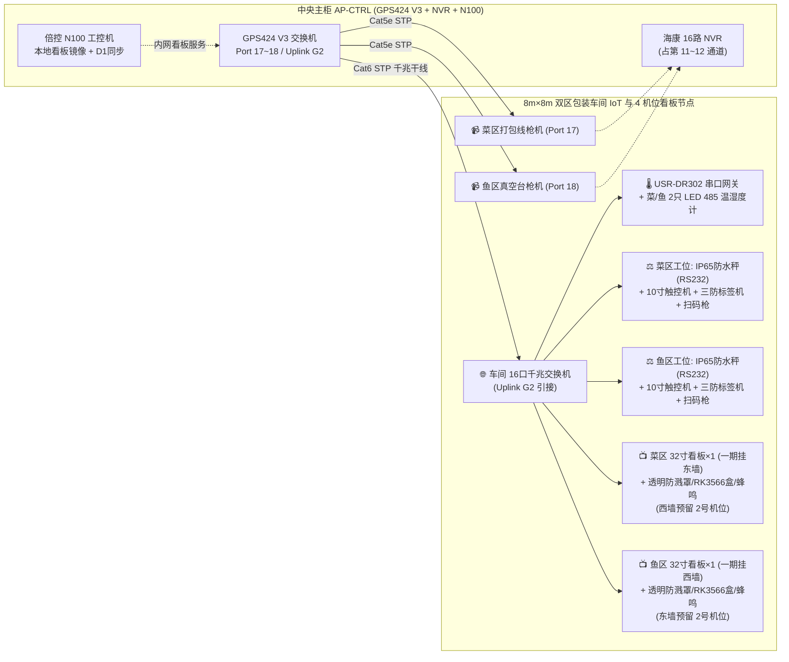

# 包装车间家具、清洗包装设备与 IoT 溯源系统采购 BOM 清单 (BOM 12: Packaging Furniture, Equipment & IoT)

> **定位与工程边界说明**：  
> 本清单承接 [BOM_11_包装车间硬装地面与暖通机电工程清单.md](./BOM_11_包装车间硬装地面与暖通机电工程清单.md)（¥ 35,607.00），覆盖 `8.0m × 8.0m` 双区（蔬菜包装区 `4m×8m` + 鱼包装区 `4m×8m`）车间内部的 **【全 SUS304 食品级不锈钢清洗与分拣家具、半自动封口/真空/制冰核心设备、“一物一码”联网 IoT 称重打码溯源工位、32 寸双区工作看板系统、温湿度与 PoE 视频监控接入、以及食品级卫生消杀设施】**（SSOT 单一事实源）。  
> 与全厂网络/数据底座无缝衔接：
> 1. **主柜 `GPS424 V3` 扩容端口落地**：本车间新增 2 台海康 PoE 枪机直连主柜 `GPS424 V3` **`Port 17~18`** 并写入既有 16 路海康 `DS-7816N-Q2` NVR（第 11~12 路）；车间防水箱内升级为 **16 口全千兆交换机（`SW-PACK-01`）** 经主柜 **`Uplink G2`** 千兆干线汇聚，接入 2 套工位触控机、2 台网口标签机、温湿度网关及 **4 路工作看板预留点位**；
> 2. **双区 4 机位看板布置与局部容灾**：菜区/鱼区按“左右两侧 `2.89m` 上圈梁对向斜倾 $18^\circ$（屏底离地约 `2.25m`）”**各预留 2 个看板机位（全车间共 4 处，水电网络与 304 吊架背板一次就位，不挡中部 PO 膜视窗）**；**一期先安装 2 台 32 寸商用 IPS 显示器（菜区 1 台 + 鱼区 1 台）**，配定制透明防溅防凝露保护罩、内置微型有线 `RK3566` 播控盒与防潮蜂鸣器，本地由中央柜 `N100` 镜像托管看板并同步 Cloudflare D1（断外网不黑屏）；
> 3. **闭环“一物一码”溯源链路**：工位 IP65 防水秤（RS232）自动回传克重至工位一体机，绑定 `BOM_06` 检验室签发的 e-COA 批次号，实时打印防潮溯源二维码并写入 Cloudflare D1，同时触发看板进度更新与不合格批次声光拦截提示。
>
> **版本与状态**：`Version 1.2.0 (补齐设备水路快插耗材、5S地贴、封口/真空易损件与IoT运维备品)` | **适用分期**：`Phase 1 扩展 / 包装车间投产` | **业务域**：`包装设备与车间IoT` | **台账状态**：`Active`  
> **生效时间**：`2026-11-12T02:38:00.000Z` (严格遵循 ISO 8601 UTC)  
> **关联总台账**：👉 [00_第一期总工程预算与采购总台账.md](../00_第一期总工程预算与采购总台账.md)  
> **关联硬装清单**：👉 [BOM_11_包装车间硬装地面与暖通机电工程清单.md](./BOM_11_包装车间硬装地面与暖通机电工程清单.md)（¥ 35,607.00）  
> **关联视频布线规范**：👉 [09_全厂视频监控PoE网络布线与交换机端口线号施工规范.md](../../03_engineering_specs/09_全厂视频监控PoE网络布线与交换机端口线号施工规范.md)

---

## 📊 一、 预算概算看板与 IoT 拓扑 (全口径核算：¥ 31,720.00 元 / 约 3.17 万元)



| 分类编码 | 分项系统名称 | 预算金额 (元) | 占比 | 1688/淘宝实核说明 |
| :---: | :--- | :---: | :---: | :--- |
| **12.1** | **全 SUS304 不锈钢台柜与防潮储物家具** | **¥ 13,560.00** | 42.75% | 4套后墙清洗/杀鱼水池台 + 4套分拣真空长台（全304加厚）+ 3组304货架 + 2组更衣柜 + 物流运费 |
| **12.2** | **菜区封口、鱼区真空与商用制冰设备** | **¥ 5,450.00** | 17.18% | 2台 `FR-900` 不锈钢连续封口机 + 1台 `DZ-400` 单室真空包装机 + 1台 `80~100kg` 商用制冰/碎冰机 |
| **12.3** | **“一物一码”IoT、双区 32 寸看板与监控** | **¥ 9,160.00** | 28.88% | 2套秤/触控屏/打印机/扫码枪 + 2只温湿 + **16口千兆交换机** + **2套32寸看板(含防溅罩/RK3566播控盒/蜂鸣器)+4机位304吊架与Cat6预布** + 2台枪机 + 耗材包 |
| **12.4** | **食品级卫生消杀与 5S 车间周转器具** | **¥ 1,660.00** | 5.23% | 2台粘捕式灭蝇灯（禁用电击）+ 2套自动洗烘手 + 2套消毒脚踏垫 + 色标周转筐/刀具 5S 架 |
| **12.5** | **家具拼装、看板吊装联调与搬运人工** | **¥ 1,550.00** | 4.89% | 3.5 工日技工拼装、4机位挂架网线及看板联调（¥1,050） + 2.0 工日大件搬运临时工（¥500） |
| **12.6** | **设备接驳耗材、5S 地贴与易损运维备品** | **¥ 340.00** | 1.07% | 制冰机/水台快插PE管生料带喉箍 + 5S防水地贴扎带 + 封口/真空发热丝油液备件 + 水晶头/304螺丝包 |
| **🎉 合计** | **包装车间家具、设备、看板与 IoT 总额** | **¥ 31,720.00** | **100.00%** | **物料设备 ¥ 30,170.00 + 人工 ¥ 1,550.00（与 `BOM_11` 合计包装车间全口径 ¥ 67,867.00）** |

---

## 🛒 二、 详细采购明细表 (1688 / 淘宝实核)

### 2.1 全 SUS304 食品级不锈钢清洗台、分拣长台与防潮储物家具 (¥ 13,560.00)
> *避坑提示：1688 商用厨房家具切勿只看低价（低价多为 `201` 材质或 `0.6mm` 薄皮，鱼区盐水冲洗极易生锈塌陷）；下单务必合同注明 **足料 SUS304 食品级不锈钢（面板/槽胆实厚 $\ge 1.0\,\text{mm}$）** 并配全套龙头下水件。*

| 序号 | 家具/台柜名称 | 规格型号 / 材质工艺标准 | 落位 | 数量 | 单位 | 1688实核单价 (元) | 合计金额 (元) | 安装位置与使用说明 |
| :---: | :--- | :--- | :---: | :---: | :---: | :---: | :---: | :--- |
| 12.1.1 | **菜区双星清洗沥水工作台** | `1500×700×850 mm`（**SUS304** $\ge 1.0\text{mm}$，双洗槽+立挡水+下置格栅+全铜龙头下水） | **菜区后墙** | **2** | **台** | **¥ 1,350.00** | **¥ 2,700.00** | 对接 `BOM_11` 后墙 2 处菜区水路接口，左池去根初洗、右池接 `BOM_09` 纯水漂洗 |
| 12.1.2 | **鱼区专用杀鱼防堵双星水池** | `1800×700×850 mm`（**SUS304** $\ge 1.0\text{mm}$，带可拆不锈钢鱼鳞杂物过滤提篮+高后挡水+水嘴） | **鱼区后墙** | **1** | **台** | **¥ 1,650.00** | **¥ 1,650.00** | 对接鱼区后墙水路，**滤篮拦截鱼鳞内脏防堵 `PVC 50` 下水管** |
| 12.1.3 | **鱼区工具消毒与洗手单星水池** | `1200×600×850 mm`（**SUS304** $\ge 1.0\text{mm}$，单深槽+后挡水+肘碰/常规龙头） | **鱼区后墙** | **1** | **台** | **¥ 950.00** | **¥ 950.00** | 专供杀鱼刀具、砧板洗消与员工洗手，与宰杀污池分开 |
| 12.1.4 | **菜区双层立架不锈钢分拣长台** | `2400×800×850 mm`（**SUS304** $\ge 1.0\text{mm}$，带台面双层包材置物架+下层加强筋平板） | **菜区中部** | **2** | **台** | **¥ 1,450.00** | **¥ 2,900.00** | 2 台背靠背/并行拼为 `4.8m` 6 人对立分拣台，上层放盒/袋、下层放周转筐，底部随时水枪冲地 |
| 12.1.5 | **鱼区冰鲜暂存与真空打包台** | `1800×800×850 mm`（**SUS304** $\ge 1.0\text{mm}$，加筋承重台面+下层架） | **鱼区中部** | **2** | **台** | **¥ 1,100.00** | **¥ 2,200.00** | 承放 `DZ-400` 真空封口机、碎冰盘与鱼区称重打码工位 |
| 12.1.6 | **SUS304 四层防潮包材货架** | `1500×500×1800 mm`（304 不锈钢网格/冲孔四层货架，防积水） | **菜区2 / 鱼区1** | **3** | **组** | **¥ 420.00** | **¥ 1,260.00** | 离地底层架高 15cm 防冲水溅湿纸箱/菜盒/真空袋 |
| 12.1.7 | **防潮双门更衣与围裙雨靴柜** | `900×420×1800 mm`（ABS 工程全塑防水柜 / 环氧喷涂全钢防锈双门柜） | **菜区1 / 鱼区1** | **2** | **组** | **¥ 550.00** | **¥ 1,100.00** | 分区存放菜区与鱼区专用工作服、防水围裙及雨靴，防止交叉污染 |
| 12.1.8 | **不锈钢台柜木架打托与重货物流** | 8 套不锈钢台柜 + 3 组货架 + 2 组更衣柜干线专线物流及送货上门 | — | **1** | **批** | **¥ 800.00** | **¥ 800.00** | 1688 商用厨具大件均不含运费，按整单拼车/专线直达光明核实 |
| **小计** | | | | | | | **¥ 13,560.00** | |

---

### 2.2 菜区封口、鱼区真空与商用制冰核心设备 (¥ 5,450.00)

| 序号 | 设备名称 | 推荐品牌与精准规格 | 落位 | 数量 | 单位 | 1688实核单价 (元) | 合计金额 (元) | 工艺用途与选型说明 |
| :---: | :--- | :--- | :---: | :---: | :---: | :---: | :---: | :--- |
| 12.2.1 | **不锈钢自动连续薄膜封口机** | **`FR-900` 不锈钢机壳款**（卧立两用，0~12m/min 无级调速，带钢印生产日期轮） | **菜区打包台** | **2** | **台** | **¥ 550.00** | **¥ 1,100.00** | 封口生菜/叶菜气调保鲜袋，机身防水防锈，支持 2 人同时高效封装 |
| 12.2.2 | **台式单室真空包装封口机** | **`DZ-400` 304 不锈钢干湿两用款**（室体 420×440mm，大功率铜线真空泵） | **鱼区打包台** | **1** | **台** | **¥ 2,150.00** | **¥ 2,150.00** | 抽真空密封鲜切加州鲈/冰鲜鱼排，防止渗水漏腥并延长货架期 |
| 12.2.3 | **商用全自动制冰/碎冰机** | **`80~100 kg/24h` 商用不锈钢制冰机**（配前置 PP 过滤芯，自动进水停机） | **鱼区水路旁** | **1** | **台** | **¥ 2,200.00** | **¥ 2,200.00** | 接入 `BOM_09` 恒压 RO 纯水分支（`2.5~3.0 bar` 防结水垢、冰块透亮），每日产冰供鲜鱼冷链覆冰 |
| **小计** | | | | | | | **¥ 5,450.00** | |

---

### 2.3 “一物一码”IoT 称重打码溯源、双区 32 寸工作看板与监控系统 (¥ 9,160.00)

| 序号 | 设备名称 | 推荐品牌与精准规格 | 落位 / 接口 | 数量 | 单位 | 实核单价 (元) | 合计金额 (元) | IoT 数据流与防潮安装说明 |
| :---: | :--- | :--- | :---: | :---: | :---: | :---: | :---: | :--- |
| 12.3.1 | **IP65 防水不锈钢计重台秤 (带 RS232)** | **`30kg / 1g` OIML III 级防水工业桌秤**（全 304 秤盘，密封防潮传感器，带标准 DB9 RS232 数据口） | **菜/鱼打包台** | **2** | **台** | **¥ 750.00** | **¥ 1,500.00** | 放上单盒蔬菜/单条鱼后，通过 RS232 实时把克重发送给工位安卓屏，防手写错漏 |
| 12.3.2 | **10.1 寸工业防溅安卓触控一体机** | **`RK3568` (2G+32G)，IP65 前面板防水防尘**，配 2×RS232 + RJ45 网口 + 不锈钢台面/壁挂支架 | **菜/鱼打包台** | **2** | **台** | **¥ 950.00** | **¥ 1,900.00** | 连接防水秤与网络标签机，选择当日批次 & e-COA 编号后一键打码并上报 Cloudflare D1 |
| 12.3.3 | **网口/USB 三防热敏标签打印机** | **佳博 `GP-1324D` / `3120TU` 网口版**（配定制透明亚克力防溅防水罩） | **菜/鱼打包台** | **2** | **台** | **¥ 420.00** | **¥ 840.00** | 打印含“一物一码”溯源二维码、净重、采收日期与检验合格编号的三防不干胶标 |
| 12.3.4 | **工业级防水无线二维扫码枪** | IP54 防摔防溅无线 2D 扫码枪（配充电底座，支持屏幕码与纸质 QR） | **菜/鱼工位** | **2** | **把** | **¥ 180.00** | **¥ 360.00** | 扫描前端菜筐批次码关联农田种植档案，或抽检复核成品溯源码 |
| 12.3.5 | **带 LED 大屏 RS-485 温湿度传感器** | 工业壁挂大屏温湿度变送器（`RS-485 Modbus-RTU`，DC 10~30V 宽压供电） | **菜区1 / 鱼区1** | **2** | **台** | **¥ 190.00** | **¥ 380.00** | 墙面 1.8m 高处悬挂，员工抬头可见实时室温，数据经网关入 D1 形成冷链加工温度曲线 |
| 12.3.6 | **车间 16 口千兆与 485 采集防水控制盒** | 250×350 IP65 防水箱 + **TP-Link / H3C 16 口全千兆桌面交换机** + **有人 `USR-DR302`** + **明纬 `HDR-30-24`** | **车间墙面干爽位** | **1** | **套** | **¥ 470.00** | **¥ 470.00** | 接通主柜 `GPS424 V3` **`Uplink G2`**；升级 16 口满足 2 工位+2 打印+网关+**4 路看板机位**（余 6 口备用） |
| 12.3.7 | **海康 300 万 PoE 室外防水广角枪机** | **海康威视 `DS-IPC-B13H-I / B13HV3-IA` (4mm, IP67)** | **菜/鱼线顶上方** | **2** | **台** | **¥ 165.00** | **¥ 330.00** | **直连主柜 `GPS424 V3` `Port 17~18`**，写入海康 NVR 第 11~12 通道，满足商超 B2B 远程溯源核查（与 `BOM_10` 同型号） |
| 12.3.8 | **车间联网屏蔽网线、串口线与辅件** | `Cat6 STP` 120m + `Cat5e STP` 60m + `RVSP 4×0.75` 30m + RS232 屏蔽线 + 金属水晶头 | **接入主柜地槽** | **1** | **批** | **¥ 460.00** | **¥ 460.00** | 经地面弱电通道将车间 2 路监控与 1 路千兆干线引回主柜 `AP-CTRL` |
| 12.3.9 | **三防溯源热敏标签纸与试产耗材包** | 60×40mm 防水防油防撕三防热敏贴纸 (`20,000张`) + 首期真空袋/菜盒试产包 | **仓库备品** | **1** | **批** | **¥ 800.00** | **¥ 800.00** | 覆盖投产初期 3 个月打印标签与真空袋/保鲜菜盒试产耗材 |
| 12.3.10 | **32 寸商用高亮防眩目 IPS 工作看板显示器** | **`32 寸 1920×1080 IPS`**（`300~350 cd/m²` 广视角防眩目，HDMI+VESA 100×100；**一期每区先装 1 台**） | **菜区东/鱼区西 `2.25m`** | **2** | **台** | **¥ 520.00** | **¥ 1,040.00** | 挂于 `2.89m` 上圈梁向下斜倾 $18^\circ$，屏底离地 `2.25m` 不挡中部 PO 采光膜且脱离冲地溅水区 |
| 12.3.11 | **定制高透 PC/亚克力防溅防凝露保护罩** | `5mm` 高透亚克力五面罩（可前掀检修+底口百叶防尘散热+进出线橡胶密封圈+2×100g 硅胶干燥剂） | **随 2 台一期屏幕** | **2** | **套** | **¥ 130.00** | **¥ 260.00** | 阻隔高湿水汽、鱼区氨气盐雾及偶发水雾侵蚀显示器主板排线，大幅延长屏幕寿命 |
| 12.3.12 | **SUS304 不锈钢斜倾吊挂架（4 机位预装）** | 304 不锈钢 $0\sim 25^\circ$ 可调墙/梁双用伸缩挂架（**一期先把 4 处机位挂架底座全部锁固就位**） | **菜区2 / 鱼区2 上圈梁** | **4** | **套** | **¥ 55.00** | **¥ 220.00** | 菜区左右墙与鱼区左右墙 `2.89m` 上圈梁全部预装就位；后续加装第 2 块对向屏免再动电钻破环氧层 |
| 12.3.13 | **工业微型无风扇有线播控盒与防潮蜂鸣器** | **`RK3566` (2G+16G) Kiosk 播控盒**（原生千兆 RJ45+看门狗+断电自启）+ `0.3m` 短 HDMI + USB 防潮蜂鸣提示器 | **藏入防溅罩背面** | **2** | **套** | **¥ 220.00** | **¥ 440.00** | 一屏一盒藏于防护罩内直插网络与插座；拉取主柜 `N100` 本地镜像看板（同步 D1，断外网不黑屏），e-COA 红灯/超温触发声光预警 |
| 12.3.14 | **4 处看板机位高位屏蔽 Cat6 网线与线材** | `80m Cat6 STP` + 4 组防潮 RJ45 面板/水晶头 + 上圈梁阻燃管卡辅件 | **SW-PACK-01 至 4 机位** | **1** | **批** | **¥ 160.00** | **¥ 160.00** | 将 4 条千兆网线一次性预布至 4 个上圈梁机位并打对称标签（`NET-PACK-KB-VEG01~02 / FISH01~02`） |
| **小计** | | | | | | | **¥ 9,160.00** | |

---

### 2.4 食品级卫生消杀、防虫与 5S 车间周转器具 (¥ 1,660.00)

| 序号 | 器具名称 | 规格型号 / 食品级标准 | 落位 | 数量 | 单位 | 实核单价 (元) | 合计金额 (元) | 卫生规范要点 |
| :---: | :--- | :--- | :---: | :---: | :---: | :---: | :---: | :--- |
| 12.4.1 | **粘捕式食品车间防爆灭蝇灯** | 双管黑光灯管 + 环保粘虫纸款（**含 20 张替换粘板，绝对禁用电击式**） | **菜区1 / 鱼区1 入口侧** | **2** | **台** | **¥ 180.00** | **¥ 360.00** | 食品厂商超验厂硬标：粘捕防虫尸爆裂落入菜叶鱼肉 |
| 12.4.2 | **入口感应洗手给皂与高速干手套装** | 全自动感应酒精/洗手液机 + 高速热风干手器 | **菜区1 / 鱼区1** | **2** | **套** | **¥ 280.00** | **¥ 560.00** | 配合入口洁净洗手流程，免触碰防二次污染 |
| 12.4.3 | **入口橡胶防滑消毒脚踏池垫** | 加厚带凸起刮泥消毒鞋底踩踏槽（`800×500mm`） | **双门入口** | **2** | **套** | **¥ 120.00** | **¥ 240.00** | 每日加配低浓度消毒水，防止车间外泥水带入室内 |
| 12.4.4 | **色标周转筐、刀具砧板与 5S 挂架** | 食品级全新料打孔菜筐 (绿×20) + 鱼筐 (蓝×10) + 304 切根/剖鱼刀 + 色标砧板 + 5S 影子板挂架 | **全车间** | **1** | **批** | **¥ 500.00** | **¥ 500.00** | 绿框装菜、蓝框装鱼、色标砧板刀具物理分离，杜绝生熟交叉与串味 |
| **小计** | | | | | | | **¥ 1,660.00** | |

---

### 2.5 家具拼装、看板吊装与 IoT 联调及搬运人工 (¥ 1,550.00 / 共 5.5 工日)

| 施工分项与工种 | 核心作业内容与验收标准 | 定额工日 | 施工安排 | 日薪标准 | 人工费小计 (元) |
| :--- | :--- | :---: | :---: | :---: | :---: |
| **1. 台柜拼装、看板吊装与 IoT 联调** *(水电/弱电工)* | 组装 8 套 SUS304 台柜与货架；4 处水池接驳与制冰机接入；**4 处 `2.89m` 看板 304 吊架及 Cat6 网线预布、2 块 32 寸屏及防溅罩密封吊装**、拉回 2 路枪机与千兆干线至主柜，完成 RS232 防水秤/打码/`N100` 本地看板镜像及蜂鸣预警联调 | **3.5 工日** | 2 名技工 × 1.75 天 | ¥ 300.00/天 | **¥ 1,050.00** |
| **2. 不锈钢大件/制冰机/真空机卸车搬运** *(临时搬运工)* | 物流点卸车拆木架、搬运 8 套不锈钢台柜、DZ-400 真空机、制冰机、32 寸看板及防溅罩进场落位及木架废料清运 | **2.0 工日** | 2 名普工 × 1.0 天 | ¥ 250.00/天 | **¥ 500.00** |
| **小计** | **实现设备落位、给排水通水、称重打码/看板镜像联调与视频入 NVR 闭环** | **5.5 工日** | | | **¥ 1,550.00** |

---

### 2.6 包装设备接驳耗材、5S 地面贴标与易损运维备品 (¥ 340.00)
> *按“装机实用足量 + 约 25% 投产头 3 个月易损维修备品”配齐；扳手、压线钳等施工工具由施工队自带包干。*

| 序号 | 耗材名称 | 规格型号 / 适用设备 | 数量 | 单位 | 实核单价 (元) | 合计金额 (元) | 安装与日常运维备品说明 |
| :---: | :--- | :--- | :---: | :---: | :---: | :---: | :--- |
| 12.6.1 | **制冰机/水台快插供水与排水接驳包** | 2分/3分食品级 PE 进水管 15m + 快插球阀弯头 6 只 + 不锈钢水槽波纹下水管备品 2 根 + 生料带 5 卷 + 304 喉箍 10 只 | **1** | **批** | **¥ 95.00** | **¥ 95.00** | 确保商用制冰机前置过滤及 4 座 SUS304 水池接驳零渗漏，留备用快插头与波纹管 |
| 12.6.2 | **5S 耐磨防水警示地贴与桌面理线件** | 红/黄/绿加厚防水 PVC 地贴胶带 4 卷 + 3M 强力背胶扎带底座 50 组 + 尼龙扎带 200 根 + 5S 区域标贴 | **1** | **批** | **¥ 85.00** | **¥ 85.00** | 划定菜/鱼区周转筐停放线、设备禁水区及打包台网线/RS232 线束整洁固定 |
| 12.6.3 | **封口机与真空包装机易损密封备件包** | `FR-900` 连续封口机高温铁氟龙布带/硅胶压带 10 条 + `DZ-400` 真空机发热丝/硅胶垫条 2 套 + 真空泵油 1 瓶 | **1** | **批** | **¥ 100.00** | **¥ 100.00** | 连续封口与抽真空机为高频损耗工装，备齐热封带、硅胶条与换季真空泵油防停线 |
| 12.6.4 | **车间弱电防水端头与 304 机牙螺丝盒** | 金属屏蔽 RJ45 水晶头与防尘护套 20 套 + 高压防水自融胶带 1 卷 + `M5/M6` 304 机牙螺丝螺母垫片混合包 | **1** | **批** | **¥ 60.00** | **¥ 60.00** | 看板与温湿传感接线端接及后续设备挂件紧固维修备品 |
| **小计** | | | | | | **¥ 340.00** | |

---

## ✅ 三、 车间家具设备、看板与 IoT 投产验收 Checklist

```markdown
- [ ] 1. 【SUS304 材质与排水通畅验收】：
  - 用 304 不锈钢药水抽检后墙 4 套水池与 4 套长台无假冒 201 锈蚀风险；鱼区杀鱼池防堵滤篮拆洗顺畅，各水嘴无滴漏；
  - 制冰机前置滤芯通水正常，产冰后排水顺畅排入地面 10cm 不锈钢沟。

- [ ] 2. 【“一物一码”IoT 称重打码与双区联网验收】：
  - 菜区、鱼区两套 IP65 防水秤（RS232）放置 500g 标准砝码后，10.1 寸安卓屏自动读取稳定克重误差 ≤±1g，网口打印机出标清晰且扫码可跳转对应批次/e-COA 记录；
  - 两只 LED 大屏 485 温湿度计现场读数与 D1 数据库同步正常，2 台 PoE 枪机在海康 NVR（通道 11~12）实时预览与录像正常。

- [ ] 3. 【双区 32 寸工作看板、防溅密封与 4 机位预留验收】：
  - 4 处上圈梁（2.89m）机位 304 吊架背板、Cat6 屏蔽网线及 IP66 电源插座全部就位不遮挡 PO 采光膜；
  - 一期 2 台 32 寸屏（菜东、鱼西，屏底离地 2.25m 下倾 18°）防溅罩密封良好并内置干燥剂，断开外网测试主柜 `N100` 镜像看板持续刷新不断屏，触发 e-COA `HOLD` 或超温测试时蜂鸣预警响起。

- [ ] 4. 【食安防虫与交叉污染红线】：
  - 2 台灭蝇灯为纯粘捕式（非电击式），绿/蓝周转筐及刀具严格分色定置，入口洗烘手与消毒脚踏垫投入使用。
```

