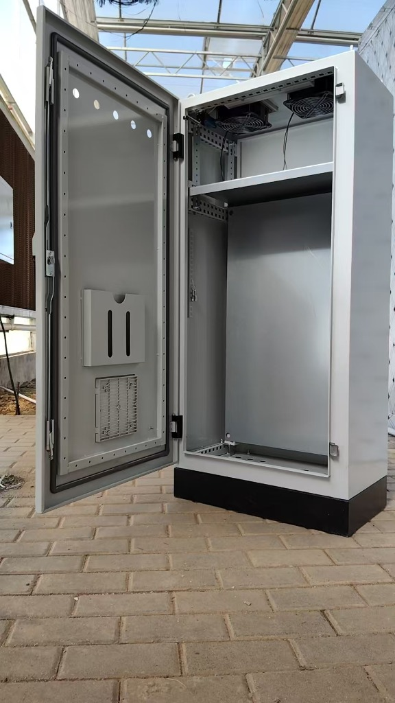
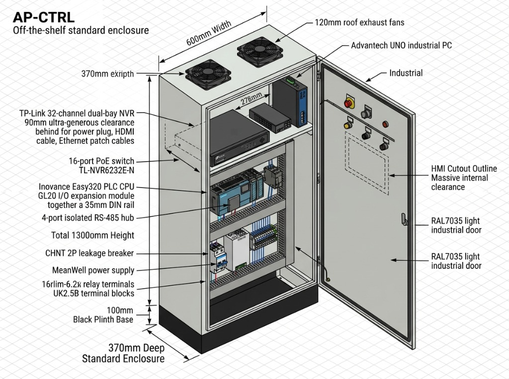
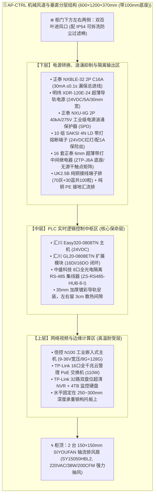

# 连锁数字化农业工厂：04_中央PLC智能主控制柜配盘与电气工程规范 (Central PLC Control Cabinet Engineering Specification)

> **核心定位与单一职责原则 (SRP)**：  
> 本规范是数字化农业工厂（鱼菜共生智能工业体系）**中央智能控制主柜 (`AP-CTRL-01`)** 的成套配盘技术与电气工程母规范。  
> 涵盖机械结构尺寸（$800\times 600\times 250\,\text{mm}$）、风道强迫对流散热计算、柜体开孔工程图、核心元器件技术选型规格、16路两级隔离输出矩阵、全柜 I/O 点位映射字典及出厂打压配盘验收 Checklist。  
>  
> 🌐 **分布式边缘控制箱专项工程规范分流索引**：  
> 遵循“单一职责、业务解耦”原则，现场分布式边缘控制箱已全部分流至专门的专项工程规范：  
> * 水质调理边缘控制箱与水化学感知：👉 [05_水质调理区边缘控制箱与原位水质感知工程规范.md](./05_水质调理区边缘控制箱与原位水质感知工程规范.md)  
> * 立柱微气候边缘控制箱与空间气象感知：👉 [06_温室立柱微气候边缘控制箱与立体气象感知工程规范.md](./06_温室立柱微气候边缘控制箱与立体气象感知工程规范.md)  
>  
> 💰 **商业采购与唯一定价事实源 (SSOT)**：  
> 遵循“规范管技术与工艺，BOM管采购与总账”的架构解耦原则，本规范已剥离全部商业价格。  
> 中央控制柜的全量采购单价、核价渠道与商务总账，请统一查阅 👉 [BOM_01_控制中枢与动力配电采购清单.md](../02_procurement_and_boms/boms/BOM_01_控制中枢与动力配电采购清单.md)。  
>  
> **版本与时间**：`Version 2.1.0 (中央主柜专注版)` | **生效时间**：`2026-11-07T23:15:00.000Z` (严格遵循 ISO 8601 UTC)  
> **关联顶层架构**：
> * 采购唯一定价源：👉 [BOM_01_控制中枢与动力配电采购清单.md](../02_procurement_and_boms/boms/BOM_01_控制中枢与动力配电采购清单.md)
> * 第一期工程总台账：👉 [00_第一期总工程预算与采购总台账.md](../02_procurement_and_boms/00_第一期总工程预算与采购总台账.md)
> * 宏观物联拓扑：👉 [02_MVP物理与物联拓扑.md](../../03_system_architecture/02_MVP物理与物联拓扑.md)
> * 全要素电气规范：👉 [08_电气系统图与拓扑数据契约规范.md](../../03_system_architecture/08_电气系统图与拓扑数据契约规范(Electrical_Topology_Schema).md)
> * 强电动力规划：👉 [02_全厂强电动力配电与电气工程规划规范.md](./02_全厂强电动力配电与电气工程规划规范.md)
> * 施工布线规范：👉 [01_现场弱电线缆选型与布线施工规范.md](./01_现场弱电线缆选型与布线施工规范.md)

---

## 1. 工程边界与物理定位 (System Boundaries)

在全厂东西跨度近 $120\,\text{m}$ 的双棚大空间厂房中，中央弱电控制柜承担着**“全厂数字化神经中枢”**的职能：

```
+---------------------------------------------------------------------------------------------------+
|                        中央控制柜 (AP-CTRL) 物理边界与工程定位说明                                |
+---------------------------------------------------------------------------------------------------+
| 1. 【设备唯一资产编号】: AP-CTRL (Plant-Wide Central PLC & Edge Automation Panel)                 |
| 2. 【物理安装位置】: 右侧 72m 主大棚与中控室交界处立柱旁 (紧邻生物过滤塔与水循环提升泵房)        |
| 3. 【强弱电物理隔离原则】: 本柜为【纯弱电与控制逻辑中枢】，严禁接入 380V 重载电机动力回路！      |
|    • 380V/220V 动力执行由隔壁独立的强电配电总柜 (AP-MAIN) 及现场各就地动力箱 (AP-AQUA等) 承担；   |
|    • 本柜仅输入 1 路 220V AC 纯净稳压电源，向外仅输出 24V DC 信号与无源常开/常闭干触点。          |
| 4. 【外置后备保命电源】: 1kVA 在线双变换式工控 UPS (山特 C1K) 置于柜外地面/操作台上，通过电源线引入。|
| 5. 【一期纯数据感知模式运行纪律】: 初期阶段系统聚焦【纯传感器数据采集】，严禁接入任何水泵或电机！ |
|    • 柜内 16 套超薄继电器及输出端子排全部成套就位，外部干触点暂不接线 (无源悬空就绪)；              |
|    • PLC 仅运行只读数据轮询程序，确保调试期绝无误动作；二期开启闭环反控时免二次破柜，零成本接管。   |
+---------------------------------------------------------------------------------------------------+
```

---

## 2. 机械结构、风道散热与面板工程规范

| 现场到货控制柜实物开门特写 | 3D 等轴测装配与工程尺寸标注图 |
| :---: | :---: |
|  |  |
| *图 2-1 现场实物到货控制柜 (AP-CTRL) 实拍（顶置双排风+托板+500mm背板+图纸袋+百叶）* | *图 2-2 中央控制柜 (AP-CTRL) 3D 机械装配图与尺寸标注 (600×370×1300mm 含底座)* |


针对温室夏季环境温度高（易达 35℃~40℃）及视频交换机发热量大的工况，本柜采用**“强制抽风 + 正压冷风下进”**的工业热力学风道设计：



### 2.1 机械结构、实物配置与开孔关键参数 (基于现场实拍与3D图纸标定)
* **柜体外形尺寸**：
  * **标准工业立柜**：外形尺寸为 **$600\,\text{mm}(\text{宽}) \times 370\,\text{mm}(\text{深}) \times 1200\,\text{mm}(\text{柜身高})$**；
  * **独立黑色加厚底座 (Black Plinth Base)**：高度 **$100\,\text{mm}$**，全柜总立高 **$1300\,\text{mm}$**；
  * **板材工艺与涂装**：国标优质冷轧钢板（门板 $\ge 1.5\,\text{mm}$，安装背板 $\ge 2.0\,\text{mm}$ 镀锌板），整柜工业浅灰喷塑（RAL7035 Light Industrial Grey），底座沉稳亚光黑。
* **上层水平固定承重隔板（托板）与后方穿线通道 (实物核心特征)**：
  * **托板净尺寸**：深度 **$278\,\text{mm}$**，宽度约 $530\,\text{mm}$，加厚钢构冲压折弯，承重 $\ge 25\,\text{kg}$；
  * **后方超大走线通风净空 (Rear Clearance)**：托板后沿距离柜体内背板留有 **$90\,\text{mm}$ 宽裕净空通道**（`90mm ultra-generous clearance behind for power plug, HDMI cable, Ethernet patch cables`）；
  * **工程价值**：现场 NVR 深度约 240mm、PoE 交换机深度约 180mm，后方留出的 90mm 超大空间使得品字交流电源插头、HDMI 4K 高清视频线、工控机 Phoenix 端子电源线及 16 根千兆网络跳线能够以超大弯曲半径自如垂直下穿，绝无挤压折损风险。
* **柜顶强迫抽风系统 (Roof Exhaust Fans)**：
  * 柜顶开设双出风口，原厂配备 **2 台 120~150mm 工业级滚珠轴流排风扇**（双滚珠纯铜电机，220VAC/38W，大风量向上强力抽风）；
  * 外侧加装金属防护网罩与防异物下落网，正对下方承重托板的高温设备（工控机、NVR、PoE交换机）形成直接抽吸对流。
* **柜门内侧工程构件与人机交互开孔 (与实物完全一致)**：
  * **交互与状态开孔 (门板上方)**：
    * 1 个 $\phi 22\,\text{mm}$ 红色机械蘑菇头急停按钮（LAY37-11ZS 铝制款，旋转自锁复位，NC 常闭触点串入 PLC X00，NO 常开备用）；
    * 3 个 $\phi 22\,\text{mm}$ LED 平头指示灯（正泰 ND16-22DS 24V，绿色：DC 24V 正常 / 黄色：系统就绪待机 / 红色：故障报警）；
    * 1 个 $\phi 22\,\text{mm}$ 声光蜂鸣一体报警器（正泰 ND16-22FS 24V，高分贝断续蜂鸣 + 红光频闪）。
  * **工业触控屏激光开孔预留区 (HMI Cutout Outline)**：
    * 柜门上半部正中预留 **$250 \times 180\,\text{mm}$** 无加强筋净空区（3D 标定：`Massive internal clearance`）；
    * 门板内侧有充裕深度裕量，二期现场可直接激光开孔嵌入 7~10 寸工业 HMI 人机触摸屏。
  * **出厂工程图纸收纳袋 (A4 Document Pocket)**：
    * 柜门内侧中部实物自带标准工程级 A4 塑料文件袋（如现场实物照片所示），用于永久收纳本电气规范、施工原理图、端子接线字典与日常点检卡。
  * **门板接地防雷等电位编织带 (Door Grounding Braid)**：
    * 柜门铰链下部出厂自带 M6 镀铜接地螺栓，配盘必须安装一条 **$\ge 4\,\text{mm}^2$ 多股高柔性镀锡纯铜接地编织带**，可靠跨接至柜体底板主 PE 汇流排，杜绝静电与感应电积累。
  * **进风防尘百叶窗 (Air Intake Louvre)**：
    * 柜门下方配置大面积通风百叶，内置 IP54 级别可拆卸清洗防尘过滤棉，与顶部风机形成冷空气下进、热空气顶抽的垂直强迫风道。
* **底部电缆防水进出线孔 (可拆卸底封板开孔)**：全量配置 **IP68 阻燃尼龙防水接头 (Cable Glands)**，底部开设 **24 个开孔**（强弱电进出线严格分区分侧布置）：
  * `PG21` (开孔直径 $\phi 28.5\,\text{mm}$) $\times 2$ 个：开于强电进线侧（靠后右侧），供 220V 进线电源电缆与外部 PE 保护大接地线；
  * `PG16` (开孔直径 $\phi 22.5\,\text{mm}$) $\times 6$ 个：供继电器输出控制多芯电缆与动力设备控制线；
  * `PG13.5` (开孔直径 $\phi 20.5\,\text{mm}$) $\times 16$ 个：供所有 RS-485 屏蔽双绞线 (RVSP 2×0.75 / 4×0.75)、液位浮球信号线与 Cat5e 屏蔽网线。

---

### 2.2 控制柜内部“四横两竖”线槽与导轨微观配盘施工图 (Detailed Panel Layout)

对照现场实物机柜结构（**柜顶双风机抽风 + 上层横向承重托板 + 下部镀锌安装大背板**），背板配盘严格采用工业电气成套标准的 **“目字形框架（两竖四横）”** 闭环线槽骨架体系：

```
+========================================================================================+
|   [柜顶] 2 台 150×150 工业轴流抽风风机 (上抽热风，柜内形成负压)                        |
+----------------------------------------------------------------------------------------+
|                                                                                        |
|   【固定承重横托板区】(平放网络计算设备，深约 280mm，直接迎向风机排风面)               |
|   ┌─────────────────────┐   ┌───────────────────────────┐   ┌──────────────────────┐   |
|   │ 倍控 N100 嵌入式主机 │   │ TP-Link 16口 PoE 交换机   │   │ TP-Link 32路 NVR     │   |
|   │ (8G+128G / 双网口)  │   │ (110W 工业云管理交换机)   │   │ (+4TB 监控酷鹰硬盘)  │   |
|   └──────────┬──────────┘   └─────────────┬─────────────┘   └──────────┬───────────┘   |
|              │(网线/DC电源线穿托盘后方孔)   │                           │              |
+==============▼============================▼===========================▼================+
| [左竖线槽] | ====================【横线槽 1 (40×60mm)】==================== | [右竖线槽] |
| 40×60mm    |                                                               | 40×60mm    |
| (全线专走  | ┌───────────────────────────────────────────────────────────┐ | (全线专走  |
|  弱电信号) | │ 【DIN 导轨 1：PLC 与现场总线中枢层】 (35mm加厚镀彩导轨)    │ |  强电动力) |
|            | │ 汇川 Easy320-0808TN 主机  汇川 GL20-0808ETN  中盛8口隔离485 │ |            |
| • 485屏蔽线| │ (24VDC / 8DI+8DO 晶体管)  (扩展 8DI+8DO)     (ZS-HUB-8-I)│ | • 220V进线 |
| • 探头信号 | └───────────────────────────────────────────────────────────┘ | • 24V直流主干|
| • 网线跳线 |                                                               | • 继电器负载 |
|            | ====================【横线槽 2 (40×60mm)】==================== |              |
|            |                                                               |              |
|            | ┌───────────────────────────────────────────────────────────┐ |              |
|            | │ 【DIN 导轨 2：电源浪涌与继电器隔离输出层】(35mm导轨)       │ |              |
|            | │ 正泰2P 16A  正泰SPD  明纬24V/5A  10粒熔断端子  16套超薄继电器│ |              |
|            | │ (总漏保)    (40kA)   (开关电源)  (SAKSI 4N LD) (6.2mm双级隔离│ |              |
|            | └───────────────────────────────────────────────────────────┘ |              |
|            |                                                               |              |
|            | ====================【横线槽 3 (40×60mm)】==================== |              |
|            |                                                               |              |
|            | ┌───────────────────────────────────────────────────────────┐ |              |
|            | │ 【DIN 导轨 3：全厂现场接线端子排层】 (35mm加厚导轨)        │ |              |
|            | │ UK2.5B 纯铜端子排 (左侧70粒灰端子走弱电 / 右侧30粒蓝端子走干触点)          │ |
|            | │ --------------------------------------------------------- │ |              |
|            | │ 【纯铜 PE 接地汇流铜排】 (15×3mm，打孔攻丝接黄绿接地线)    │ |              |
|            | └───────────────────────────────────────────────────────────┘ |              |
|            |                                                               |              |
|            | ====================【横线槽 4 (40×60mm)】==================== |              |
+============▼===============================================================▼===========+
| [柜底出线] |  PG13.5 ×16 (左侧弱电探头)        PG16×6 / PG21×2 (右侧强电/动力进线)   |
+========================================================================================+
```

#### 1. 为什么两侧“必须”设立竖向走线槽？
* **左右强弱电绝对物理隔离**：
  * **左侧竖向走线槽（弱电专属通道）**：内走所有从柜底进来的 16 根传感器 RS-485 屏蔽双绞线、液位浮球信号线以及向上直通顶层交换机的 Cat5e/Cat6 网线；
  * **右侧竖向走线槽（强电/动力专属通道）**：内走 220V 交流总进线、24V 大电流直流主干母线以及通往外部阀门/水泵的继电器控制火线；
  * **电磁抗扰硬指标**：左竖槽与右竖槽横向间距长达 **$400\sim 450\,\text{mm}$**，远超工业规范要求的 $\ge 200\,\text{mm}$ 强弱电防耦合间距红线，彻底消灭电机启闭电弧对 PLC 信号的串扰。
* **规避裸露“飞线”**：现场外部线缆无论从柜底哪个孔进来，直接拐入左/右竖槽垂直向上输送，在目标横槽拐弯进入对应端子，柜面永远平整清爽。

#### 2. 从上往下“四横三轨”安装间隙与毫米级施工标定

| 层次编号 | 结构构件名称 | 推荐规格尺寸 | 垂直标高与净空要求 | 内部安装设备 / 线缆流向说明 |
| :---: | :--- | :--- | :---: | :--- |
| **0** | **固定水平隔板 (承重托板)** | 宽 530 × 深 280 mm 钢构托板 | 托板离柜顶排风面约 250mm | 平放倍控工控机、PoE 交换机、32路 NVR；后部开设 2 处 $\phi 30\text{mm}$ 护线穿线孔 |
| **H1** | **顶部走线横槽 1** | PVC 阻燃灰色行线槽 **$40\times 60\,\text{mm}$** | 紧贴托板下沿打自攻钉固定 | 承接上方托板下穿的网线、DC 12V/24V 电源线，向左/向右汇流 |
| — | *安装与出线操作净空* | — | 净空间距 **$35\sim 40\,\text{mm}$** | 预留手持螺丝刀紧固端子空间，出线露出线号管长约 15mm |
| **R1** | **DIN 安装导轨 1** | 35mm 加厚高品质镀彩钢导轨 (长 420mm，适配 500mm 背板) | 背板中心线上部 | 卡装汇川 Easy320 PLC + GL20 扩展切片 + 中盛 8 口隔离 485 集线器 |
| — | *安装与出线操作净空* | — | 净空间距 **$35\sim 40\,\text{mm}$** | PLC 底部 I/O 端子出线垂直入横槽 2 |
| **H2** | **中间走线横槽 2** | PVC 阻燃灰色行线槽 **$40\times 60\,\text{mm}$** | 位于导轨 1 与导轨 2 之间 | 收集 PLC 晶体管 DO 输出线，向右侧竖槽或向下层中继引出 |
| — | *安装与出线操作净空* | — | 净空间距 **$35\sim 40\,\text{mm}$** | 继电器与开关电源上方端子进出线空间 |
| **R2** | **DIN 安装导轨 2** | 35mm 加厚高品质镀彩钢导轨 (长 420mm，适配 500mm 背板) | 背板中心线中部 | 卡装正泰 2P 16A 漏保 + 40kA SPD + 明纬 24V/5A 电源 + 10组熔断端子 + 16套超薄继电器 |
| — | *安装与出线操作净空* | — | 净空间距 **$35\sim 40\,\text{mm}$** | 继电器下方干触点端子与开关电源出线空间 |
| **H3** | **中间走线横槽 3** | PVC 阻燃灰色行线槽 **$40\times 60\,\text{mm}$** | 位于导轨 2 与导轨 3 之间 | 收集继电器干触点与直流 24V/0V 电源分配线，整齐引向端子排 |
| — | *安装与出线操作净空* | — | 净空间距 **$35\sim 40\,\text{mm}$** | 端子排上方打线、紧固与查线万用表表笔接触空间 |
| **R3** | **DIN 安装导轨 3** | 35mm 加厚高品质镀彩钢导轨 (长 420mm，适配 500mm 背板) | 背板中心线下部离底约 180mm | 卡装 UK2.5B 端子排 (左70粒灰信号/电源端子 + 右30粒蓝干触点)；导轨下方平行布置 PE 接地铜排 |
| — | *安装与出线操作净空* | — | 净空间距 **$35\sim 40\,\text{mm}$** | 现场进线剥皮压接冷压头进入端子排下方孔位 |
| **H4** | **底部走线横槽 4** | PVC 阻燃灰色行线槽 **$40\times 60\,\text{mm}$** | 贴紧背板最底沿安装 | 汇集从柜底 24 处 PG 接头穿入的所有外线，向左右竖槽疏导 |
| **V-L**| **左侧竖向走线槽** | PVC 阻燃灰色行线槽 **$40\times 60\,\text{mm}$** | 垂直通长贯穿整个背板左侧 | **全柜弱电命脉**：串联 H1~H4 横槽左侧，专走 RS-485、网线与传感器信号线 |
| **V-R**| **右侧竖向走线槽** | PVC 阻燃灰色行线槽 **$40\times 60\,\text{mm}$** | 垂直通长贯穿整个背板右侧 | **全柜强电母线**：串联 H1~H4 横槽右侧，专走 220V 交流电、24V 动力电与控制输出高电位线 |

#### 3. 镀锌背板（总宽 500mm）与“两竖四横”微观毫米级空间冗余校验

针对现场实物柜体安装底板（**总宽度净尺寸 $500\,\text{mm}$**），采用“两竖线槽外贴、导轨横槽居中”的标准工程结构，空间计算与物理安装冗余验证如下：

```
|<--------------------------------- 镀锌背板总宽度 500mm --------------------------------->|
+------------------+----------------------------------------------------+------------------+
| 左竖走线槽 (弱电)|                  35mm 标准 DIN 导轨有效净宽         | 右竖走线槽 (强电)|
|  宽度 40mm       |             500mm - 40mm*2 = 420mm 净安装空间       |  宽度 40mm       |
+------------------+----------------------------------------------------+------------------+
```

* **物理空间微观分解计算**：
  * **背板总宽**：$W_{\text{plate}} = 500\,\text{mm}$；
  * **左右两侧竖线槽**：选用 $40\times 60\,\text{mm}$ PVC 阻燃开齿线槽，占用 $2 \times 40\,\text{mm} = 80\,\text{mm}$；
  * **横向 DIN 导轨有效可用净宽**：$W_{\text{rail}} = 500\,\text{mm} - 80\,\text{mm} = \mathbf{420\,\text{mm}}$。
* **各导轨层元器件宽度求和与空间占用率校验**：
  1. **【DIN 导轨 1：PLC 与现场通信中枢层】**：
     * 汇川 Easy320 PLC CPU 模块：宽约 $90\,\text{mm}$；
     * 汇川 GL20-0808ETN 扩展模块：宽约 $50\,\text{mm}$；
     * 中盛科技 8 路光电全隔离 RS-485 集线器：宽约 $82\,\text{mm}$；
     * **设备总占用宽度**：$90 + 50 + 82 = \mathbf{222\,\text{mm}}$；
     * **空间余量**：$420 - 222 = \mathbf{198\,\text{mm}}$（导轨利用率仅 $52.8\%$，两端及模块间可预留超充足的 $30\sim 50\,\text{mm}$ 空气对流散热间隙，支持未来随意卡装二期通信网关）。
  2. **【DIN 导轨 2：电源转换、浪涌抑制与隔离输出层】**：
     * 正泰 NXBLE-32 2P 16A 漏电保护器：宽 $62.8\,\text{mm}$；
     * 正泰 NXU-IIG 2P 40kA 电源防雷浪涌保护器：宽 $36\,\text{mm}$；
     * 明纬 XDR-120E-24 导轨直流电源：宽 $30\,\text{mm}$；
     * 10 组 SAKSI 4N LD 带灯熔断端子：$10 \times 7.0\,\text{mm} = 70\,\text{mm}$；
     * 16 套正泰 6.2mm 超薄带灯中间继电器：$16 \times 6.15\,\text{mm} \approx 98.4\,\text{mm}$；
     * **设备总占用宽度**：$62.8 + 36 + 30 + 70 + 98.4 = \mathbf{297.2\,\text{mm}}$；
     * **空间余量**：$420 - 297.2 = \mathbf{122.8\,\text{mm}}$（导轨利用率 $70.7\%$，处于工业电气成套最舒适的 $70\%$ 黄金负荷区间，电源与微电子期间间隔 $20\,\text{mm}$ 阻燃隔板，杜绝热传导）。
  3. **【DIN 导轨 3：现场接线端子排层】**：
     * UK2.5B 纯铜导轨接线端子：厚度 $5.2\,\text{mm}$/粒，全柜一期实际排布 60~75 粒，总宽度约 $312\sim 390\,\text{mm}$；
     * 完全容纳于 $420\,\text{mm}$ 导轨范围内，下方贴近布置 $15\times 3\,\text{mm}$ 纯铜 PE 接地汇流排。
* **结论**：在 $500\,\text{mm}$ 宽的镀锌背板上，两侧设立 $40\,\text{mm}$ 竖向走线槽**在空间物理上完全可行，且具备极其充裕的器件间距与散热冗余**，是兼顾左右强弱电绝对隔离与外观整洁的最佳工程构型！

#### 4. 配盘施工五大工艺硬红线
1. **导轨与线槽紧固间距**：线槽与导轨每隔 $200\sim 250\,\text{mm}$ 采用 M4/M5 沉头螺钉或拉铆螺母牢固锁紧在镀锌安装背板上，严禁使用双面胶粘贴；
2. **走线梳齿穿出原则**：所有电线必须从行线槽侧壁的梳齿缝穿出，穿出端子严禁打死结，必须留出便于二次剥线压头的 **$3\sim 5\,\text{cm}$ 弧形微弯预留量**；
3. **线槽内部填充率**：横向与竖向走线槽内的导线总截面积（含绝缘外皮）不得超过线槽内部净截面积的 **$70\%$**，必须保留 $30\%$ 空间用于空气对流散热与未来增补走线；
4. **线号管标刻标准**：所有导线穿出线槽处必须套上热缩型或梅花型线号管，线号必须与下文【第 4 节 I/O 点位分配表】严格一致，机打字符朝向一致、清晰可辨；
5. **地线与屏蔽层单端入排**：所有从左侧竖槽进来的 RS-485 屏蔽双绞线（RVSP）的镀锡排流屏蔽细铜丝，必须剥出套黄绿热缩管，集中引接至导轨 3 下方的 **PE 纯铜接地铜排** 上锁紧，严禁就近搭在普通信号 0V 端子上。

---

## 3. 控制柜全量元器件技术选型与配盘规格表 (Component Technical Specifications)

> 💰 **商业采购与唯一定价事实源声明 (SSOT)**：  
> 本规范严格遵循“**工程规范管技术参数与装配工艺，BOM 清单管物料采购与商务总账**”原则，本表已抽离全部采购单价与商业金额。  
> 中央控制柜（AP-CTRL）所有 24 项元器件的真实采购渠道、实核单价、合价（全套物料 ¥ 7,233.95）与采购看板，请严格查阅 👉 [BOM_01_控制中枢与动力配电采购清单.md](../02_procurement_and_boms/boms/BOM_01_控制中枢与动力配电采购清单.md)。  
> 配盘车间与接线技术人员请依据以下精准 SKU、参数与数量进行物理盘面布局与配线：

| 序号 | 体系分类 | 物料名称 | 推荐品牌 | 规格型号 / 精准技术 SKU | 数量 | 单位 | 关键电气技术参数、安装方式与工程作用说明 |
| :---: | :--- | :--- | :--- | :--- | :---: | :---: | :--- |
| **一** | **柜体结构与强迫风冷** | | | | | | *(风道与机械安装部件)* |
| 1.1 | 柜体结构 | **标准工业成套控制柜** | 仿威图九折九折型钢标准柜 (现货款) | 宽 $600\times$ 高 $1200\times$ 深 $370\,\text{mm}$ (+100mm独立黑色底座，全高1300mm) | 1 | 台 | RAL7035喷塑/1.5mm冷轧门/2.0mm镀锌背板(宽500mm)，自带门板A4图纸袋、接地螺栓及进风百叶，开孔执行第二节规范 |
| 1.2 | 强迫抽风 | **柜顶工业轴流排风扇** | 思友凡 / 台达 | `120~150mm 工业级轴流排风扇` (220VAC/38W) | 2 | 台 | 双滚珠轴承纯铜电机，大风量向上强力抽风形成柜内负压，外置金属防异物网罩 |
| 1.3 | 柜内托板 | **设备承重固定托盘** | 机柜原厂配套冲压托架 | 深度 $278\,\text{mm}$ 加厚钢构托盘 (后方留 90mm 超宽穿线通道) | 1 | 件 | 水平承托工控机、16口PoE交换机与32路双盘位NVR，后部90mm净空供电源插头与网线自如下穿 |
| **二** | **主控计算、视频与工业网络** | | | | | | *(核心计算与通信拓扑部件)* |
| 2.1 | PLC 主机 | **PLC 主控 CPU** | 汇川 (Inovance) | `Easy320-0808TN` | 1 | 台 | 24VDC 供电，8DI/8DO 晶体管，集成以太网 (Modbus-TCP) + RS-485 现场总线 |
| 2.2 | PLC 扩展 | **I/O 扩展模块** | 汇川 (Inovance) | `GL20-0808ETN` | 1 | 台 | 8DI/8DO 晶体管，导轨直接卡扣扩展，全柜组成 **16DI / 16DO** |
| 2.3 | 边缘计算 | **智能边缘工控机** | 倍控 (Beikong) | `N100 9-36V 工业嵌入式主机 (8G+128G)` | 1 | 台 | **9~36V 宽压凤凰端子直连24V，全铝无风扇鳍片被动散热，双网双串，DIN导轨安装** |
| 2.4 | 通信中枢 | **8口 RS-485 隔离集线器**| 中盛科技 (ZSKJ) | `ZS-RS485-HUB-8-I (8路通道全隔离)` | 1 | 台 | **6~36VDC供电，通道全光电隔离防雷防静电，35mm导轨卡扣，8大独立物理分区** |
| 2.5 | 监控交换 | **16口全千兆 PoE 交换机**| TP-Link | `TL-SG2016MP (云管理型)` | 1 | 台 | 16个 PoE+ 端口 (总功率 110W)，直连 10 路枪机并提供远程数据与供电 |
| 2.6 | 监控录像 | **32路高清铁壳 NVR** | TP-Link | `TL-NVR6232E-N (双盘位款)` | 1 | 台 | 32路 H.265+，标准千兆网口直连交换机，支持 RTSP 视频流与远程抓拍 |
| 2.7 | 监控存储 | **4TB 监控专用机械硬盘** | 希捷 (Seagate) | `酷鹰 ST4000VX015 (4TB)` | 1 | 块 | 7×24 CMR 垂直记录技术，装于 NVR 内部，循环录存 15 天视频 |
| **三** | **电源转换与电气安全保护** | | | | | | *(强电保护与弱电隔离部件)* |
| 3.1 | 开关电源 | **工业导轨直流开关电源** | 明纬 (MeanWell) | `XDR-120E-24 (24V 5A 120W 超薄款)` | 1 | 台 | **30mm 超薄机身，85~264VAC宽压，双组输出端子，供 PLC、工控机与继电器** |
| 3.2 | 进线漏保 | **总电源漏电断路器** | 正泰 (CHNT) | `NXBLE-32 2P C16A (30mA)` | 1 | 台 | **62.8mm紧凑型，2P双极脱扣，瞬动型($\le 0.1\,\text{s}$)，切除微漏电保障人身安全** |
| 3.3 | 分路保护 | **分路微型断路器** | 正泰 (CHNT) | `NXB-63 1P C10A` | **5** | **台** | **5路分级：明纬24V、柜顶风扇、监控NVR、柜内检修插座、二期预留SPARE** |
| 3.4 | 电源防雷 | **二级电源电涌保护器** | 正泰 (CHNT) | `NXU-IIG-40kA/275V 2P` | 1 | 台 | **2P一体化导轨安装(Uc=275V, In=20kA, Imax=40kA)，同时防御相线与中性线感应雷涌** |
| 3.5 | 熔断保护 | **导轨带灯熔断器端子组** | 魏德米勒 (Weidmüller) | `SAKSI 4N LD (24V红灯) 10只 + 1A熔丝(100只/盒)` | **1** | **套** | **经典翻盖杠杆式(订货号2697370000)，24V红色LED熔断故障报警，配1A快熔玻璃管保险丝(100只备件)** |
| 3.6 | 检修插座 | **导轨式五孔电源插座** | 正泰 (CHNT) | `CZ-35 (DIN 35mm 导轨式 10A)` | 1 | 只 | **卡装于下层导轨由 QF4 独立保护，供工程师笔记本调试与仪器维护** |
| **四** | **双级隔离继电器与端子排 (预留 3 倍余量)** | | | | | | *(信号隔离与输入输出界面)* |
| 4.1 | 输出隔离 | **超薄微型中间继电器组**| 正泰 (CHNT) | `6mm超薄继电器 DC24V + ZTP-J6A-11/Z 底座` | **16** | **套** | **6mm超薄薄片式(带动作指示灯与脱扣拔插手柄)，1NO1NC(阻性6A/感性1A)，16路无源干触点彻底隔离PLC** |
| 4.2 | 信号接线 | **导轨式通用接线端子排** | 冠辰 / 正泰 | `UK2.5B 纯铜件 (70灰+30蓝,含挡板与短接条)` | **100** | **粒** | **高导电纯铜压线框(0.2~2.5mm²)，灰蓝分色(灰信号/蓝0V与零线)，配2片挡板与2根10位短接排，20粒备用** |
| 4.3 | 面板急停 | **工业机械蘑菇头急停** | 上海胜利 / 国标 | `LAY37-11ZS 红色蘑菇头急停 (一开一闭 22MM 升级款)` | **1** | **只** | **22mm开孔，升级款铝制蘑菇头+铜镀银触点，1NO1NC(NC串入PLC X00/NO备用硬线告警)，旋转自锁复位** |
| 4.4 | 面板指示 | **LED 工业状态指示灯** | 正泰 (CHNT) / 泰明 | `ND16-22DS AC/DC 24V (绿/黄/红各1只)` | **3** | **只** | **22mm标准开孔平头型，尾部螺丝压线端子，全24V低压供电杜绝柜门强电触电** |
| 4.5 | 声光警报 | **声光一体高分贝报警器** | 正泰 (CHNT) / 泰明 | `ND16-22FS 红色 (AC/DC 24V 信号灯加报警声)` | **1** | **只** | **22mm标准开孔，断续高分贝蜂鸣结合红光高亮频闪，水质突跌或系统越限触发本地声光广播** |
| 4.6 | 等电位汇流 | **纯铜接地汇流排** | 国标 | $15\times 3\,\text{mm}$ (配 10 位接线螺母) | 1 | 根 | 镀锡纯铜，柜内所有屏蔽网线屏蔽层、PE保护地线统一汇聚 |
| **五** | **成套辅材、走线槽与防水件** | | | | | | *(成套走线与穿孔密封辅件)* |
| 5.1 | 阻燃线槽 | **PVC 开齿绝缘阻燃线槽** | 联新电气 | `高40*宽40mm 灰色PVC阻燃线槽 (开齿款含盖板)` | **2** | **根** | **标称2米/根(共4米)，开齿梳状方便就近出线直达端子，高40×宽40平齐导轨元器件且不挤线** |
| 5.2 | 加厚导轨 | **C45 国标35mm镀彩导轨** | 佛山中壮元电气 | `国标1.0实厚一米 35×7.5mm 彩锌 (4.2孔×12)` | **10** | **米** | **1.0mm 实厚高抗弯刚度，冗余覆盖主控柜+就地动力箱+裁切损耗** |
| 5.3 | 防水格兰头 | **IP68 阻燃防水接头组合** | 宏劲配线 | `PG13.5B (16只) + PG16B (6只) + PG21B (2只)` | **24** | **只** | **PA66+三元乙丙，PG13.5B(5~9mm穿网线/485/浮球)+PG16B(5~11mm穿控制线)+PG21B(7~13mm穿220V进线/PE)** |
| 5.4 | 冷压线号 | **管型预绝缘冷压端头与线号管**| 国标 / 德力西 | `VE/TE全规格冷压端头盒装(1200只)` + 阻燃打印线号管 | 1 | 批 | 含 VE0508~2510 单线管头 + TE 双线并接头 + 机打线号管，所有进出线强制压头套管绝缘 |

---

## 4. 柜内 I/O 点位分配字典与两级隔离拓扑 (I/O Mapping & Dual-Stage Isolation)

全柜共配置 **16 点数字量输入 (DI) + 16 点数字量输出 (DO)**，不仅覆盖第一期全部需求，而且预留了近 **3 倍的冗余空间**：

### 4.1 数字量输入 (DI) 端口分配表 (24V NPN 漏型，无源常闭触点接入)
| 端口号 | 物理端子编号 | 关联线号 | 信号名称与工程物理意义 | 传感器/接入设备类型 | 默认安全状态 |
| :---: | :---: | :---: | :--- | :--- | :---: |
| **X00** | TB1-01 | EMG-01 | 柜门面板急停按钮 | LAY37-11ZS 升级款机械常闭触点 | **NC (常闭安全)** |
| **X01** | TB1-02 | RAIN-01 | 室外微气象站雨雪硬触点 | 竞道微气象站雨雪无源干触点 (0.1s拉闸关窗) | **NC (常闭安全)** |
| **X02** | TB1-03 | LV-FISH-01 | 1号成鱼池防干烧/防溢流双浮球开关 | 316L 侧装双液位浮球干触点 | **NC (常闭安全)** |
| **X03** | TB1-04 | LV-FISH-02 | 2号鱼池防干烧/防溢流双浮球开关 | 316L 侧装双液位浮球干触点 | **NC (常闭安全)** |
| **X04** | TB1-05 | LV-HYD-01 | 水培跑道 DWC 低液位防抽空开关 | 316L 水培槽浮球干触点 | **NC (常闭安全)** |
| **X05** | TB1-06 | PUMP1-FLT | 1号主循环水泵变频器/接触器故障反馈 | 汇川 MD290 变频器 TA/TC 故障继电器触点 | **NC (常闭安全)** |
| **X06** | TB1-07 | PUMP2-FLT | 2号备用泵变频器/接触器故障反馈 | 汇川 MD290 变频器 TA/TC 故障继电器触点 | **NC (常闭安全)** |
| **X07** | TB1-08 | BLOW1-FLT | 1号高压充氧罗茨风机热继电器故障 | 正泰热过载继电器无源辅助触点 | **NC (常闭安全)** |
| **X10~X17** | TB1-09~16 | SPARE-DI | **GL20 扩展模块预留 8 路通用 DI 点位** | 供二期扩建鱼池浮球、加药池高低位等接入 | **预留备用** |

---

### 4.2 数字量输出 (DO) 端口与 16 套超薄继电器映射表 (双级隔离)
汇川晶体管输出驱动柜内超薄继电器（KA1~KA16），继电器输出纯无源干触点通过端子排接往现场动力小柜：

| PLC 端口 | 柜内中继 | 端子排引脚 | 外部线号 | 受控动力设备与执行职能 | 现场对接设备 (二级动力分箱) | 额定容量与动作逻辑 |
| :---: | :---: | :---: | :---: | :--- | :--- | :--- |
| **Y00** | **KA01** | TB2-01/02 | DO-PUMP1 | **1号主水循环泵启停** | `AP-AQUA` 养殖箱交流接触器线圈 | 250VAC 6A (溶氧正常且水位安全时闭合) |
| **Y01** | **KA02** | TB2-03/04 | DO-PUMP2 | **2号备用水泵自投启动** | `AP-AQUA` 养殖箱备用接触器线圈 | 250VAC 6A (主泵故障反馈时 0.2s 自动互投) |
| **Y02** | **KA03** | TB2-05/06 | DO-BLOW-AC | **吹扫微型无油空压机电源** | 柜旁 24V 空压机接触器 | 24VDC 6A (每 4 小时吹扫周期前 10s 预先加压) |
| **Y03** | **KA04** | TB2-07/08 | DO-VALVE-BL | **出水探头气动吹扫电磁阀** | 出水就地仪表箱 2V025-08 电磁阀 | 24VDC 2A (开启 5 秒高压气动脉冲冲洗电极) |
| **Y04** | **KA05** | TB2-09/10 | DO-WATER-IN| **调理池清水置换补水电磁阀** | 调理池进水管电动球阀 | 24VDC 2A (UIA 超标保命时强制开阀换水) |
| **Y05** | **KA06** | TB2-11/12 | DO-FEED-CUT| **自动投喂机电源控制** | 养殖池投料机配电回路 | 250VAC 6A (DO<4.0 或 TAN 超标毫秒级断电熔断) |
| **Y06** | **KA07** | TB2-13/14 | DO-OXY-VALVE| **应急高纯液氧注氧电磁阀** | 纯氧锥入气管电磁阀 | 24VDC 2A (DO 跌破 3.5mg/L 极速强启增氧) |
| **Y07** | **KA08** | TB2-15/16 | DO-ALM-SIREN| **柜门及现场高分贝声光警报** | 柜门蜂鸣器 + 现场旋转警报灯 | 24VDC 1A (系统突破一级安全包络时触发) |
| **Y10** | **KA09** | TB2-17/18 | DO-HYD-P1 | A/B 跑道水培增氧泵启停 | `AP-HYDRO` 水培箱接触器 | 250VAC 6A (根据根区 DO 轮换开停) |
| **Y11** | **KA10** | TB2-19/20 | DO-DOSE-P1 | 调理池脉冲加酸加药泵 | `AP-HYDRO` 调理池计量泵 | 250VAC 2A (AI 边缘脉冲加药闭环控制) |
| **Y12** | **KA11** | TB2-21/22 | DO-HVAC-FAN | 温室高空环流风机群 | `AP-HVAC` 环控箱接触器 | 250VAC 6A (立体微气候逆温层超标时启动) |
| **Y13** | **KA12** | TB2-23/24 | DO-WINDOW-CL| 温室天窗紧急强关电机回路 | `AP-HVAC` 环控箱开窗控制器 | 250VAC 6A (雨雪触点动作时强制下发闭窗) |
| **Y14~Y17**| **KA13~16**| TB2-25~32 | SPARE-DO | **GL20 扩展预留 4 路干触点输出**| 预留二期温控地源热泵、电动遮阳卷膜 | **完全预留备用** |

---

## 5. 反复调整成功的经验教训与防踩坑备注 (Lessons Learned)

> [!CAUTION]
> **【经验教训备注 1：PLC 晶体管直接拉长线导致主板击穿报废】**
> 在 2025 年项目早期试运行中，施工队图省事，将 PLC 的晶体管 DO 端口直接拉了 45 米电缆连接远端水泵中间继电器。由于长距离线缆平行于动力桥架，**感应电动势与继电器线圈断开瞬间产生的反向尖峰电动势（反向浪涌），直接打穿击穿了 PLC 输出端的达林顿管阵列，导致整台 CPU 报废**！
> **在此确立死规矩**：汇川晶体管输出端子**出线距离严禁超过 30 厘米**，必须在柜内就地接入 **正泰 6mm 超薄微型中间继电器 (带动作指示灯与续流保护底座)**，向柜外引出的所有控制线**100% 必须是纯无源干触点**！

> [!WARNING]
> **【经验教训备注 2：UPS 电池散发酸雾与外置地面摆放纪律】**
> 曾有方案将工控机、PLC 与工控 UPS 密闭关在同一控制柜内。由于铅酸/锂电池充放电发热严重，且温室环境本身潮湿，**UPS 散发的微量酸雾与高热导致柜内温度常年超过 50℃，研华工控机 CPU 频繁热保护降频，且金属端子发生电化学腐蚀发黑**！
> **在此明确物理隔离纪律**：1kVA 在线式 UPS **坚决不入控制柜**，必须摆放在中控室地面的干燥架或专用办公桌下方，通过一根国标 $3\times 2.5\,\text{mm}^2$ 电缆向控制柜输送纯净 220V 电源。

> [!NOTE]
> **【经验教训备注 3：地面 100×60 PVC 弱电地槽统一走线与严禁动力电混敷红线】**
> 在采用 $100\times 60\,\text{mm}$ PVC 地槽的工况下，地槽作为**全厂纯弱电干线专用保护通道**，统一集中容纳 Cat5e STP 视频监控网线与 Cat6 STP 边缘控制箱数据网线（两者均为直流低压弱电/数据差分信号，同槽并排走线完全安全合规、检修便利）。**绝对严禁将 380V/220V 大功率水泵/电机动力电缆混同放入本地槽敷设**（动力电缆必须走既有独立动力管路）！
> 凡是进入本控制柜的弱电信号网线，自地槽引出后一律穿管自柜体顶部或侧上方进线孔落入，UPS 220V 单相电源进线自柜底 PG16 孔穿入，实现控制柜内部空间上绝对的“上弱下强、清清楚楚”。

> [!IMPORTANT]
> **【经验教训备注 4：单相 220V 电源防雷务必选用 2P 一体式电涌保护器 (SPD) 与 275V 额定电压】**
> 在农业温室与郊野空旷水产基地，雷击感应极易由外架空电网引入。若仅采用单极 1P SPD 保护相线（L-PE），雷电反击极易从中性线（N-PE）长驱直入，击穿明纬开关电源与 PLC 晶体管端口！
> **在此确立选型与施工死规矩**：
> 1. **必须选用 2P 一体式 SPD**（如正泰 `NXU-IIG-40kA/275V 2P`），同时提供相线与零线对 PE 接地排的差模与共模保护；
> 2. **持续工作电压严格锁定 $U_c = 275\,\text{V}$**，切忌误选 $385\,\text{V}$ 或 $440\,\text{V}$ 款型（电压保护水平 $U_p$ 过高，无法有效箝位微电子耐受阈值）；
> 3. **通流容量选用工业二级 $I_{\max} = 40\,\text{kA}$ ($I_n = 20\,\text{kA}$)**；
> 4. **SPD 接地端引线必须采用 $\ge 4\,\text{mm}^2$ 多股黄绿铜线**，以不超过 $30\,\text{cm}$ 的最短直线路径压接至底板纯铜 PE 汇流排，杜绝弯折形成寄生电感。

> [!TIP]
> **【经验教训备注 5：水质弱电传感器 24V 供电支路熔断器保护端子的选型与报警色标规范】**
> 水质监测探头（光学 DO、离子氨氮、pH/EC）常年在高湿、浸水工况下运行，线缆擦伤或接头浸水极易发生 24V 对地短路。若多路探头共用明纬 24V 电源且缺乏精细分路保护，单点短路将拉垮整柜 24V 母线，导致 PLC 与工控机断电崩溃！
> **在此确立熔断端子配盘准则**：
> 1. **每路探头独立单路保险**：采用魏德米勒经典杠杆翻盖式 `SAKSI 4N LD` 导轨端子（全柜配置 10 只，含 2 只备用），更换熔丝徒手翻盖即换；
> 2. **报警指示灯坚决选用「24VDC 红色 LED」**：熔断报警属于电气故障，指示灯在熔丝烧断时才点亮。严禁误用绿灯（造成巡检误判为正常），严禁选 220V 氖泡款（24V 无法起辉）；
> 3. **熔丝容量严格锁定「1A 快速熔断管 ($5\times 20\,\text{mm}$)」**：严禁采用小作坊标配的 6A/10A 粗熔丝（微电子探头正常电流仅 30~80mA，6A 熔丝无法在探头起火前切断短路）；随柜采购 100 只 1A 备件盒，保障长期连续运维。

> [!NOTE]
> **【经验教训备注 6：接线端子纯铜材质与工业灰蓝分色防坑纪律】**
> 在农业温室与水产养殖高湿环境下，**严禁选用廉价锌合金/铁杂质端子**（压线螺丝极易滑丝、受潮后电化学腐蚀发黑发热、导致微弱传感器信号失真！）。
> **在此确立端子排工艺标准**：
> 1. **全量选用纯铜压线件**：采购 `UK2.5B 纯铜款`，导电率与机械刚性保障 10 年免维护；
> 2. **执行灰蓝分色工业规范**：配置 70 粒灰色（用于 PLC DI 信号、继电器干触点与 24V 正极）+ 30 粒蓝色（专门汇集直流 0V 负极与交流零线 N），正负极性一目了然杜绝误接；
> 3. **成套配件与冗余储备**：端子两端必须配置侧挡板（D-UK2.5B）与固定件（EW-35），并配齐 10 位中心短接条（FBI-10-6）实现 0V/24V 一体化快速并联；全柜按 100 粒整取采购（实际装柜约 75~80 粒，留 20 粒现场热备），彻底杜绝缺件停工。

---

## 6. 电气成套配盘出厂验收 Checklist (Factory Acceptance Test)

委托电气成套厂配盘装配完毕后，提货前必须依据下表执行严格的静态与动态验收：

```markdown
- [ ] 1. 【绝缘电阻测试】断开 PLC 与工控机电源，使用 500V 兆欧表摇测 220V 进线相线、中性线对 PE 接地排的绝缘电阻，阻值必须 ≥ 20 MΩ。
- [ ] 2. 【接地连续性】使用低阻测试仪测量柜门、安装底板、导轨与纯铜 PE 接地排之间的导通电阻，接触电阻严格 ≤ 0.1 Ω。
- [ ] 3. 【风道与温升测试】通电开启柜顶 2 台排风扇，手持纸条测试柜门两侧百叶进风口，必须有明显的负压吸入感；排风扇出风口风速 ≥ 2.5 m/s。
- [ ] 4. 【线号管与冷压端头】抽检 20 处接线端子，所有软线必须压接针形冷压端头（无毛刺外露）；每个端子线号与本规范《I/O 分配字典》100% 一一对应。
- [ ] 5. 【晶体管双级隔离核查】万用表蜂鸣档逐点测量 Y00~Y17 到外部引出端子 TB2，必须为完全断开的无源干触点，杜绝任何弱电共地漏电。
- [ ] 6. 【Modbus-TCP 通信测试】网线连接研华工控机网口 1 与汇川 PLC，运行轮询脚本，确认每秒读取 Holding Register 正常无误码。
```

---

## 7. 分布式边缘控制柜 (AP-EDGE) 接口扩展准则

为了支持系统未来的分期演进与产区物理扩建，控制系统架构采用「1个中央控制中枢 + N个分布式边缘柜」的模块化星型/环网拓扑。后续所有边缘控制柜必须遵循以下工程与文档架构规范：

### 7.1 单一职责与文档解耦架构 (SRP)
1. **工程与工艺通用规范（SSOT）**：
   - 所有的边缘控制柜（`AP-EDGE-XX`）的机械外壳材质、冷轧板喷塑标准、双风道散热计算、强弱电导轨分区、灰蓝分色端子、SAKSI 4N 红色指示灯熔断端子、晶体管双级隔离、浪涌防护接地、线号管标牌以及出厂 FAT 验收准则，**100% 严格复用并继承本规范文档（第 09 号工程规范）**，绝不重复撰写配盘工艺标准。
2. **商业采购清单绝对独立（Atomic BOM）**：
   - 坚决杜绝“大一统”巨型 BOM。每个边缘控制柜必须在 `docs/02_requirements_and_plans/02_procurement_and_boms/boms/` 目录下建立独立的原子采购文档（例如 `BOM_07_温室南区边缘控制柜AP-EDGE-01采购清单.md`）；
   - 每个边缘柜 BOM 仅包含该物理柜的机柜钣金、微型PLC/分布式远程IO模块、开关电源、断路器、继电器与辅材台账，价格独立核算，严禁与中央控制柜 `BOM_01` 相互交叉混合。

### 7.2 边缘节点编号与拓扑规范
- **命名规则**：
  - 中央控制中枢：`AP-CTRL-01`（位于中控化验室）
  - 进水调理池边缘控制箱：`AP-EDGE-01`（位于进鱼池前调理池，折线距主柜约 $40\,\text{m}$）；
  - 出水调理池边缘控制箱：`AP-EDGE-02`（位于鱼池出水端生化/回流调理池，折线距主柜约 $20\,\text{m}$）；
  - 立柱微气候与动力边缘控制箱：`AP-EDGE-03`（位于大棚 8 米立柱底部，折线距主柜约 $30\,\text{m}$）；
  - 后续预留节点：`AP-EDGE-04`（大棚天窗与风机动力区）等；
- **动力与供电解耦**：
  - 严禁从中央控制柜跨长距离拉取 24V 直流电源为远端边缘柜供电（避免大电流导致直流压降与线损）；
  - 每个边缘控制柜均就地引入独立 AC 220V 动力电源，柜内配置独立明纬 NDR/HDR 系列导轨电源进行本地降压稳压；
- **现场通信总线**：
  - 边缘柜与中央中枢之间统一采用 Cat6 工业屏蔽双绞线（Cat6 STP），走 Modbus-TCP 协议，汇聚至中央控制柜的工业交换机（Modbus-TCP 502 端口）；
  - 远距离（>100米）跨区节点预留单模双芯光纤接口与工业光电收发器位置；
- **备品备件标准化**：
  - 边缘柜的接线端子、继电器、熔断管、指示灯等耗材规格必须与中央控制柜 100% 保持一致，实现全场易损件 0 额外备件品类库存。

---

### 7.3 分布式边缘控制箱独立专项工程规范索引

遵循单一职责原则（SRP）与业务高内聚解耦架构，现场各边缘控制节点的具体成套图纸、现场水路/立柱工艺及 Modbus 地址映射，请直接查阅对应的独立专项工程规范：

1. **水质调理区边缘控制节点 (`AP-EDGE-01` / `AP-EDGE-02`)**：
   - 包含：进出水两级 $400\times 500\times 200\,\text{mm}$ 冷轧小箱配盘、有人 USR-DR302 导轨网关集成、塑料水池免开孔原位自适应浮动浸入式电极安装（3秒提拉规程）及强电并联近距（$\le 20\,\text{cm}$）防脉冲施工红线；
   - 专用工程规范入口：👉 [05_水质调理区边缘控制箱与原位水质感知工程规范.md](./05_水质调理区边缘控制箱与原位水质感知工程规范.md)
   - 绑定原子采购清单：👉 [BOM_07_水质调理区边缘控制箱与水质感知采购清单.md](../02_procurement_and_boms/boms/BOM_07_水质调理区边缘控制箱与水质感知采购清单.md)

2. **温室立柱微气候与动力边缘控制节点 (`AP-EDGE-03`)**：
   - 包含：8 米钢立柱 $400\times 500\times 200\,\text{mm}$ 柱底边缘控制箱、3 层 SHT35 百叶箱温湿度逆温层解析、作物冠层 NDIR 红外二氧化碳监测、8 米垂直阻燃 PVC 线槽无损抱箍工艺及环流对流风机“无源纯干触点接口解耦”；
   - 专用工程规范入口：👉 [06_温室立柱微气候边缘控制箱与立体气象感知工程规范.md](./06_温室立柱微气候边缘控制箱与立体气象感知工程规范.md)
   - 绑定原子采购清单：👉 [BOM_08_立柱微气候与动力边缘控制箱采购清单.md](../02_procurement_and_boms/boms/BOM_08_立柱微气候与动力边缘控制箱采购清单.md)
