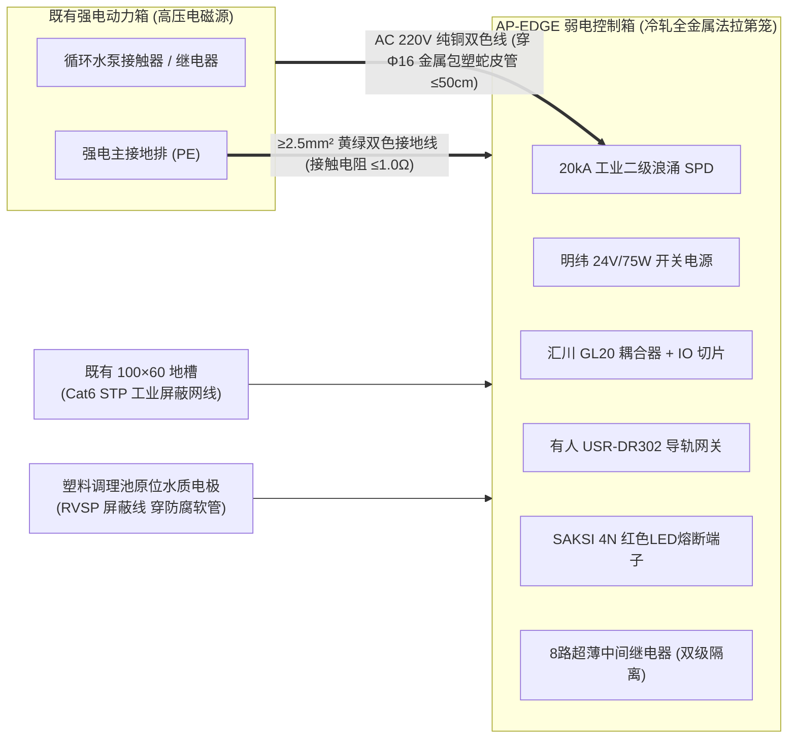
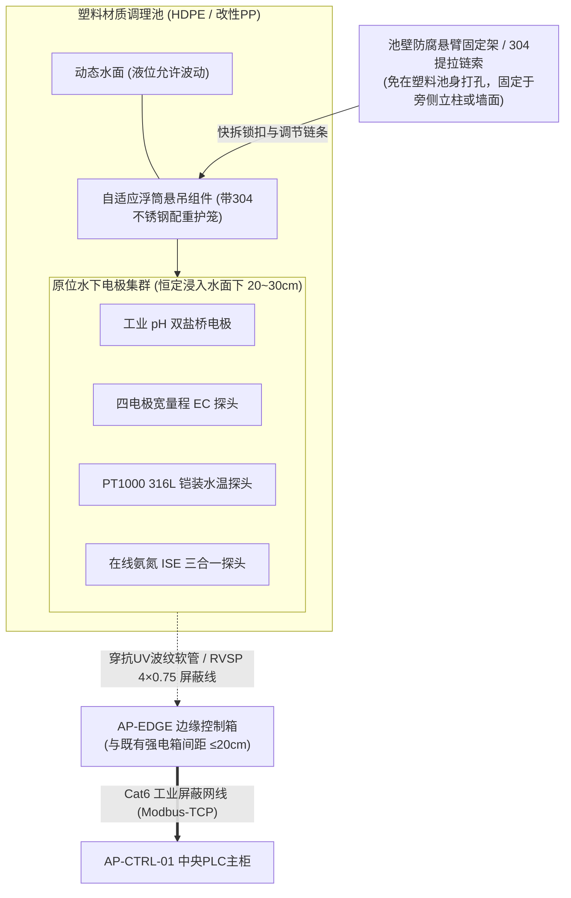

# 第一期水质调理区边缘控制箱与原位水质感知工程规范 (AP-EDGE-01 / AP-EDGE-02 Engineering Specification)

> **定位与工程边界说明**：  
> 本规范是数字化农业工厂（鱼菜共生智能工业体系）水处理与水质安全调理区边缘控制节点专用工程实施标准。  
> **服务对象**：进水调理池 `AP-EDGE-01`（折线距中控室约 $40\,\text{m}$）与 出水调理池 `AP-EDGE-02`（折线距中控室约 $20\,\text{m}$）两台壁挂式控制箱及配套感知单元。  
> **单一事实源（SSOT）绑定采购清单**：👉 [BOM_07_水质调理区边缘控制箱与水质感知采购清单.md](../02_procurement_and_boms/boms/BOM_07_水质调理区边缘控制箱与水质感知采购清单.md)  
> **通用配盘母标准继承**：钣金喷塑、双风道排热、灰蓝分色端子、红色指示灯熔断保护及 FAT 出厂验收准则 100% 继承并执行 👉 [04_中央PLC智能主控制柜配盘与电气工程规范.md](./04_中央PLC智能主控制柜配盘与电气工程规范.md)。  
>  
> **生效时间**：`2026-11-07T23:15:00.000Z` (严格遵循 ISO 8601 UTC)

---

## 1. 现场空间定置与强弱电近距防护规范

两处调理池旁均已存在既有的强电动力控制箱。为节约土建与线管开支，本弱电控制箱**紧邻强电箱壁挂安装，边缘间距控制在 $15\sim 20\,\text{cm}$ 以内**，形成标准化的现场“机电+自控并联单元”：

> [!WARNING]
> **【经验教训备注 7：弱电箱紧邻强电箱 (间距 ≤ 20cm) 的电磁屏蔽与防窜电防干扰红线】**  
> 强电动力箱内常配有水泵接触器或继电器，分断感性负载时电弧会产生极强的瞬态电磁脉冲（EFT/Burst）。当弱电箱与强电箱边缘间距仅 $20\,\text{cm}$ 时，必须死守以下 4 条抗干扰红线：
> 1. **全金属外壳物理法拉第笼屏蔽**：坚决采用冷轧喷塑金属箱（严禁塑料箱），弱电箱外壳与接地排必须通过 $\ge 2.5\,\text{mm}^2$ 黄绿线压接至强电箱主 PE 排，接地电阻 $\le 1\,\Omega$；
> 2. **穿线绝对物理隔离**：强电箱引出至弱电箱的 220V 进线必须穿 **$\Phi 16$ 金属包塑蛇皮软管**，严禁明线裸露或与传感器屏蔽线同孔进出；
> 3. **电源前端双重吸收滤波**：弱电箱进线设置 2P 10A 微断 + 盾仪 20kA 浪涌 SPD，在明纬开关电源前端吸收接触器火花引起的浪涌毛刺；
> 4. **探头线网线绝不进强电箱**：pH/EC/水温/氨氮传感器线缆与 Cat6 屏蔽网线直接自下方管沟穿入弱电箱底 PG13.5 接头，物理路径与强电箱电缆平行间距保持 $\ge 15\,\text{cm}$，杜绝电磁耦合。

---

## 2. 机械结构与底板防水开孔

* **外壳规格**：选用现货标准 **$400\,\text{mm}(\text{宽}) \times 500\,\text{mm}(\text{高}) \times 200\,\text{mm}(\text{深})$ 壁挂式冷轧钢板喷塑箱 (IP65)**；
* **底板开孔与穿线锁紧**：
  * `PG13.5` ($\phi 20.5\,\text{mm}$) $\times 5$ 个：分别供 pH、EC、水温、氨氮探头屏蔽线及 Cat6 屏蔽网线进线；
  * `PG16` ($\phi 22.5\,\text{mm}$) $\times 2$ 个：分别供 AC 220V 动力进线电源及未来执行器输出电缆；
  * `PG21` ($\phi 28.3\,\text{mm}$) $\times 1$ 个：预留多芯动力控制扩容口；
  * 全部接头采用 IP68 阻燃尼龙防水葛兰头，旋紧后严防潮气倒灌与虫蚁钻入。

---

## 3. 电气配盘、网络规划与寄存器字典

### 3.1 核心硬件架构
1. **分布式以太网 I/O 总线耦合器**：选用 **汇川 `GL20-RTU-MOD`**，双 RJ45 工业以太网口，支持标准 Modbus-TCP 从站协议；
2. **本地 I/O 扩展切片**：配置 1 块 **汇川 `GL20-0808ETN`**（8 点数字量输入 DI + 8 点晶体管输出 DO），8点 DO 负责驱动本地中间继电器组，DI 预留未来水位报警信号；
3. **串口-以太网双向 Modbus 网关**：配置 1 台 **有人 `USR-DR302` 工业导轨串口服务器**，24VDC 供电。下行 RS-485 直连池边 4 支水质探头，上行通过 0.3m 屏蔽短跳线直插 GL20-RTU-MOD 的第二 RJ45 网口，将 Modbus-RTU 串行数据无缝转换为 Modbus-TCP；
4. **就地稳压电源**：配置 **明纬 `NDR-75-24` (24VDC / 3.2A / 75W)**，就地承载耦合器、IO 模块、有人网关及 4 支水质探头供电，回路最大负荷 $<1.5\text{A}$，预留 2 倍供电冗余；
5. **传感器独立熔断保护**：配置 6 只魏德米勒 `SAKSI 4N LD` 杠杆翻盖式导轨端子（配 **24VDC 红色 LED 故障指示灯** 与 **1A 快速玻璃熔断管 $5\times 20\,\text{mm}$**），单路探头短路仅点亮本体红灯，绝不拉垮系统；
6. **执行回路继电器无源干触点预留**：配置 8 套超薄带灯微型中间继电器（250VAC/6A 无源纯干触点引出至端子排，为未来电动阀与加药泵预留物理接口）。

### 3.2 IP 地址与 Modbus 寄存器映射

| 节点名称 | 物理位置 | 核心设备 | IP 地址与端口 | Modbus 从站映射 | 对应测点/功能 |
| :---: | :---: | :---: | :---: | :---: | :--- |
| **AP-EDGE-01** | 进鱼池前调理池 (40m) | 汇川 GL20-RTU-MOD | `192.168.1.11:502` | Unit ID = 1 | 8点 DI 开关量状态 + 8点 DO 继电器驱动 |
| | | 有人 USR-DR302 | `192.168.1.13:502` | Slave ID = 01 | 联测双盐桥 pH 传感器 (量程 0~14pH) |
| | | | | Slave ID = 02 | 联测四电极宽量程 EC 传感器 (量程 0~10mS/cm) |
| | | | | Slave ID = 03 | PT1000 316L 铠装水温探头 ($\pm 0.1^\circ\text{C}$) |
| | | | | Slave ID = 04 | 塞恩在线氨氮三合一 ISE 探头 (TAN/pH/Temp) |
| **AP-EDGE-02** | 鱼池出来调理池 (20m) | 汇川 GL20-RTU-MOD | `192.168.1.12:502` | Unit ID = 1 | 8点 DI 开关量状态 + 8点 DO 继电器驱动 |
| | | 有人 USR-DR302 | `192.168.1.14:502` | Slave ID = 01 | 联测双盐桥 pH 传感器 (量程 0~14pH) |
| | | | | Slave ID = 02 | 联测四电极宽量程 EC 传感器 (量程 0~10mS/cm) |
| | | | | Slave ID = 03 | PT1000 316L 铠装水温探头 ($\pm 0.1^\circ\text{C}$) |
| | | | | Slave ID = 04 | 塞恩在线氨氮三合一 ISE 探头 (TAN/pH/Temp) |

---

## 4. 塑料材质调理池水质传感器原位浸入浮动式安装规范

针对两座塑料材质（HDPE/改性PP）调理池，当前阶段**坚决剥离液位控制，100% 聚焦于水的物理参数（水温）与化学参数（pH、EC、氨氮 TAN）**。现场采纳**原位浸入浮动式测量方案**，彻底免除在塑料池壁打孔接管与取样水泵故障点：

1. **塑料水池零开孔与浮动恒深原则**：
   * **零池壁开孔**：塑料水池（HDPE/PP）池壁绝不承受任何打孔螺栓或重型管道拉扯，杜绝开裂与渗漏隐患；
   * **液位自适应恒深感知**：采用抗老化工程塑料浮筒（外包 304 不锈钢防护笼与沉底配重），带动 pH/EC/水温/氨氮 4 支电极随水面平稳升降，电极敏感玻璃泡及离子膜恒定保持在水面下 $20\sim 30\,\text{cm}$（避开表面浮油浮沫，且无论调理池液位高低绝不露空干烧，也不沉底淤泥）；
2. **快速提拉维护规程（3秒出水）**：
   * 浮筒组件通过 304 不锈钢提拉链条悬挂在池边立柱或护栏悬臂上；
   * 现场运维人员每周例行擦洗探头生物膜或用标准缓冲液标定时，**单手拉起链条 3 秒即可将探头组提出水面**，无需工具拆卸管道，维护极大便捷；
3. **感知参数与范围锁定**：
   * **物理参数**：水温（PT1000，$\pm 0.1^\circ\text{C}$ 高精度）；
   * **化学参数**：pH（$0\sim 14$ 双盐桥抗硫中毒）、EC（$0\sim 10\,\text{mS/cm}$ 四电极耐腐蚀）、总氨氮 TAN（$0\sim 10\,\text{ppm}$ 离子选择电极，PLC 反演有毒氨 UIA）；
   * **水位浮球状态**：当前阶段不采购、不安设浮球硬件，端子排与 PLC DI 通道做纯软件与接线预留，待未来土建管网全部标定后再行接入。

