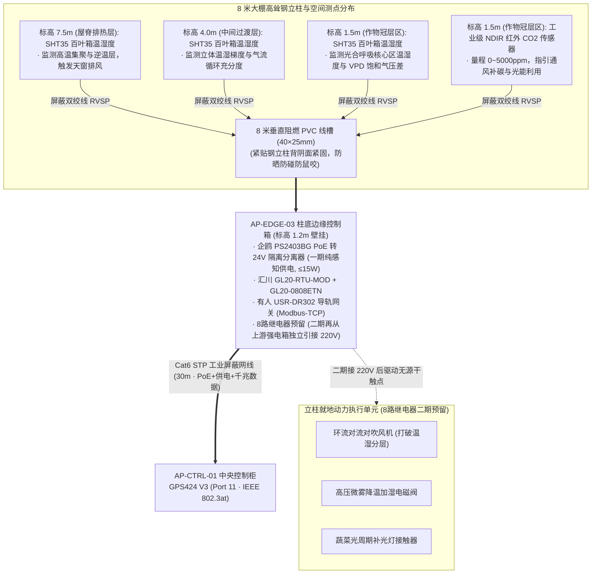

# 第一期温室立柱微气候边缘控制箱与立体气象感知工程规范 (AP-EDGE-03 Engineering Specification)

> **定位与工程边界说明**：  
> 本规范是数字化农业工厂（鱼菜共生智能工业体系）温室大棚内 **8 米高承重主立柱（折线距中控室约 30 米）** 专用微气候感知与动力边缘控制节点实施标准。  
> **服务对象**：`AP-EDGE-03` 壁挂式控制箱、8米立柱垂直走线、立体 3 层温湿度矩阵、作物冠层 NDIR 红外 CO2 监测与环流风机动力接口。  
> **单一事实源（SSOT）绑定采购清单**：👉 [BOM_08_立柱微气候与动力边缘控制箱采购清单.md](../02_procurement_and_boms/boms/BOM_08_立柱微气候与动力边缘控制箱采购清单.md)  
> **通用配盘母标准继承**：钣金喷塑、双风道排热、灰蓝分色端子、红色指示灯熔断保护及 FAT 出厂验收准则 100% 继承并执行 👉 [04_中央PLC智能主控制柜配盘与电气工程规范.md](./04_中央PLC智能主控制柜配盘与电气工程规范.md)。  
>  
> **生效时间**：`2026-11-15T11:38:00.000Z` (严格遵循 ISO 8601 UTC)

---

## 1. 物理结构与 8 米立柱垂直感知空间分布

针对温室大棚内 **8 米高承重主立柱**，实施集“立体温湿度逆温层解析 + 冠层 CO2 监测 + 本地环流动力预留”三位一体的复合型边缘控制节点。**一期纯感知阶段，立柱旁暂不单独拉取 220V 强电，统一利用中央控制柜 `GPS424 V3` 交换机 `Port 11` 的 `IEEE 802.3at (PoE+)` 供电，在立柱箱内通过企鸥通讯 `PS2403BG` 千兆 PoE 转 24V 隔离分离器直接驱动全部感知设备；二期接入环流风机等动力设备时再由上游强电箱独立引接 AC 220V**：

---

## 2. 8 米钢立柱无损施工与垂直线槽走线工艺

1. **温室立柱免损抱箍安装准则（严禁焊接打孔）**：
   * 大棚 8 米立柱属于核心受力钢结构，**严禁在立柱壁上进行任何焊接作业或打自攻螺丝**（防止破坏防腐热镀锌层引发生锈腐蚀，损伤抗风剪切力）；
   * 40×25mm PVC 线槽与 3 处百叶箱传感器支架，统一采用 **304 不锈钢喉箍/加厚喉卡抱箍固定**，全机械外抱紧固；
2. **立体空间测点定标**：
   * **底层（1.5m）**：紧贴水培蔬菜冠层生长核心区，监测冠层微气候温度、相对湿度（SHT35）与红外二氧化碳（NDIR，量程 $0\sim 5000\,\text{ppm}$），用于计算 VPD（饱和水汽压差）；
   * **中层（4.0m）**：大棚空间垂直过渡层，监测中空温湿度；
   * **顶层（7.5m）**：拱形屋脊热气聚积区，监测高温聚热与逆温现象；
3. **线槽封装**：
   * 沿立柱背阴面紧贴固定一条 **$40\times 25\,\text{mm}$ 阻燃 PVC 线槽**（4 根 × 2m，带卡扣盖板）；
   * 4 支传感器的 RVSP 屏蔽双绞线全部入槽下引，直达柱底控制箱底部，防农药喷淋腐蚀、防机械剐蹭、防老鼠啃咬。

---

## 3. 电气配盘、网络规划与寄存器字典

### 3.1 核心硬件选型与分期供电模式
* **箱体**：标准 $400\times 500\times 200\,\text{mm}$ IP65 壁挂式冷轧钢板喷塑箱，安装于立柱底部离地 $1.2\,\text{m}$ 处；
* **一期纯感知供电（PoE+ 隔离转 24V 方案，免拉 220V）**：
  * 从中央控制柜 `GPS424 V3` 交换机 **`Port 11`（支持 `IEEE 802.3at PoE+` 30W）** 经 30m `Cat6 STP` 屏蔽网线送电；
  * 立柱箱内配置 **企鸥通讯 `PS2403BG` 千兆 PoE 转 24V 隔离分离器**（兼容 `802.3at/bt`、输出 `24VDC/3A`、`1.5kV` 电气隔离、绿色端子排输出），同时分离出千兆网口接入 `GL20-RTU-MOD`；**工艺要求**：无导轨卡扣，须用螺丝固定在底板上（`106×77×24mm`），工作温度 `-20~50℃`，箱体安装在立柱背阴面并放干燥剂防凝露，接传感器前用万用表实测端子 `24V` 极性；
  * **一期功耗校核**：`GL20-RTU-MOD` + `GL20-0808ETN`（空载/DI）+ `USR-DR302` + 3×`SHT35` + 1×`NDIR CO2` 合计约 **`7.5~9.5W`**（24V 下约 `0.3~0.4A`），远低于 `802.3at` 30W 供电上限（**一期务必保持 8 路继电器线圈不吸合**）；
* **二期接动力供电（预留升级位）**：二期需驱动环流风机、微雾阀或补光灯时，**严禁从中央 PLC 柜内拉 220V**，须从上游强电配电箱单独穿管引接 AC 220V 进线，并在箱内补装 `NXB-63` 微断、20kA 工业二级 SPD 与明纬 `NDR-75-24`（75W）；
* **总线耦合器与切片**：汇川 `GL20-RTU-MOD`（双 RJ45 口）+ `GL20-0808ETN`（8DI/8DO）；
* **串口网关**：有人 `USR-DR302` 导轨串口服务器（DC 5~36V 宽压供电），短跳线直插 GL20 第二网口；
* **熔断保护**：6 粒魏德米勒 `SAKSI 4N LD` 红色报警熔断端子（1A 快熔）。

### 3.2 IP 地址与 Modbus 寄存器映射

| 节点名称 | 物理位置 | 核心设备 | IP 地址与端口 | Modbus 从站映射 | 对应测点/功能 |
| :---: | :---: | :---: | :---: | :---: | :--- |
| **AP-EDGE-03** | 温室8米主立柱 (30m) | 汇川 GL20-RTU-MOD | `192.168.1.15:502` | Unit ID = 1 | 8点 DI 开关量状态 + 8点 DO 继电器驱动 |
| | | 有人 USR-DR302 | `192.168.1.16:502` | Slave ID = 01 | 标高 1.5m 作物冠层 SHT35 百叶箱温湿度 |
| | | | | Slave ID = 02 | 标高 4.0m 中间过渡层 SHT35 百叶箱温湿度 |
| | | | | Slave ID = 03 | 标高 7.5m 屋脊排热层 SHT35 百叶箱温湿度 |
| | | | | Slave ID = 04 | 标高 1.5m 冠层工业级 NDIR 红外 CO2 传感器 |

---

## 4. 动力联动控制与无源干触点解耦设计

> [!TIP]
> **【经验教训备注 8：8 米立柱垂直温湿逆温层解析与环流风机动力解耦】**  
> 1. **动力规格待定下的接口解耦原则**：  
>    箱内 8 套超薄中间继电器的输出端全部作为 **250VAC/6A 无源纯干触点** 引出至端子排。  
>    * **若未来选用常规 220V 小型环流对流风机（$\le 250\text{W}$）**：火线可直接串入继电器触点直驱；  
>    * **若未来选用 380V 三相电机或大功率风机**：继电器干触点仅充当控制回路（吸合外部强电箱内的交流接触器线圈 A1/A2），主高压动力绝不进本弱电箱；  
>    * **本设计确保无论未来风机规格如何变化，箱内配盘 100% 免二次拆改！**  
> 2. **智能联动控制策略**：  
>    中央 PLC 实时计算顶层（7.5m）与底层（1.5m）温差。当检测到温差 $>3^\circ\text{C}$ 时，触发 DO 闭合开启环流风机，强制向下混合高处热空气，打破分层对流，消除局部闷热死区。

