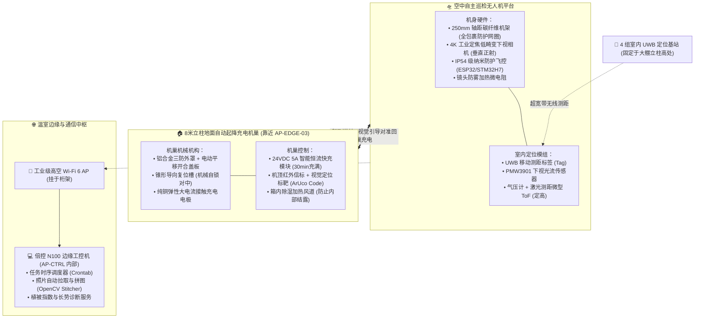

# 连锁数字化农业工厂：07_温室大棚移动视觉巡检与蔬菜生长溯源系统设计方案 (Mobile Visual Inspection & Crop Traceability: UAV Drone vs Suspended Rail Robot)

> **核心定位与研讨备忘**：  
> 本规范是数字化农业工厂（鱼菜共生智能工业体系）**水培跑道作物生长全生命周期数字化、移动高空视觉巡检与农艺品质溯源**的技术方案研讨与工程储备母文档。  
> 深入剖析长距深水浮板水培（DWC）中“每米每板定点成像”的核心痛点，客观推演温室非标受限环境下的物理风险，对比论证**「室内全自主无人机巡检系统 (Indoor UAV)」**与**「棚顶悬挂单轨/索道巡检机器人 (Suspended Rail Robot)」**两大技术流派，确立可落地的系统拓扑、通信协议、CV 视觉流水线与分期演进试验路线。  
>  
> **生效时间**：`2026-11-08T19:30:00.000Z` (严格遵循 ISO 8601 UTC)  
> **关联架构与顶层设计**：  
> * 采购与预算总台账：👉 [00_第一期总工程预算与采购总台账.md](../02_procurement_and_boms/00_第一期总工程预算与采购总台账.md) (含三期演进路线)  
> * 中央控制柜与网络中枢：👉 [04_中央PLC智能主控制柜配盘与电气工程规范.md](./04_中央PLC智能主控制柜配盘与电气工程规范.md) (NVR、工控机与 PoE 交换机底座)  
> * 8米立柱边缘控制箱：👉 [06_温室立柱微气候边缘控制箱与立体气象感知工程规范.md](./06_温室立柱微气候边缘控制箱与立体气象感知工程规范.md) (机巢物理安装与配电接入点)  

---

## 1. 业务痛点与技术诉求深度剖析 (Problem Statement & Business Value)

在东西跨度超 $72\,\text{m}$ 的现代深水水培（Deep Water Culture, DWC）跑道中，成千上万块高密度聚苯乙烯（EPS）定植浮板漂浮于流动营养液中。为了实现**高品质净菜的“一菜一码”生长全生命周期溯源与精准农艺诊断**，必须对每一块浮板上的蔬菜长势进行高频、定点、高质量的数字化记录。

```
+---------------------------------------------------------------------------------------------------+
|                        传统固定摄像头阵列 VS 移动正射俯拍方案的痛点对比                            |
+---------------------------------------------------------------------------------------------------+
| 传统密集固定相机阵列的致命缺陷：                                                                   |
| 1. 【成本与布线爆炸】: 72米双向跑道若每隔 2 米布设 1 台枪机，仅单跨就需要 70~80 台工业摄像机，     |
|    PoE 网线敷设与交换机端口成本激增数万元，施工与后期维护形同灾难；                              |
| 2. 【大倾角透视畸变】: 边缘枪机存在“近大远小”严重倾斜角，蔬菜叶片相互重叠遮挡，无法提取真实垂直正交视角； |
| 3. 【光照与反射死角】: 水面镜面反射与棚顶遮阳网阴影交替，固定相机逆光侧画面动态范围严重不足。        |
|                                                                                                   |
| 移动式自顶向下垂直俯拍 (Nadir View Orthophoto) 的核心农艺价值：                                   |
| 1. 【几何正交无畸变】: 镜头光轴垂直向下，与水面严格呈 90°，拍得的标准正射影像（Orthophoto）能以真实 |
|    物理毫米比例尺精确计算「植被覆盖率 (Canopy Cover %)」与「叶面积指数 (LAI)」；                 |
| 2. 【单设备巡检全场】: 仅需 1 套高机动载具，即可按照既定航线巡视全棚数万株蔬菜，资产利用率提高数十倍；  |
| 3. 【时序生长对齐】: 每天在相同位置、相同高度、相同曝光参数拍摄同一浮板，生成毫厘不差的“生长延时档案”。 |
+---------------------------------------------------------------------------------------------------+
```

---

## 2. 温室大棚受限物理场的“五大现实陷阱” (Grill & Feasibility Analysis)

温室内部不同于开阔大田，属于**受限室内极端环境**。盲目采购普通室外航拍无人机在温室运行，将面临严重的工程灾难：

### 2.1 陷阱一：GPS/北斗卫星信号屏蔽与多径失锁 (GPS-Denied)
* **物理机理**：大棚棚顶由大量轻钢龙骨、三角桁架支撑，且覆盖双层耐候膜或 PC 阳光板（表面易吸附水膜形成导电屏蔽层）。
* **灾难后果**：卫星微弱信号被散射并发生剧烈多径反射，常规飞控丢星后会自动切换为毫无阻尼的“姿态模式（ATTI）”，微弱气流就会导致机身横向漂移，直接撞击钢架立柱！
* **工程对策**：**必须完全摒弃卫星导航**，采用基站式 **UWB 超宽带厘米级定位系统**、或 **下视光流 + 双目视觉里程计 (VIO/SLAM)** 实现自主室内悬停。

### 2.2 陷阱二：旋翼强下洗气流（Propeller Downwash）伤苗与掀翻浮板
* **物理机理**：旋翼飞行器通过向下加速排出空气获得升力，下洗风速随离地距离衰减。
* **灾难后果**：
  * **生菜幼苗叶片机械损伤**：大棚水培生菜（如奶油生菜、绿萝蔓）幼嫩多汁，强气流近距离冲击会导致叶缘撕裂、气孔保护性闭合引发光合抑制；
  * **浮板翻倾下沉风险**：深水浮板采用轻质 EPS 泡沫板（密度仅约 $15\sim 20\,\text{kg/m}^3$），若无人机飞行高度低于 $2.0\,\text{m}$，旋翼下洗高压风场在水面形成局部正压，极易导致浮板掀边、翻扣沉底！
* **工程对策**：
  * **巡航高度红线**：飞行高度严格锁定在浮板水面上方 **$3.5\sim 4.5\,\text{m}$**（此高度下洗气流到达植被冠层时已衰减为 $< 1.5\,\text{m/s}$ 的柔和微风）；
  * **机身轻量化与涵道静音多叶桨**：选用总起飞重量 $\le 600\,\text{g}$ 的小轴距微型飞行器，采用全包裹式涵道防护圈（既减噪、聚风，又防止撞击挂线）。

### 2.3 陷阱三：高湿凝露与镜头起雾 (High Humidity & Condensation)
* **物理机理**：农业温室在早晨蒸腾作用加剧且夜间通风受限时，局部相对湿度可长期维持在 **$90\%\sim 98\%$ RH**。
* **灾难后果**：
  * 金属电极与飞控裸板极易冷凝出导电微水珠，引发短路烧蚀；
  * 无人机光学镜头表面在冷热交替时结露起雾，导致拍照模糊失真。
* **工程对策**：飞行器全机核心电路板喷涂 **高等级纳米绝缘防潮三防胶（达 IP54 防护标准）**；光学镜头配置 **微阻加热除雾圈**，起飞前预热驱散雾气。

### 2.4 陷阱四：大棚密集高空障碍物（悬挂吊索、风机与拉线）
* **物理机理**：8 米立柱间纵横交错着抗风钢索、高压微雾喷淋 PE 管路、环流风机供电桥架及遮阳幕布传动轴。
* **灾难后果**：细弱钢丝在雷达与普通双目避障算法中极难识别，极易绞桨挂线。
* **工程对策**：**坚决杜绝“AI 自主随机路径规划”**。必须采用预先全站仪硬性标定的 **“三维绝对电子走廊（Virtual Tunnel）”**，无人机仅在无任何遮挡的跑道正上方中央绝对净空航道内线性穿梭。

### 2.5 陷阱五：高可靠回巢自锁与接触式充电 (Precision Docking)
* **物理机理**：微型无人机受电池能量密度限制，巡航时长仅为 **$12\sim 18\,\text{分钟}$**，必须依赖机巢自动补电。
* **灾难后果**：无法使用卫星返航，若机巢对齐误差 $> 2\,\text{cm}$，充电探针将无法准确接触，导致系统缺电瘫痪。
* **工程对策**：采用 **两级级联对准机构**——一级采用高精度 UWB 引导至机巢上方 $1\,\text{m}$；二级依靠机腹下视单目相机锁定机巢底座上的 **高对比度 ArUco 视觉二维码与红外信标**，配合漏斗式机械限位槽自锁导入，底部镀金弹簧极片实现 24V DC 快速充电。

---

## 3. 技术路线深度对比：【多旋翼无人机】VS【棚顶悬挂单轨巡检车】

在温室水培跑道场景中，解决“垂直正交拍照”不仅有空中多旋翼一条路，现代农业工程界（以荷兰普瓦、瓦赫宁根大学为代表）广泛采用**棚顶单轨/索道移动小车**。两种技术路线对比矩阵如下：

| 对比维度 | 路线 A：空中全自主巡检无人机 (Indoor UAV) | 路线 B：棚顶悬挂轨道/索道巡检小车 (Suspended Rail Bot) |
| :--- | :--- | :--- |
| **机械与运动形态** | 4轴/6轴轻型微旋翼，三维空间自由航行 | 沿跑道正上方钢桁架悬挂轻型铝轨或钢丝绳，轻量吊舱小车往复滑行 |
| **抗风压防伤苗能力** | 存在旋翼下洗气流，需保证 $\ge 3.5\text{m}$ 安全飞行高度 | **0 气流产生**，轻盈滑行，可贴近至 $1.5\text{m}$ 拍出极高微观画质 |
| **定位与坐标精度** | 依赖 UWB/SLAM，静态精度约 $\pm 5\sim 10\,\text{cm}$ | **编码器机械硬计数，位置精度可达 $\pm 1\,\text{mm}$**，每次拍照像素级重合 |
| **供电与续航体系** | 锂电池驱动，15分钟巡航，需昂贵复杂的充电机巢 | **轻型拖链电缆或滑触线直接供电，7×24小时无限续航，免充电机巢** |
| **坠落与安全风险** | 存在断电、偶发失步坠毁损坏作物的概率风险 | **机械导轨双重抱轨锁死，100% 杜绝坠落摔击事故** |
| **跨区域机动性** | **优秀**：单机可自主跃升、跨越不同大棚或多条跑道 | **较差**：局限于单条轨道，跨跑道需增设机械变轨机构或人工换道 |
| **系统综合造价** | 工业无人机 + 室内UWB基站 + 自主机巢：**约 ¥ 25,000 ~ 40,000** | 72米轻型悬挂轨道 + 步进电机滑车 + 树莓派工业相机：**约 ¥ 3,000 ~ 5,000** |
| **后期维护复杂度** | 高（电机动平衡、桨叶损耗、电池寿命衰减、光流校准） | 极低（仅有轴承与同步带机械磨损，无易损易耗传感器） |

---

## 4. 路线 A（空中无人机）系统工程架构实施规划

若未来项目坚持选用高科技感且可跨区作业的空中无人机方案，系统必须按以下工程架构落地闭环：



### 4.1 核心工作流程
1. **就绪与预热**：每天定时（如早晨 09:00、正午 12:30），工控机经局域网向机巢发送启动指令。机巢顶盖平移开启，镜头加热除雾 60 秒，无人机自检电量与传感器健康；
2. **垂直起飞与航线锁定**：无人机垂直爬升至水面上方 **$4.0\,\text{m}$** 安全标高，依托立柱 UWB 基站定位，以恒定速度 $0.8\,\text{m/s}$ 沿跑道中线向前飞行；
3. **等间隔正射定点拍摄**：每隔 $1.2\,\text{m}$（与浮板排布模数整倍对齐）悬停瞬间触发全局快门拍照，在照片 EXIF 元数据中写入精确的 `(X, Y, Z)` 空间坐标与精确 UTC 时间戳；
4. **自主返航与视觉精确入巢**：单次巡航耗时约 6 分钟，结束后回飞至机巢上方，下视相机识别机巢顶面的 ArUco 标靶，垂直缓降并借助机械漏斗槽自锁对中，接通底座充电极片，顶盖闭合保温防尘；
5. **高速图传与数据入库**：无人机连入温室 Wi-Fi 6 网络，自动将 4K 原图同步至工控机本地 SSD 盘，触发后台长势分析流水线。

---

## 5. 计算机视觉（CV）与作物生长溯源数据闭环

拍摄得到的高清垂直俯拍照片，通过边缘工控机上的自动化算法流水线，最终转化为生产经营与农艺溯源指标：


### 5.1 核心农艺量化算法指标
1. **超绿特征提取 (Excess Green Index, ExG)**：
   $$ExG = 2 \times G - R - B$$
   通过色空间非线性变换，将绿色蔬菜冠层与背景水体、EPS 白色泡沫浮板完全二值化剥离，彻底消除水面反光干扰。
2. **植被覆盖率 (Canopy Cover, CC %)**：
   $$CC = \frac{\text{绿色植被像素总数}}{\text{单块浮板总像素数}} \times 100\%$$
   每日追踪同一块浮板的 $CC$ 增长斜率。若某块浮板连续 2 天增长停滞或异常下降，系统自动标记为“异常生长告警”，指导农艺工人就地排查病虫害或烂根。
3. **品质与溯源大模型联动**：
   每一颗成品蔬菜出厂贴附的溯源二维码，不仅能看到播种日与采收日，更能查看其**“每日由巡检机拍摄的生长延时快照 + 当日溶氧水温曲线”**，形成极具商业溢价的“全透明数字蔬菜”品牌背书。

---

## 6. 项目落地分期与试验演进路线图 (Roadmap)

针对无人机系统的复杂性，避免前期盲目大额投资，确立**“一期留接口、二期做试验、三期落系统”**的演进策略：

### 阶段 0：第一期（当前工程）—— 零成本物理接口超前预留
* **网络中枢预留**：中央控制柜（`AP-CTRL`）内部的 TP-Link PoE 交换机预留 1 处千兆网口，为温室高空工业 Wi-Fi 6 AP 留出布线孔；
* **物理空间与配电预留**：在 8 米钢立柱背阴面（即 `AP-EDGE-03` 控制箱旁），于离地 $1.2\sim 1.5\,\text{m}$ 平台预留 **$600\times 600\,\text{mm}$ 干燥水平安装面**，箱内断路器预留一路 220V/10A 电源回路，供未来机巢接电。

### 阶段 1：第二期（水质稳定后）—— 物理风压实地安全测定
* **抗风压极限摸底试验**：使用一台便携微型消费级无人机，由飞手手动遥控至生菜浮板上方，从 $1.5\,\text{m}$ 逐步升高至 $4.5\,\text{m}$，测定不同高度对生菜叶片震颤及泡沫浮板平稳度的真实物理扰动；
* **环境湿度实测评估**：连续记录雨季和清晨大棚高空的冷凝露点，确定机载镜头的防雾需求；
* **技术路线最终抉择**：若风压影响极小且全棚跨区需求大，正式立项 **路线 A（自主无人机）**；若水培跑道单一且追求极低成本与绝对零坠毁，则顺势采用 **路线 B（棚顶悬挂单轨小车）**。

### 阶段 2：第三期（全自动系统工程交付）
* 完成专用机身结构、室内高精度 UWB 锚点安装、以及地面智能充电机巢的成套联调，系统全自动融入工厂日常巡检运维调度体系。

---

## 7. 研讨与决策待办事项 (Discussion Action Items)

针对后续深入讨论，列出以下待定决策清单供阶段性研判：
- [ ] **决策项 1（跨区需求）**：巡检系统未来仅针对单条 72 米跑道，还是需要单机跨越全厂左右两个大棚、多个鱼池全域巡检？
- [ ] **决策项 2（农艺承受度）**：泡沫浮板是否加装了边缘物理限位卡扣（防侧滑倾覆）？
- [ ] **决策项 3（商业溯源诉求）**：客户对“单菜生长延时视频/延时照片”的营销付费意愿与品牌溢价预期。
