# 连锁数字化农业工厂：09_全厂视频监控PoE网络布线与交换机端口线号施工规范 (PoE Camera Network Cabling & Port Tagging Engineering Specification)

> **核心定位**：本规范是数字化农业工厂（鱼菜共生智能工业体系）视频监控与视觉感知子系统的**单一事实来源 (Single Source of Truth, SSOT)** 规范。  
> **管辖范围**：覆盖从中央控制柜 (`AP-CTRL`) 内 16口 PoE 交换机到全厂 10 台网络摄像枪机 (IPC) 的**网络拓扑结构、交换机物理端口固化分配、网线三段式线号编码、两端对称互指标签打标标准、Cat5e STP 选型与水晶头制作、地面 100×60mm PVC 地槽同槽敷设与立柱引上防滴水工艺**。  
> **版本**：`v1.0.0` | **生效时间**：`2026-11-08T16:30:00.000Z` (遵循 ISO 8601 UTC)  
> **工程归口**：现场弱电智能化工程组 / 计算机视觉边缘计算组  
> **关联总台账与硬件清单**：  
> - 核心采购台账 👉 [00_第一期总工程预算与采购总台账.md](../02_procurement_and_boms/00_第一期总工程预算与采购总台账.md)  
> - 前端摄像枪机清单 👉 [BOM_03_微气候气象与视频监控硬件采购清单.md](../02_procurement_and_boms/boms/BOM_03_微气候气象与视频监控硬件采购清单.md)  
> - 交换机与录像机清单 👉 [BOM_01_控制中枢与动力配电采购清单.md](../02_procurement_and_boms/boms/BOM_01_控制中枢与动力配电采购清单.md)  
> - 柜内配盘工程规范 👉 [04_中央PLC智能主控制柜配盘与电气工程规范.md](./04_中央PLC智能主控制柜配盘与电气工程规范.md)  
> - 全厂弱电网络规范 👉 [01_现场弱电线缆选型与布线施工规范.md](./01_现场弱电线缆选型与布线施工规范.md)

---

## 1. 系统拓扑与硬件承载架构 (System Topology)

视频监控网络采用 **“核心交换机集中供电 + 前端星型直连 + 边缘智能双路分流”** 拓扑：
1. **集中受电与交换核心**：集中设于中央主控制柜 (`AP-CTRL`) 第 1 层托盘，由 **TP-Link 16口全千兆 PoE+ 工业交换机** 提供 $48\,\text{V}$ 集中 PoE 供电与线速转发，总供电能力 $110\,\text{W}$（10 台前端枪机满载总功耗约 $45\,\text{W}$，负载率仅 $41\%$，余量充足可靠）；
2. **边缘智能分流**：
   - **一路进录像机 (NVR)**：10 路 300 万超清码流 (H.265) 写入 TP-Link 32路 NVR 进行 24 小时全量循环录像，留存 30 天；
   - **一路进边缘工控机 (IPC)**：研华 UNO-2271G-V2 智能工控机通过 RTSP 取流，执行 YOLO11 轻量化实时推理（鱼群摄食水花反演、蔬菜叶焦病与生长溯源）。

```mermaid
flowchart TD
    subgraph AP_CTRL["中央控制柜 AP-CTRL (托盘层)"]
        UPS["1kVA 在线式 UPS (纯净 220VAC)"]
        SW["TP-Link 16口全千兆 PoE+ 交换机<br>(110W PoE 供电 / 端口固化)"]
        NVR["TP-Link 32路 NVR (4TB 希捷酷鹰)<br>IP: 192.168.1.100"]
        IPC["研华 UNO-2271G-V2 边缘工控机<br>IP: 192.168.1.50"]
        GW["工业 4G/有线双网关路由器<br>IP: 192.168.1.1"]
        
        UPS --> SW
        UPS --> NVR
        UPS --> IPC
        
        SW -- "Port 15 (短跳线)" --> NVR
        SW -- "Port 16 (短跳线)" --> GW
        SW -. "工控内网 (千兆)" .- IPC
    end

    subgraph FIELD_CAM["现场前端摄像枪机群 (走地面 100×60mm PVC 地槽 + 立柱穿管引上)"]
        direction TB
        C1["CAM-FISH-01 (1号成鱼池) / Port 01"]
        C2["CAM-FISH-02 (2号成鱼池) / Port 02"]
        C3["CAM-FISH-03 (3号幼鱼池) / Port 03"]
        C4["CAM-FISH-04 (4号调理池) / Port 04"]
        C5["CAM-HYDRO-01 (A跑道深水浮板) / Port 05"]
        C6["CAM-HYDRO-02 (B跑道深水浮板) / Port 06"]
        C7["CAM-HYDRO-03 (C跑道深水浮板) / Port 07"]
        C8["CAM-HYDRO-04 (D跑道定植育苗) / Port 08"]
        C9["CAM-CTRL-01 (主控柜电气安全) / Port 09"]
        C10["CAM-OUTDOOR-01 (室外气象全景) / Port 10"]
    end

    SW ==>|NET-CAM01-P01| C1
    SW ==>|NET-CAM02-P02| C2
    SW ==>|NET-CAM03-P03| C3
    SW ==>|NET-CAM04-P04| C4
    SW ==>|NET-CAM05-P05| C5
    SW ==>|NET-CAM06-P06| C6
    SW ==>|NET-CAM07-P07| C7
    SW ==>|NET-CAM08-P08| C8
    SW ==>|NET-CAM09-P09| C9
    SW ==>|NET-CAM10-P10| C10
```



---

## 2. 交换机端口固化分配与线号映射字典 (SSOT Mapping Table)

> [!IMPORTANT]
> **红线规则**：全厂交换机端口、网线编号、前端设备 ID 与 IP 地址实行 **四位一体强制绑死**。现场严禁随意互调插拔网线接口。

| 交换机端口 | 专用线号 (Cable ID) | 对应设备 ID | 固定静态 IP | 安装物理位置 | 镜头规格 | 监控业务与 AI 分析功能 |
| :---: | :---: | :---: | :---: | :---: | :---: | :--- |
| **Port 01** | **`NET-CAM01-P01`** | **`CAM-FISH-01`** | `192.168.1.101` | 1号成鱼池上方钢梁 (高 2.5m) | 4mm 广角 (85°) | 1号池水面鱼群游姿、表面摄食水花捕捉 (YOLO11 摄食截断) |
| **Port 02** | **`NET-CAM02-P02`** | **`CAM-FISH-02`** | `192.168.1.102` | 2号成鱼池上方钢梁 (高 2.5m) | 4mm 广角 (85°) | 2号池鱼群摄食与浮头缺氧行为观察 |
| **Port 03** | **`NET-CAM03-P03`** | **`CAM-FISH-03`** | `192.168.1.103` | 3号幼鱼池上方钢梁 (高 2.5m) | 4mm 广角 (85°) | 幼鱼培育区状态监测与投喂溯源 |
| **Port 04** | **`NET-CAM04-P04`** | **`CAM-FISH-04`** | `192.168.1.104` | 4号调理池/沉淀池上方 | 4mm 广角 (85°) | 沉淀区固液分离、微滤机出水与水面泡沫监测 |
| **Port 05** | **`NET-CAM05-P05`** | **`CAM-HYDRO-01`**| `192.168.1.105` | A 跑道深水浮板床纵深端头 | 6mm 长焦 (50°) | 72米长跑道纵深透视、生菜生长展开度与长势溯源 |
| **Port 06** | **`NET-CAM06-P06`** | **`CAM-HYDRO-02`**| `192.168.1.106` | B 跑道深水浮板床纵深端头 | 6mm 长焦 (50°) | 蔬菜冠层遮阴度、叶焦病/缺素症视觉初筛 |
| **Port 07** | **`NET-CAM07-P07`** | **`CAM-HYDRO-03`**| `192.168.1.107` | C 跑道深水浮板床纵深端头 | 6mm 长焦 (50°) | 72米长跑道纵深透视、LED 植物补光灯反光复核 |
| **Port 08** | **`NET-CAM08-P08`** | **`CAM-HYDRO-04`**| `192.168.1.108` | D 跑道定植育苗区上方 (高 3.5m) | 4mm 广角 (85°) | 幼苗定植区覆盖率、定植杯浮板沉降状态核验 |
| **Port 09** | **`NET-CAM09-P09`** | **`CAM-CTRL-01`** | `192.168.1.109` | AP-CTRL 主控制柜与配电间入口 | 4mm 广角 (85°) | 电气配电房操作合规、柜门启闭安全巡视与防火安防 |
| **Port 10** | **`NET-CAM10-P10`** | **`CAM-OUTDOOR-01`**| `192.168.1.110`| 温室天窗外立面 / 气象立柱高位 | 4mm 广角 (85°) | 室外超声波气象站运行状态、暴雨天窗开闭全景核查 |
| *Port 11* | *`NET-SPARE-P11`* | *预留扩展* | *`192.168.1.111`* | *预留温室人脸识别门禁闸机* | — | 二期出入人员合规审计与生物安全门禁 |
| *Port 12* | *`NET-SPARE-P12`* | *预留扩展* | *`192.168.1.112`* | *预留无人机机巢自动起降坪* | — | 二期自主无人机航飞图像高速回传基座 (4G/WiFi) |
| *Port 13* | *`NET-SPARE-P13`* | *预留扩展* | *`192.168.1.113`* | *预留悬挂轨道巡检小车* | — | 二期高空轨道移动相机流媒体接入 |
| *Port 14* | *`NET-SPARE-P14`* | *预留扩展* | *`192.168.1.114`* | *预留应急工程调测网口* | — | 现场运维笔记本工程师专插调测口 |
| **Port 15** | **`NET-NVR-UPLINK`** | **`NVR-TPLINK-01`**| `192.168.1.100` | 主控制柜第一层托盘 | 1m 纯铜跳线 | 交换机千兆上联至 32路 NVR 录像机 LAN 口 |
| **Port 16** | **`NET-GW-UPLINK`** | **`GW-ROUTER-01`** | `192.168.1.1`   | 主控制柜第一层托盘 | 1m 纯铜跳线 | 交换机千兆上联至工业双网关路由器 LAN 口 |

---

## 3. 两端对称互指打标规范 (Symmetrical Labeling Standard)

在大跨度工业大棚中，严禁只在一端贴标签或只手写“数字序号”。必须推行 **“两端对称互指”** 工业规范：

```text
[交换机端水晶头] ──(5~8cm)──[ 标签 A (指明对端去向) ]════════════════════[ 标签 B (指明本端来向) ]──(5~8cm)── [摄像头端防水头]
```

### 3.1 标签物理材质要求
* **严禁品类**：严禁使用普通纸胶带、不干胶贴纸或油性记号笔手写（大棚湿度常年 $70\%\sim 90\%$，喷雾水汽几个月内会导致胶水水解脱落、字迹晕黑失效）；
* **强制品类**：统一采用 **“缠绕式自覆膜防水阻燃线缆标签纸”**（如 Brother 或 硕方 专用户外线缆标签），自带加长透明保护尾膜，缠绕时透明膜将打印字迹死死包裹在内部，达到 IP67 防泼水、耐高温耐腐蚀等级。

### 3.2 标签两端打印内容模板

#### 1. 控制柜侧（插在交换机 PoE 端口上的这一头）
* **粘贴位置**：距离网线水晶头尾部护套 **$5\sim 8\,\text{cm}$** 处；
* **打印格式（两行居中）**：
  ```text
  ┌───────────────────────────────┐
  │ NET-CAM01-P01                 │  <-- 线号 (Cable ID)
  │ TO: 1号成鱼池 (192.168.1.101)  │  <-- 去向：目标物理区域 + IP
  └───────────────────────────────┘
  ```
  > **实操收益**：柜内检修或某路网口告警时，不用查阅图纸，直接看标签就知道是“1号成鱼池”的视频线路。

#### 2. 前端摄像机侧（插在摄像头尾线防水接头上的这一头）
* **粘贴位置**：进入摄像头自带防水旋钮套件前 **$5\sim 8\,\text{cm}$** 处；
* **打印格式（两行居中）**：
  ```text
  ┌───────────────────────────────┐
  │ NET-CAM01-P01                 │  <-- 线号 (Cable ID)
  │ FROM: 主控柜SW-Port01         │  <-- 来向：源机柜代号 + 交换机端口号
  └───────────────────────────────┘
  ```
  > **实操收益**：电工在高空桁架更换损坏枪机时，无需对讲机询问中控室，直接根据标签明确知道该线通往中央柜交换机的第 1 号端口。

---

## 4. 线缆规格选型与水晶头制作标准 (Cabling & RJ45 Termination)

### 4.1 线缆规格选型
* **标准型号**：**Cat5e STP (超五类带屏蔽双绞线)** 或 **Cat6 FTP/STP (六类带屏蔽双绞线)**；
* **导体标准**：4 对 8 芯纯无氧铜（线规 AWG24，单芯线径 $\ge 0.51\,\text{mm}$，严禁采用铜包铝 CCA 或铜包铁）；
* **直流内阻**：$100\,\text{m}$ 回路电阻必须 $< 9.5\,\Omega$，保障 $48\,\text{V}$ PoE 在 $70\,\text{m}$ 极端拉伸下末端工作电压不低于 $44\,\text{V}$；
* **外皮材质**：阻燃高密度抗老化聚乙烯 (PE) 或 防火聚氯乙烯 (PVC)，抗紫外线 (UV) 辐射。

### 4.2 压接线序与水晶头工艺
* **线序标准**：强制执行 **EIA/TIA-568B** 标准，两端必须完全一致（直通线）：
  ```text
  1: 白橙 (Tx+)    2: 橙   (Tx-)    3: 白绿 (Rx+)    4: 蓝   (PoE V+)
  5: 白蓝 (PoE V+) 6: 绿   (Rx-)    7: 白棕 (PoE V-) 8: 棕   (PoE V-)
  ```
* **水晶头规格**：必须使用**带金属屏蔽铜壳超五类/六类水晶头**与软胶保护套；
* **单端接地原则 (Single-Point Grounding)**：
  - 屏蔽双绞线内部的排流线 (Drain Wire) 与铝箔层，在**控制柜交换机侧通过金属水晶头连接交换机金属外壳实现机柜集中等电位接地**；
  - **前端摄像机侧屏蔽层必须悬空不接地**，严禁两端同时接地，防止大棚大跨度钢架感应电势差形成接地环路地电流，引入工频干扰。

---

## 5. 现场大棚走线与地面地槽同槽敷设 SOP (Installation SOP)

温室大棚内具有高湿度、频繁热胀冷缩、强光照及冷凝水滴落的特殊物理环境。长距离干线**统一敷设在地面 100×60mm 阻燃 PVC 弱电地槽内，与 Cat6 STP 边缘控制箱数据线同槽并排走线**，到点位后再通过立柱穿管引上。施工必须严格遵循以下 4 步工艺：

```text
[摄像头安装支架 (高 2.5~3.5m)] ── [防水旋套组件] <──┐
                                                    │
                                                    │ (U 型滴水弯，防冷凝水顺线倒灌)
                                                    ╰──┐
                                                       │
                                   [垂直引上线段 (穿 Φ20 阻燃 PVC 护管)]
                                                       │
                                                       ▲
[地面 100×60mm PVC 弱电地槽] ═════════════════════════╧═══════════ (至 AP-CTRL 主控制柜)
(Cat5e STP 视频线 与 Cat6 STP 边缘数据线同槽敷设，过道处扣 3mm 镀锌花纹钢板)
```

1. **地面 PVC 弱电地槽同槽并排敷设规范**：
   - 10 路摄像机的 `Cat5e STP` 超五类屏蔽网线与 `AP-EDGE` 边缘控制箱的 `Cat6 STP` 六类屏蔽网线，**全部统一放入地面 $100\times 60\,\text{mm}$ 阻燃 PVC 地槽内集中走线**；
   - **电气安全与抗干扰合规性**：两者均为直流低压弱电/数据差分信号（$48\,\text{V}$ PoE 供电与以太网数据包），在同一 PVC 弱电地槽内并排走线完全符合国家规范（GB 50311 / GB 50174），绝不会互相串扰，且**彻底禁止与 380V/220V 强电动力电缆混同走槽**；
   - **地面防压保护**：在人员往来和饲料推车经过的 3 处主过道处，线槽上方严格扣装 $300\times 1000\times 3.0\,\text{mm}$ 加厚热镀锌防滑花纹钢板，将推车轮压分散至地表两侧硬化土，保护线槽永不压裂。
2. **垂直立柱引上与护管工艺**：
   - 当网线自地面线槽到达摄像头对应的立柱或支撑墙时，自线槽接三通开孔引出，**穿 $\Phi 20$ 阻燃 PVC 垂直护管（或金属蛇皮管）**引上至安装高度（$2.5\sim 3.5\,\text{m}$）；
   - 护管使用 304 不锈钢喉箍紧抱在钢立柱背阴面，严禁在钢柱上钻孔焊接，严禁网线在近地面裸露悬空，防止人员刮碰或鼠咬。
3. **U 型防冷凝水滴水弯 (Drip Loop - 极其关键)**：
   - 网线从垂直引上段引出进入摄像头自带防水旋套前，**必须弯折出一个向下下垂弧度 $\ge 15\,\text{cm}$ 的 U 型滴水弯**；
   - **工程目的**：无论棚顶或护管外壁有冷凝水滑落，水珠都会顺着弧度在滴水弯最低处自然滴落到地面，绝不会顺线倒灌流入摄像头 RJ45 防水螺套内部导致短路腐蚀。
4. **两端检修活动余量**：
   - 控制柜交换机端预留 $0.5\,\text{m}$ 走线余量（收纳在柜内侧边理线环中）；
   - 前端摄像机吊装支架处必须盘留 $1.0\,\text{m}$ 检修环圈（用扎带扎在横梁上），方便未来更换安装角度或设备更换维修。

---

## 6. 施工交付与测试验收准则 (Acceptance Criteria)

每个点位施工完毕后，必须逐线完成以下 3 项硬性测试并登记入册：

| 验收项目 | 测试工具 | 合格判定准则 | 不合格处置动作 |
| :--- | :--- | :--- | :--- |
| **1. 物理连通性** | 网络测线仪 (寻线仪) | 1~8 芯线指示灯严格按序逐一亮绿灯，Shield 屏蔽灯常亮 | 重新剥皮更换金属屏蔽水晶头并重新压接 |
| **2. PoE 供电电压** | 数字万用表 (或 PoE 巡检仪) | 4/5 针脚与 7/8 针脚间实测直流空载电压在 $46\sim 52\,\text{V}$ DC 之间 | 检查线长是否超标 ($>80\text{m}$) 或线芯纯铜电阻超标 |
| **3. RTSP 码流稳定性** | 研华工控机终端 `ping` 测试 | 连续持续 ping 前端固定 IP 500 次，**丢包率 $= 0\%$**，网络延迟 $< 3\,\text{ms}$ | 检查交换机端口接触情况，排查强电电磁干扰源 |

---

> 📝 **修订履历**：  
> - `2026-11-08T16:30:00.000Z`：正式建立本工程规范，完成交换机 Port 01~16 字典固化、三段式线号体系及两端防潮打标规范制定，收敛全厂视频网络布线为 SSOT 单一事实来源。

