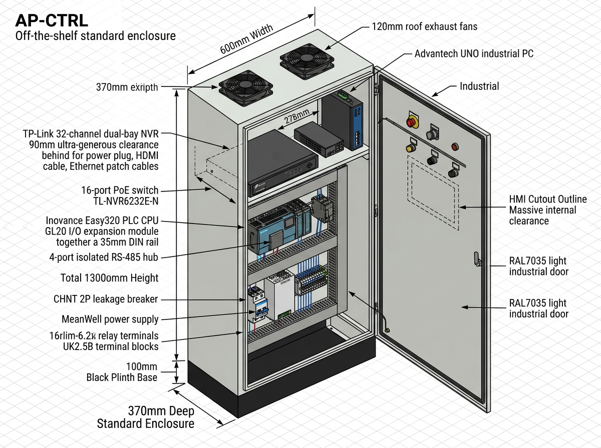
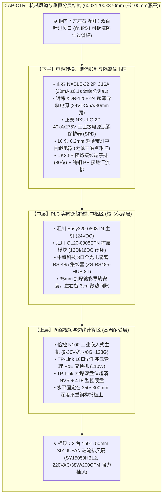

# 连锁数字化农业工厂：09_中央PLC智能控制柜硬件采购BOM与配盘工程规范 (Central PLC & IIoT Control Cabinet BOM & Engineering Specification)

> **核心定位**：本规范是数字化农业工厂（鱼菜共生智能工业体系）在 **中央弱电智能控制柜 (`AP-CTRL`)** 领域的专项工程落地标准。涵盖从机械柜体尺寸、风道强迫对流散热、核心计算中枢（PLC+边缘工控机）、视频网络汇聚、电源隔离与双级保护、16路无源干触点微中继矩阵、到全量物料采购精准 SKU 与出厂配盘验收 Checklist 的全生命周期工程规范。
>
> **版本与时间**：`Version 1.0.0` | **生效时间**：`2026-10-18T15:40:00.000Z` (严格遵循 ISO 8601 UTC)  
> **关联顶层架构**：
> * 宏观物联拓扑：👉 [02_MVP物理与物联拓扑.md](../03_system_architecture/02_MVP物理与物联拓扑.md)
> * 全要素电气规范：👉 [08_电气系统图与拓扑数据契约规范.md](../03_system_architecture/08_电气系统图与拓扑数据契约规范(Electrical_Topology_Schema).md)
> * 强电动力规划：👉 [06_全厂强电动力配电与电气工程规划规范.md](./06_全厂强电动力配电与电气工程规划规范.md)
> * 施工布线规范：👉 [05_现场弱电线缆选型与布线施工规范.md](./05_现场弱电线缆选型与布线施工规范.md)

---

## 1. 工程边界与物理定位 (System Boundaries)

在全厂东西跨度近 $120\,\text{m}$ 的双棚大空间厂房中，中央弱电控制柜承担着**“全厂数字化神经中枢”**的职能：

```
+---------------------------------------------------------------------------------------------------+
|                        中央控制柜 (AP-CTRL) 物理边界与工程定位说明                                |
+---------------------------------------------------------------------------------------------------+
| 1. 【设备唯一资产编号】: AP-CTRL (Plant-Wide Central PLC & Edge Automation Panel)                 |
| 2. 【物理安装位置】: 右侧 72m 主大棚与中控室交界处立柱旁 (紧邻生物过滤塔与水循环提升泵房)        |
| 3. 【强弱电物理隔离原则】: 本柜为【纯弱电与控制逻辑中枢】，严禁接入 380V 重载电机动力回路！      |
|    • 380V/220V 动力执行由隔壁独立的强电配电总柜 (AP-MAIN) 及现场各就地动力箱 (AP-AQUA等) 承担；   |
|    • 本柜仅输入 1 路 220V AC 纯净稳压电源，向外仅输出 24V DC 信号与无源常开/常闭干触点。          |
| 4. 【外置后备保命电源】: 1kVA 在线双变换式工控 UPS (山特 C1K) 置于柜外地面/操作台上，通过电源线引入。|
+---------------------------------------------------------------------------------------------------+
```

---

## 2. 机械结构、风道散热与面板工程规范


*图 2-1 中央弱电控制柜 (AP-CTRL) 3D 等轴测装配图与尺寸标注 (600×1200×370mm (带100mm底座))*


针对温室夏季环境温度高（易达 35℃~40℃）及视频交换机发热量大的工况，本柜采用**“强制抽风 + 正压冷风下进”**的工业热力学风道设计：



### 2.1 机械与开孔关键参数
* **柜体外形尺寸**：$1200\,\text{mm}(\text{高}) \times 600\,\text{mm}(\text{宽}) \times 370\,\text{mm}(\text{深})$ (含 $100\,\text{mm}$ 可拆卸独立加厚底座，全高 $1300\,\text{mm}$)；
* **板材工艺**：国标优质冷轧钢板，门板厚度 $\ge 1.5\,\text{mm}$，柜体内部安装底板厚度 $\ge 2.0\,\text{mm}$，环氧树脂静电喷塑（RAL7035 工业浅灰）；
* **柜顶风扇安装开孔**：
  * 开设 2 处风扇出风孔，适配 **$150 \times 150 \times 50\,\text{mm}$** 工业轴流风机；
  * 安装螺栓孔距：**$122 \times 122\,\text{mm}$**（四角 $\phi 4.5\,\text{mm}$ 螺栓孔），外侧加装金属防护网罩，排气出风阻力小且防止异物落入；
* **柜门预留交互与指示开孔**：
  * **急停控制**：1 个 $\phi 22\,\text{mm}$ 红色机械蘑菇头带灯急停按钮（带旋转复位，常闭触点串入 PLC X00）；
  * **状态指示**：3 个 $\phi 22\,\text{mm}$ LED 平头指示灯（绿色：220V 电源正常 / 黄色：系统就绪待机 / 红色：故障报警）；
  * **声光报警**：1 个 $\phi 22\,\text{mm}$ 脉冲蜂鸣带高亮闪烁报警器；
  * **屏幕预留区**：柜门上半部正中预留 $250 \times 180\,\text{mm}$ 范围无加强筋净空区，便于远期现场根据需要直接激光开孔加装 7~10 寸工业触摸屏 (HMI)；
* **底部敲落出线孔**：底部预制 20 个标准敲落孔，全量配置 **IP68 尼龙电缆防水接头 (Cable Glands)**：
  * `PG16` (孔径 22.5mm) $\times 4$ 套：供 220V 进线、主干网络与大电缆；
  * `PG11` (孔径 18.6mm) $\times 6$ 套：供输出继电器干触点多芯电缆；
  * `PG9` (孔径 15.2mm) $\times 10$ 套：供 RS-485 屏蔽双绞线与探头引线。

---

## 3. 中央控制柜全量硬件采购精准 BOM 表 (Bill of Materials)

以下物料清单覆盖柜体机械、风冷散热、计算网络、PLC 控制、电源保护、输出隔离及配线辅材全要素，可直接用于采购询价与电气成套厂委托加工：

| 序号 | 体系分类 | 物料名称 | 推荐品牌 | 规格型号 / 精准订货 SKU | 数量 | 单位 | 采购参考单价 (元) | 合计金额 (元) | 关键技术参数与工程选型说明 |
| :---: | :--- | :--- | :--- | :--- | :---: | :---: | :---: | :---: | :--- |
| **一** | **柜体结构与强迫风冷** | | | | | | | **¥ 688.00** | |
| 1.1 | 柜体结构 | **标准工控控制柜** | 奥格 / 仿威图九折柜 (现货标准款) | 宽 $600\times$ 高 $1200\times$ 深 $370\,\text{mm}$ (含100mm底座) | 1 | 台 | ¥ 530.00 | ¥ 530.00 | 1.5mm 冷轧钢板喷塑，带镀锌安装底板、门锁及接地铜排 |
| 1.2 | 强迫抽风 | **柜顶轴流排风扇** | SIYOUFAN (思友凡) | `SY15050HBL2 (150×150×50mm)` | 2 | 台 | ¥ 59.00 | ¥ 118.00 | 220VAC 38W 双滚珠轴承，风量 200 CFM，孔距 122mm，纯铜电机 |
| 1.3 | 柜内托板 | **设备承重固定托盘** | 现货标准件 | 深度 $250\sim 300\,\text{mm}$ 加厚固定托盘 | 1 | 件 | ¥ 40.00 | ¥ 40.00 | 水平固定 PoE 交换机与 32路 NVR 录像机，承重 $\ge 15\,\text{kg}$ |
| **二** | **主控计算、视频与工业网络** | | | | | | | **¥ 4,971.00** | |
| 2.1 | PLC 主机 | **PLC 主控 CPU** | 汇川 (Inovance) | `Easy320-0808TN` | 1 | 台 | ¥ 700.00 | ¥ 700.00 | 24VDC 供电，8DI/8DO 晶体管，集成以太网 (Modbus-TCP) + RS485 |
| 2.2 | PLC 扩展 | **I/O 扩展模块** | 汇川 (Inovance) | `GL20-0808ETN` | 1 | 台 | ¥ 300.00 | ¥ 300.00 | 8DI/8DO 晶体管，导轨直接卡扣扩展，全柜组成 **16DI / 16DO** |
| 2.3 | 边缘计算 | **智能边缘工控机** | 倍控 (Beikong) | `N100 9-36V 工业嵌入式主机 (8G+128G)` | 1 | 台 | **¥ 2,131.00** | **¥ 2,131.00** | **9~36V 宽压凤凰端子直连24V，全铝无风扇，双网双串，DIN导轨安装** |
| 2.4 | 通信中枢 | **8口 RS-485 隔离集线器**| 中盛科技 (ZSKJ) | `ZS-RS485-HUB-8-I (8路通道全隔离)` | 1 | 台 | **¥ 220.00** | **¥ 220.00** | **6~36VDC供电，通道全光电隔离防雷防静电，35mm导轨卡扣，8大独立物理分区** |
| 2.5 | 监控交换 | **16口全千兆 PoE 交换机**| TP-Link | `TL-SG2016MP (云管理型)` | 1 | 台 | ¥ 488.00 | ¥ 488.00 | 16个 PoE+ 端口 (总功率 110W)，直连 10 路枪机并提供供电 |
| 2.6 | 监控录像 | **32路高清铁壳 NVR** | TP-Link | `TL-NVR6232E-N (双盘位款)` | 1 | 台 | ¥ 480.00 | ¥ 480.00 | 32路 H.265+，标准千兆网口直连交换机，支持 RTSP 视频流 |
| 2.7 | 监控存储 | **4TB 监控专用机械硬盘** | 希捷 (Seagate) | `酷鹰 ST4000VX015 (4TB)` | 1 | 块 | ¥ 652.00 | ¥ 652.00 | 7×24 CMR 垂直记录技术，装于 NVR 内部，循环录存 15 天视频 |
| **三** | **电源转换与电气安全保护** | | | | | | | **¥ 284.27** | |
| 3.1 | 开关电源 | **工业导轨直流开关电源** | 明纬 (MeanWell) | `XDR-120E-24 (24V 5A 120W 超薄款)` | 1 | 台 | **¥ 106.00** | **¥ 106.00** | **30mm 超薄机身，85~264VAC宽压，双组输出端子，供 PLC、工控机与继电器** |
| 3.2 | 进线漏保 | **总电源漏电断路器** | 正泰 (CHNT) | `NXBLE-32 2P C16A (30mA)` | 1 | 台 | **¥ 19.77** | **¥ 19.77** | **62.8mm紧凑型，2P双极脱扣，瞬动型($\le 0.1\,\text{s}$)，切除微漏电保障人身安全** |
| 3.3 | 分路保护 | **分路微型断路器** | 正泰 (CHNT) | `NXB-63 1P C10A` | **5** | **台** | **¥ 8.50** | **¥ 42.50** | **5路分级：明纬24V、柜顶风扇、监控NVR、柜内检修插座、二期预留SPARE** |
| 3.4 | 电源防雷 | **二级电源电涌保护器** | 正泰 (CHNT) | `NXU-IIG-40kA/275V 2P` | 1 | 台 | **¥ 48.00** | **¥ 48.00** | **2P一体化导轨安装(Uc=275V, In=20kA, Imax=40kA)，同时防御相线与中性线感应雷涌** |
| 3.5 | 熔断保护 | **导轨式带灯熔断器端子** | 菲尼克斯 / 精工 | `ASK1LD (配 5×20mm 2A 熔丝管)` | 8 | 组 | ¥ 7.00 | ¥ 56.00 | 专用于外部水质探头 24V 供电支路，单回路短路熔断且发光报警 |
| 3.6 | 检修插座 | **导轨式五孔电源插座** | 正泰 (CHNT) | `CZ-35 (DIN 35mm 导轨式 10A)` | 1 | 只 | **¥ 12.00** | **¥ 12.00** | **卡装于下层导轨由 QF4 独立保护，供工程师笔记本调试与仪器维护** |
| **四** | **双级隔离继电器与端子排 (预留 3 倍余量)** | | | | | | | **¥ 615.00** | |
| 4.1 | 输出隔离 | **超薄微型中间继电器组**| 菲尼克斯 / 魏德米勒| `PLC-RSC-24VDC/21 (6.2mm 超薄带灯)` | **16** | **套** | ¥ 20.00 | **¥ 320.00** | **16路无源常开/常闭干触点，彻底隔离 PLC 晶体管，防反向击穿** |
| 4.2 | 信号接线 | **导轨式通用接线端子排** | 菲尼克斯 / 正泰 | `UK2.5B (阻燃尼龙 PA66 灰/蓝)` | 80 | 粒 | ¥ 2.00 | ¥ 160.00 | 汇聚 220V 进线、24V 分电、RS485 总线与 16 路无源干触点外引 |
| 4.3 | 面板急停 | **工业级机械蘑菇头急停** | 施耐德 / 正泰 | `NP2-BS542 红色常闭 1NC (带灯)` | 1 | 只 | ¥ 35.00 | ¥ 35.00 | 柜门面板安装，拍下直接硬切除 PLC 输出及水泵使能 |
| 4.4 | 面板指示 | **LED 工业状态指示灯** | 正泰 (CHNT) | `ND16-22D/2 24VDC (绿/黄/红)` | 3 | 只 | ¥ 6.00 | ¥ 18.00 | 柜门状态实时监控 (绿：市电正常 / 黄：待机 / 红：报警) |
| 4.5 | 声光警报 | **声光一体高分贝报警器** | 正泰 (CHNT) | `ND16-22SM 24VDC (断续蜂鸣带闪)` | 1 | 只 | ¥ 22.00 | ¥ 22.00 | 水质 DO 突跌或超温触发本地高分贝报警广播 |
| 4.6 | 等电位汇流 | **纯铜接地汇流排** | 国标 | $15\times 3\,\text{mm}$ (配 10 位接线螺母) | 1 | 根 | ¥ 60.00 | ¥ 60.00 | 镀锡纯铜，柜内所有屏蔽网线屏蔽层、PE保护地线统一汇聚 |
| **五** | **成套辅材、走线槽与防水件** | | | | | | | **¥ 172.00** | |
| 5.1 | 阻燃线槽 | **PVC 开齿绝缘阻燃线槽** | 国标阻燃 | $40\times 40\,\text{mm}$ 灰色阻燃线槽 (含盖板) | 4 | 米 | ¥ 8.00 | ¥ 32.00 | 柜内各层导轨间强弱电规范走线 |
| 5.2 | 加厚导轨 | **C45 国标35mm镀彩导轨** | 佛山中壮元电气 | `国标1.0实厚一米 35×7.5mm 彩锌 (4.2孔×12)` | **10** | **米** | **¥ 2.50** | **¥ 25.00** | **1.0mm 实厚高抗弯刚度，冗余覆盖主控柜+就地动力箱+裁切损耗** |
| 5.3 | 防水格兰头 | **IP68 尼龙电缆接头** | 精工防水 | `PG9` (10个) + `PG11` (6个) + `PG16` (4个) | 20 | 套 | ¥ 3.00 | ¥ 60.00 | 柜底所有出线孔全面密封锁紧，阻绝地面湿气渗入 |
| 5.4 | 线号辅料 | **阻燃线号管与针形冷压头**| 国标 | `VE0508 / VE1508` 冷压头 + 打印线号管 | 1 | 批 | ¥ 55.00 | ¥ 55.00 | 所有进出线强制压接冷压头并套打标线号管 |
| **🎉 合计** | **中央控制柜全要素物料总计**| | | **机械、电气、计算、网络、安全全要素** | | | | **¥ 6,730.27** | **含税物料净额约 0.673 万元 (不含成套厂工时，大幅节约成本)** |

---

## 4. 柜内 I/O 点位分配字典与两级隔离拓扑 (I/O Mapping & Dual-Stage Isolation)

全柜共配置 **16 点数字量输入 (DI) + 16 点数字量输出 (DO)**，不仅覆盖第一期全部需求，而且预留了近 **3 倍的冗余空间**：

### 4.1 数字量输入 (DI) 端口分配表 (24V NPN 漏型，无源常闭触点接入)
| 端口号 | 物理端子编号 | 关联线号 | 信号名称与工程物理意义 | 传感器/接入设备类型 | 默认安全状态 |
| :---: | :---: | :---: | :--- | :--- | :---: |
| **X00** | TB1-01 | EMG-01 | 柜门面板急停按钮 | 施耐德 NP2-BS542 机械常闭触点 | **NC (常闭安全)** |
| **X01** | TB1-02 | RAIN-01 | 室外微气象站雨雪硬触点 | 竞道微气象站雨雪无源干触点 (0.1s拉闸关窗) | **NC (常闭安全)** |
| **X02** | TB1-03 | LV-FISH-01 | 1号成鱼池防干烧/防溢流双浮球开关 | 316L 侧装双液位浮球干触点 | **NC (常闭安全)** |
| **X03** | TB1-04 | LV-FISH-02 | 2号鱼池防干烧/防溢流双浮球开关 | 316L 侧装双液位浮球干触点 | **NC (常闭安全)** |
| **X04** | TB1-05 | LV-HYD-01 | 水培跑道 DWC 低液位防抽空开关 | 316L 水培槽浮球干触点 | **NC (常闭安全)** |
| **X05** | TB1-06 | PUMP1-FLT | 1号主循环水泵变频器/接触器故障反馈 | 汇川 MD290 变频器 TA/TC 故障继电器触点 | **NC (常闭安全)** |
| **X06** | TB1-07 | PUMP2-FLT | 2号备用泵变频器/接触器故障反馈 | 汇川 MD290 变频器 TA/TC 故障继电器触点 | **NC (常闭安全)** |
| **X07** | TB1-08 | BLOW1-FLT | 1号高压充氧罗茨风机热继电器故障 | 正泰热过载继电器无源辅助触点 | **NC (常闭安全)** |
| **X10~X17** | TB1-09~16 | SPARE-DI | **GL20 扩展模块预留 8 路通用 DI 点位** | 供二期扩建鱼池浮球、加药池高低位等接入 | **预留备用** |

---

### 4.2 数字量输出 (DO) 端口与 16 套超薄继电器映射表 (双级隔离)
汇川晶体管输出驱动柜内超薄继电器（KA1~KA16），继电器输出纯无源干触点通过端子排接往现场动力小柜：

| PLC 端口 | 柜内中继 | 端子排引脚 | 外部线号 | 受控动力设备与执行职能 | 现场对接设备 (二级动力分箱) | 额定容量与动作逻辑 |
| :---: | :---: | :---: | :---: | :--- | :--- | :--- |
| **Y00** | **KA01** | TB2-01/02 | DO-PUMP1 | **1号主水循环泵启停** | `AP-AQUA` 养殖箱交流接触器线圈 | 250VAC 6A (溶氧正常且水位安全时闭合) |
| **Y01** | **KA02** | TB2-03/04 | DO-PUMP2 | **2号备用水泵自投启动** | `AP-AQUA` 养殖箱备用接触器线圈 | 250VAC 6A (主泵故障反馈时 0.2s 自动互投) |
| **Y02** | **KA03** | TB2-05/06 | DO-BLOW-AC | **吹扫微型无油空压机电源** | 柜旁 24V 空压机接触器 | 24VDC 6A (每 4 小时吹扫周期前 10s 预先加压) |
| **Y03** | **KA04** | TB2-07/08 | DO-VALVE-BL | **出水探头气动吹扫电磁阀** | 出水就地仪表箱 2V025-08 电磁阀 | 24VDC 2A (开启 5 秒高压气动脉冲冲洗电极) |
| **Y04** | **KA05** | TB2-09/10 | DO-WATER-IN| **调理池清水置换补水电磁阀** | 调理池进水管电动球阀 | 24VDC 2A (UIA 超标保命时强制开阀换水) |
| **Y05** | **KA06** | TB2-11/12 | DO-FEED-CUT| **自动投喂机电源控制** | 养殖池投料机配电回路 | 250VAC 6A (DO<4.0 或 TAN 超标毫秒级断电熔断) |
| **Y06** | **KA07** | TB2-13/14 | DO-OXY-VALVE| **应急高纯液氧注氧电磁阀** | 纯氧锥入气管电磁阀 | 24VDC 2A (DO 跌破 3.5mg/L 极速强启增氧) |
| **Y07** | **KA08** | TB2-15/16 | DO-ALM-SIREN| **柜门及现场高分贝声光警报** | 柜门蜂鸣器 + 现场旋转警报灯 | 24VDC 1A (系统突破一级安全包络时触发) |
| **Y10** | **KA09** | TB2-17/18 | DO-HYD-P1 | A/B 跑道水培增氧泵启停 | `AP-HYDRO` 水培箱接触器 | 250VAC 6A (根据根区 DO 轮换开停) |
| **Y11** | **KA10** | TB2-19/20 | DO-DOSE-P1 | 调理池脉冲加酸加药泵 | `AP-HYDRO` 调理池计量泵 | 250VAC 2A (AI 边缘脉冲加药闭环控制) |
| **Y12** | **KA11** | TB2-21/22 | DO-HVAC-FAN | 温室高空环流风机群 | `AP-HVAC` 环控箱接触器 | 250VAC 6A (立体微气候逆温层超标时启动) |
| **Y13** | **KA12** | TB2-23/24 | DO-WINDOW-CL| 温室天窗紧急强关电机回路 | `AP-HVAC` 环控箱开窗控制器 | 250VAC 6A (雨雪触点动作时强制下发闭窗) |
| **Y14~Y17**| **KA13~16**| TB2-25~32 | SPARE-DO | **GL20 扩展预留 4 路干触点输出**| 预留二期温控地源热泵、电动遮阳卷膜 | **完全预留备用** |

---

## 5. 反复调整成功的经验教训与防踩坑备注 (Lessons Learned)

> [!CAUTION]
> **【经验教训备注 1：PLC 晶体管直接拉长线导致主板击穿报废】**
> 在 2025 年项目早期试运行中，施工队图省事，将 PLC 的晶体管 DO 端口直接拉了 45 米电缆连接远端水泵中间继电器。由于长距离线缆平行于动力桥架，**感应电动势与继电器线圈断开瞬间产生的反向尖峰电动势（反向浪涌），直接打穿击穿了 PLC 输出端的达林顿管阵列，导致整台 CPU 报废**！
> **在此确立死规矩**：汇川晶体管输出端子**出线距离严禁超过 30 厘米**，必须在柜内就地接入 **菲尼克斯超薄光电/电磁中间继电器 (带续流二极管保护)**，向柜外引出的所有控制线**100% 必须是纯无源干触点**！

> [!WARNING]
> **【经验教训备注 2：UPS 电池散发酸雾与外置地面摆放纪律】**
> 曾有方案将工控机、PLC 与工控 UPS 密闭关在同一控制柜内。由于铅酸/锂电池充放电发热严重，且温室环境本身潮湿，**UPS 散发的微量酸雾与高热导致柜内温度常年超过 50℃，研华工控机 CPU 频繁热保护降频，且金属端子发生电化学腐蚀发黑**！
> **在此明确物理隔离纪律**：1kVA 在线式 UPS **坚决不入控制柜**，必须摆放在中控室地面的干燥架或专用办公桌下方，通过一根国标 $3\times 2.5\,\text{mm}^2$ 电缆向控制柜输送纯净 220V 电源。

> [!NOTE]
> **【经验教训备注 3：浅表 PVC 地槽背景下的弱电扎带高挂红线】**
> 在取消金属桥架、采用 $100\times 60\,\text{mm}$ PVC 地槽的工况下，**严禁将弱电网线和 485 信号线丢入地槽与 380V 动力电缆混敷**！
> 弱电线缆（RVSP 485 菊花链总线 + 超五类网线）必须利用耐候扎带高挂于温室棚顶钢桁架。凡是进入本控制柜的弱电信号线，一律自柜体顶部或侧上方走管落入，强电 220V 进线自柜底 PG16 孔穿入，实现空间上绝对的“上弱下强、清清楚楚”。

> [!IMPORTANT]
> **【经验教训备注 4：单相 220V 电源防雷务必选用 2P 一体式电涌保护器 (SPD) 与 275V 额定电压】**
> 在农业温室与郊野空旷水产基地，雷击感应极易由外架空电网引入。若仅采用单极 1P SPD 保护相线（L-PE），雷电反击极易从中性线（N-PE）长驱直入，击穿明纬开关电源与 PLC 晶体管端口！
> **在此确立选型与施工死规矩**：
> 1. **必须选用 2P 一体式 SPD**（如正泰 `NXU-IIG-40kA/275V 2P`），同时提供相线与零线对 PE 接地排的差模与共模保护；
> 2. **持续工作电压严格锁定 $U_c = 275\,\text{V}$**，切忌误选 $385\,\text{V}$ 或 $440\,\text{V}$ 款型（电压保护水平 $U_p$ 过高，无法有效箝位微电子耐受阈值）；
> 3. **通流容量选用工业二级 $I_{\max} = 40\,\text{kA}$ ($I_n = 20\,\text{kA}$)**；
> 4. **SPD 接地端引线必须采用 $\ge 4\,\text{mm}^2$ 多股黄绿铜线**，以不超过 $30\,\text{cm}$ 的最短直线路径压接至底板纯铜 PE 汇流排，杜绝弯折形成寄生电感。

---

## 6. 电气成套配盘出厂验收 Checklist (Factory Acceptance Test)

委托电气成套厂配盘装配完毕后，提货前必须依据下表执行严格的静态与动态验收：

```markdown
- [ ] 1. 【绝缘电阻测试】断开 PLC 与工控机电源，使用 500V 兆欧表摇测 220V 进线相线、中性线对 PE 接地排的绝缘电阻，阻值必须 ≥ 20 MΩ。
- [ ] 2. 【接地连续性】使用低阻测试仪测量柜门、安装底板、导轨与纯铜 PE 接地排之间的导通电阻，接触电阻严格 ≤ 0.1 Ω。
- [ ] 3. 【风道与温升测试】通电开启柜顶 2 台排风扇，手持纸条测试柜门两侧百叶进风口，必须有明显的负压吸入感；排风扇出风口风速 ≥ 2.5 m/s。
- [ ] 4. 【线号管与冷压端头】抽检 20 处接线端子，所有软线必须压接针形冷压端头（无毛刺外露）；每个端子线号与本规范《I/O 分配字典》100% 一一对应。
- [ ] 5. 【晶体管双级隔离核查】万用表蜂鸣档逐点测量 Y00~Y17 到外部引出端子 TB2，必须为完全断开的无源干触点，杜绝任何弱电共地漏电。
- [ ] 6. 【Modbus-TCP 通信测试】网线连接研华工控机网口 1 与汇川 PLC，运行轮询脚本，确认每秒读取 Holding Register 正常无误码。
```
