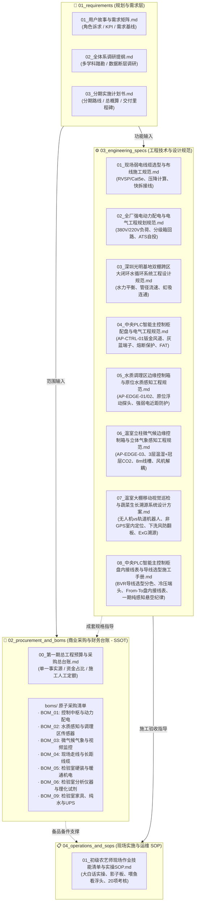

# 02. 项目需求、商业采购与工程设计规范体系 (Requirements, Procurement & Engineering Specs)

> **版本**：`v3.0.0 (EPC 架构分层重构版)`  
> **生效时间**：`2026-11-07T11:21:00.000Z` (严格遵循 ISO 8601 UTC)  
> **体系定位**：本目录为鱼菜共生数字工业化工厂一期建设与分期扩建的**物理工程实施基准总纲**。涵盖业务需求、商业采购台账、机电水动力详细工程规范及现场作业 SOP。

---

## 🏛️ 一、 目录组织架构与工程角色分工 (EPC 分层模型)

本项目遵循工业工程（EPC: Engineering, Procurement, Construction）与系统工程最佳实践，按生命周期与岗位职责将文档解耦为四大专业子目录，彻底消灭职责混杂与价格双源维护：

---

## 📑 二、 目录快速索引与文档字典

### 2.1 需求规划层 (`01_requirements/`)
| 序号 | 核心文档 | 核心内容与受众 | 链接入口 |
| :---: | :--- | :--- | :--- |
| 1.1 | **用户故事与需求矩阵** | 养殖长、种植长、电工、销售、财务等 7 大角色的核心诉求、输入输出契约与 KPI 跟踪矩阵 | 👉 [01_用户故事与需求矩阵.md](./01_requirements/01_用户故事与需求矩阵.md) |
| 1.2 | **全体系调研提纲** | 农学水质、立体栽培、PLC物联、算力调度等 10 大专业模块的现场踏勘与技术断层核查标准 | 👉 [02_全体系调研提纲.md](./01_requirements/02_全体系调研提纲.md) |
| 1.3 | **分期实施计划书** | 三期投资规划总览、第一期 8 周敏捷交付里程碑、¥6.62万投资概算与保命机制路线图 | 👉 [03_分期实施计划书.md](./01_requirements/03_分期实施计划书.md) |

### 2.2 商业采购层 (`02_procurement_and_boms/`) —— 唯一真实价格源 (SSOT)
| 序号 | 核心文档 | 核心内容与受众 | 链接入口 |
| :---: | :--- | :--- | :--- |
| 2.0 | **第一期采购总台账与施工定额** | **全厂采购单一事实源 (SSOT)**：各专业子 BOM 预算总汇总 (¥4.14万)、现场电工施工定额表 (13工日)、进场统一验货 Checklist | 👉 [00_第一期总工程预算与采购总台账.md](./02_procurement_and_boms/00_第一期总工程预算与采购总台账.md) |
| 2.1 | **BOM 01: 中央弱电控制柜成套** | AP-CTRL 核心控制柜 24 项全量采购清单 (¥7,233.95，纯弱电中枢；查看电费移至二期大棚旧电表控制柜) | 👉 [BOM_01_控制中枢与动力配电采购清单.md](./02_procurement_and_boms/boms/BOM_01_控制中枢与动力配电采购清单.md) |
| 2.2 | **BOM 02: 水质安全与调理传感器** | 深圳国数 316L 荧光法 DO、塞恩在线氨氮三合一、浮球开关、PMMA 旁路流通槽、pH/EC/Temp 探头 | 👉 [BOM_02_水质安全感知与调理区传感器采购清单.md](./02_procurement_and_boms/boms/BOM_02_水质安全感知与调理区传感器采购清单.md) |
| 2.3 | **BOM 03: 微气候气象与视频监控** | 菜池水温/液位、6柱18点位立体温湿度变送器、PAR光量子计、超声微气象站、10台 TP-Link 300万工业枪机 | 👉 [BOM_03_微气候气象与视频监控硬件采购清单.md](./02_procurement_and_boms/boms/BOM_03_微气候气象与视频监控硬件采购清单.md) |
| 2.4 | **BOM 04: 走线基础设施与长距线缆** | ECO-01 地面阻燃地槽 (200m)、防滑镀锌钢板、RVSP 4×0.75 屏蔽双绞线 (200m)、Cat5e 纯铜网线 (305m) | 👉 [BOM_04_现场走线基础设施与长距线缆清单.md](./02_procurement_and_boms/boms/BOM_04_现场走线基础设施与长距线缆清单.md) |
| 2.5 | **BOM 05: 检验室硬装与暖通机电** | 镀锌方管阁楼钢构、统一 9mm 防潮欧松板体系、双室两台 1.5HP 冷暖空调、全套施工工具与耗材清单 (¥21,778.00) | 👉 [BOM_05_检验室硬装与暖通机电工程清单.md](./02_procurement_and_boms/boms/BOM_05_检验室硬装与暖通机电工程清单.md) |
| 2.6 | **BOM 06: 检验室分析仪器与理化试剂** | 普析 T6-1650F 紫外分光光度计、带数据导出 6 通道农残仪、FA1004C/N 万分之一内校天平、ATAGO 糖度计、海尔 4℃ 留样箱、优普超纯水机、AZ86032 荧光水质仪与制样试剂耗材 (淘宝/1688实核 ¥55,049.00) | 👉 [BOM_06_检验室分析仪器与理化试剂设备清单.md](./02_procurement_and_boms/boms/BOM_06_检验室分析仪器与理化试剂设备清单.md) |
| 2.7 | **BOM 07: 水质调理区边缘控制箱与传感** | 进水调理池 (40m, AP-EDGE-01) 与出水调理池 (20m, AP-EDGE-02) 2台壁挂箱、GL20耦合器、两套对称原位浸入浮动式pH/EC/水温/氨氮套件 | 👉 [BOM_07_水质调理区边缘控制箱与水质感知采购清单.md](./02_procurement_and_boms/boms/BOM_07_水质调理区边缘控制箱与水质感知采购清单.md) |
| 2.8 | **BOM 08: 立柱微气候与动力边缘控制箱** | 8米立柱 (30m, AP-EDGE-03) 边缘箱、3层SHT35温湿度+冠层NDIR红外CO2、8米垂直PVC线槽、8路环流风机动力继电器 | 👉 [BOM_08_立柱微气候与动力边缘控制箱采购清单.md](./02_procurement_and_boms/boms/BOM_08_立柱微气候与动力边缘控制箱采购清单.md) |
| 2.9 | **BOM 09: 检验室实验家具与纯水UPS** | 2.8m 实心理化板实验边台×2、独立大理石天平减震台、PP 耐酸试剂柜、阁楼 0.25T/h 商用 RO 机组+300L 蓄水箱+盛漏托盘、山特 C3K 3kVA 在线式 UPS 与独立接地极 (淘宝/1688实核 ¥14,950.00) | 👉 [BOM_09_检验室实验家具与纯水UPS辅助设施清单.md](./02_procurement_and_boms/boms/BOM_09_检验室实验家具与纯水UPS辅助设施清单.md) |

### 2.3 工程设计规范层 (`03_engineering_specs/`)
| 序号 | 核心文档 | 核心内容与受众 | 链接入口 |
| :---: | :--- | :--- | :--- |
| 3.1 | **现场弱电线缆选型与布线规范** | 485/以太网弱电选型、DC 24V 长距直流压降公式、固定 IP 与 Modbus 站号字典、M12 快拆防呆工艺 | 👉 [01_现场弱电线缆选型与布线施工规范.md](./03_engineering_specs/01_现场弱电线缆选型与布线施工规范.md) |
| 3.2 | **全厂强电动力配电与电气规范** | 380V/220V 三相动力负荷平衡、一级总柜/二级分箱分级保护、断路器级联脱扣计算、ATS 应急发电机自投 | 👉 [02_全厂强电动力配电与电气工程规划规范.md](./03_engineering_specs/02_全厂强电动力配电与电气工程规划规范.md) |
| 3.3 | **双棚跨区大闭环水循环设计** | 深圳光明基地鱼棚与菜棚连通、落差虹吸自流、回水集水井水泵扬程与沿程阻力计算、防溢流管网拓扑 | 👉 [03_深圳光明基地双棚跨区大闭环水循环系统工程设计规范.md](./03_engineering_specs/03_深圳光明基地双棚跨区大闭环水循环系统工程设计规范.md) |
| 3.4 | **中央PLC智能主控制柜配盘规范** | AP-CTRL-01 主柜钣金与双风道排热设计、纯铜灰蓝分色端子、晶体管双级中继隔离、熔断报警端子、出厂 FAT 验收 | 👉 [04_中央PLC智能主控制柜配盘与电气工程规范.md](./03_engineering_specs/04_中央PLC智能主控制柜配盘与电气工程规范.md) |
| 3.5 | **水质调理区边缘控制与感知规范** | 调理池 AP-EDGE-01/02 边缘小箱、GL20耦合器、有人网关、塑料水池原位自适应浮动电极（3秒提拉规程）、强弱电近距防护 | 👉 [05_水质调理区边缘控制箱与原位水质感知工程规范.md](./03_engineering_specs/05_水质调理区边缘控制箱与原位水质感知工程规范.md) |
| 3.6 | **温室立柱微气候与立体气象规范** | 8米立柱 AP-EDGE-03 边缘小箱、3层SHT35温湿度+冠层NDIR红外CO2、8米垂直PVC线槽无损抱箍、环流风机动力解耦 | 👉 [06_温室立柱微气候边缘控制箱与立体气象感知工程规范.md](./03_engineering_specs/06_温室立柱微气候边缘控制箱与立体气象感知工程规范.md) |
| 3.7 | **移动视觉巡检与蔬菜生长溯源方案** | 水培跑道垂直俯拍正射影像、室内无人机(UAV)与悬挂轨道小车双技术路线对比、非GPS室内定位、抗风掀板测定、ExG植被指数溯源流水线 | 👉 [07_温室大棚移动视觉巡检与蔬菜生长溯源系统设计方案(无人机与悬挂轨道).md](./03_engineering_specs/07_温室大棚移动视觉巡检与蔬菜生长溯源系统设计方案(无人机与悬挂轨道).md) |
| 3.8 | **中央控制柜盘内接线与导线选型手册** | 全柜 BVR 软铜线规格分色、VE/TE 冷压针形管状端头匹配、From-To 全量回路点对点接线明细、一期纯感知无源悬空与二期平滑接管纪律 | 👉 [08_中央PLC智能主控制柜盘内接线表与导线选型施工手册.md](./03_engineering_specs/08_中央PLC智能主控制柜盘内接线表与导线选型施工手册.md) |
| 3.9 | **视频监控网络与端口线号规范** | 16口 PoE 交换机端口固化字典、三段式线号体系 (`NET-CAM01-P01`)、两端对称防潮覆膜打标、Cat5e STP 制作与高空 U 型滴水弯工艺 (SSOT) | 👉 [09_全厂视频监控PoE网络布线与交换机端口线号施工规范.md](./03_engineering_specs/09_全厂视频监控PoE网络布线与交换机端口线号施工规范.md) |

### 2.4 现场作业与运维层 (`04_operations_and_sops/`)
| 序号 | 核心文档 | 核心内容与受众 | 链接入口 |
| :---: | :--- | :--- | :--- |
| 4.1 | **初级农艺师作业技能与实操SOP** | 面向一线作业工人的大白话实操手册：工具定置影子板防丢、海绵育苗定植规程、慢撒喂鱼看浮头、20项通关考核表 | 👉 [01_初级农艺师现场作业技能清单与实操SOP.md](./04_operations_and_sops/01_初级农艺师现场作业技能清单与实操SOP.md) |

---

## ⚠️ 三、 工程管理与维护红线纪律

> [!IMPORTANT]
> **【红线 1：单一真实价格源 (Single Source of Truth, SSOT)】**
> 任何涉及物料采购金额、实核渠道（1688/淘宝/授权代理商）、包装规格与数量的维护，**必须且仅能在 `02_procurement_and_boms/` 及其子清单中修改**。严禁在工程规范（`03_engineering_specs/`）中私自编写或硬编码价格，规范仅负责技术参数与配盘工艺！

> [!WARNING]
> **【红线 2：边缘控制系统扩展原则 (Atomic Extensibility)】**
> 当未来基地扩建新增分布式边缘控制柜（如 `AP-EDGE-01`、`AP-EDGE-02`）时：
> 1. 配盘工艺、钣金标准、端子分色与 FAT 验收准则**必须 100% 继承并复用** `03_engineering_specs/04_中央PLC智能主控制柜配盘与电气工程规范.md` 及水质/微气候专项规范；
> 2. 商业采购明细**必须在 `02_procurement_and_boms/boms/` 目录下新建独立的原子采购清单**（如 `BOM_07_边缘控制柜AP-EDGE-01采购清单.md`），严禁塞入已归档的历史 BOM 文件中。

> [!NOTE]
> **【红线 3：文档与代码时间戳严格一致性】**
> 所有文档的创建、修订记录及数据日志，时间处理必须归一化为严格遵循 ISO 8601 的 UTC 格式（例：`2026-11-07T11:21:00.000Z`），严禁书写本地无时区的时间字符串。
