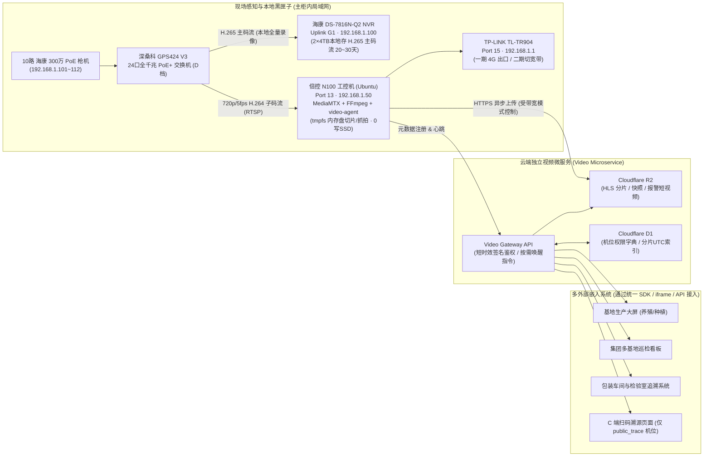

# 连锁数字化农业工厂：09_视频监控与流媒体微服务架构设计规范 (Video Streaming & Surveillance Microservice)

> **定位与设计原则**：  
> 本规范定义全厂视频监控与流媒体子系统（`video-service`）的独立微服务架构。遵循 **“边缘极简无状态推流 + 云端统一鉴权网关 + 多业务系统按需嵌入”** 原则，彻底解耦底层摄像头/NVR 硬件与上层生产大屏、集团巡检、包装追溯及 C 端扫码溯源等业务系统。  
> **版本与状态**：`Version 1.0.0` | **适用分期**：`Phase 1 ~ Phase 3` | **台账状态**：`Active`  
> **生效时间**：`2026-11-16T07:56:00.000Z` (严格遵循 ISO 8601 UTC)  
> **关联硬件拓扑 SSOT**：👉 [09_全厂视频监控PoE网络布线与交换机端口线号施工规范.md](../../02_requirements_and_plans/03_engineering_specs/09_全厂视频监控PoE网络布线与交换机端口线号施工规范.md)  
> **关联中枢与摄像机清单**：👉 [BOM_01_控制中枢与动力配电采购清单.md](../../02_requirements_and_plans/02_procurement_and_boms/boms/BOM_01_控制中枢与动力配电采购清单.md) · [BOM_10_全厂视频监控前端摄像机采购清单.md](../../02_requirements_and_plans/02_procurement_and_boms/boms/BOM_10_全厂视频监控前端摄像机采购清单.md)  
> **工程落地细则与计划**：👉 [01_数据库表结构与边云控制协议.md](./01_数据库表结构与边云控制协议.md) · [02_视频微服务一期实施计划.md](./02_视频微服务一期实施计划.md)

---

## 1. 架构总览与硬件解耦边界

系统采用 **“本地录像保底 + 边缘内存切片 + 云端独立网关”** 三层架构，确保公网中断或 4G 限速时**本地 24h 高清录像绝不丢失**，且云端业务无需感知底层摄像头 IP 或 NVR 品牌差异。



### 核心职责边界红线
1. **本地录像不走工控机**：海康 NVR 独立接收各枪机 `H.265` 主码流并写入双 4TB 酷鹰硬盘，工控机仅在需要云端同步或按需查看时拉取 **`720p / 5 fps / H.264` 子码流**（约 `320 kbps`），两者互不抢占解码与磁盘资源。
2. **保护 128G 系统盘（`0` 视频写入 SSD）**：工控机所有 HLS `.ts` 分片、临时 `.jpg` 快照与报警短视频缓冲**必须落入 `/mnt/hls_ram`（`tmpfs` 内存盘，上限 `512 MB`）**，上传 R2 成功后立即删除。
3. **单一拉流复用（禁止多客户端直怼摄像头）**：工控机内由 **`MediaMTX`** 统一向海康枪机拉取一路子码流并做本地 RTSP 分发，避免 `FFmpeg` 快照任务、HLS 任务或二期 AI 任务重复建立 RTSP 连接拖垮摄像头。

---

## 2. 带宽自适应运行模式（兼容一期纯 4G 与二期宽带）

实测单路 `320 kbps` 子码流 24 小时连续上传约消耗 **`101 GB/月`**（7 路全开约 `707 GB/月`），纯 4G 流量卡无法长期承载。因此 `video-agent` 必须从 Day 1 内置 **三档运行模式**，由云端配置热切换：

| 模式代号 | 适用网络阶段 | 边缘端行为与上传内容 | 预估月流量 (7~10路) |
| :--- | :--- | :--- | :--- |
| **`snapshot`（一期 4G 默认）** | **无宽带纯 4G 过渡期** | 本地 NVR 照常 24h 录像；工控机每路每 `10 分钟` 抓拍 1 张 `720p JPG`（~150KB）上传 R2，另支持 PLC/传感报警触发截取前后 `60s` 短视频 | **约 4.5 ~ 8 GB / 月** |
| **`on-demand`（4G 按需唤醒直播）** | **无宽带纯 4G 阶段查看实时画面** | 平时保持 `snapshot` 模式；当外部系统请求某路 `/live` 时，云端向 N100 下发唤醒指令临时推流该路 HLS/WebRTC，**无人观看满 `180 秒` 自动断开休眠** | **约 10 ~ 50 GB / 月**（视观看时长） |
| **`continuous-hls`（宽带全量模式）** | **二期拉通光纤宽带后** | 全量拉取 `5 fps` 子码流切 `30s` HLS 分片传 R2，实现全天候云端时间轴回放与伪直播 | **约 700 ~ 1,010 GB / 月** |

---

## 3. 机位权限分级与安全隔离模型

由于未来需嵌入 **C 端消费者扫码溯源** 等外部公网页面，所有摄像头必须在元数据中强制划分 **`visibility` 权限级别**，从源头杜绝安防隐私或厂区内部画面泄漏：

| 权限级别 (`visibility`) | 适用机位范围 (对齐 09 号规范) | 允许嵌入的目标系统 | 安全与隐私强制策略 |
| :--- | :--- | :--- | :--- |
| **`internal_ops`**（内部运维/安防） | `CAM-GATE-IN-01` (`.101`)、 `CAM-GATE-OUT-01` (`.102`)、 `CAM-BACK-IN-01` (`.103`)、 `CAM-EQUIP-IN-01` (`.107`)、 `CAM-LAB-01` (`.108`)、 `CAM-PACK-*` (`.111/.112`) | 仅限基地生产大屏、集团管理看板、检验/包装内部追溯后台 | 必须携带管理员/员工登录态 JWT；禁止任何匿名或 C 端接口访问 |
| **`public_trace`**（对外脱敏溯源） | `CAM-FISH-PAN-01` (`.104`)、 `CAM-FISH-P5-01` (`.105`)、 `CAM-HYDRO-PAN-01` (`.106`) | 除内部系统外，允许嵌入 C 端扫码溯源页、加盟商展示大屏 | **FFmpeg 推流强制加 `-an` 参数彻底剥离音轨**；仅开放全景/生长区机位；Token 绑定单机位与防盗链 Referer |

---

## 4. 统一对外 API 契约（供多系统嵌入）

所有外部业务系统均通过 `Video Gateway API` 接入，**严禁业务系统直接持有 R2 密钥或拼接底层存储路径**：

### 4.1 机位目录查询
```http
GET /api/v1/cameras?site_id=guangming-01&visibility=public_trace
Authorization: Bearer <service_or_user_jwt>
```
返回每个机位的 `cam_id`、`name`、`zone`（`fish` / `hydro` / `gate` / `lab` / `pack`）、`visibility`、`stream_mode`、`online_status` 与最新 `last_snapshot_at`（严格 ISO 8601 UTC）。

### 4.2 实时流 / 伪直播获取（支持按需唤醒）
```http
GET /api/v1/streams/{cam_id}/live?protocol=hls
Authorization: Bearer <service_or_user_jwt>
```
* **返回结构**：
  ```json
  {
    "cam_id": "CAM-FISH-P5-01",
    "status": "waking",
    "protocol": "hls",
    "playback_url": "https://video-gw.example.com/sign/<short_lived_token>/hls/CAM-FISH-P5-01/live.m3u8",
    "expires_at": "2026-11-16T08:10:00.000Z"
  }
  ```
* 若处于 `on-demand` 模式且该路当前休眠，网关返回 `status: "waking"` 并异步通知工控机 `video-agent` 拉流，前端播放器每 `2s` 轮询直至 `status: "ready"`（通常 `4~8s` 首帧出图）。

### 4.3 历史分片回放与延时快照（与 5 秒传感器宽表对齐）
```http
GET /api/v1/streams/{cam_id}/playback?start=2026-11-16T07:00:00.000Z&end=2026-11-16T07:30:00.000Z
GET /api/v1/snapshots/{cam_id}?start=2026-11-16T00:00:00.000Z&end=2026-11-16T12:00:00.000Z
```
* **时间格式红线**：所有请求参数与响应时间戳**强制使用严格 ISO 8601 UTC（`YYYY-MM-DDTHH:mm:ss.sssZ`）**，便于生产大屏点击水质报警曲线（如 `DO < 4.0mg/L` 发生时刻）时精准跳转至前后 2 分钟的视频切片。

### 4.4 异常事件短视频固化（内部服务调用）
```http
POST /api/v1/events/clip
Content-Type: application/json
{
  "cam_id": "CAM-FISH-PAN-01",
  "event_id": "ALM-20261116-001",
  "trigger_at": "2026-11-16T07:52:00.000Z",
  "pre_seconds": 30,
  "post_seconds": 30
}
```
由告警服务触发，工控机从本地环形内存缓冲（或 NVR 回放接口）截取对应 60 秒片段转码并上传至 `events/` 目录永久留档。

### 4.5 多系统前端嵌入方式
提供轻量级无依赖嵌入方案，外部系统二选一即可：
1. **标准 `<iframe src="https://video-gw.example.com/embed?token=...">`**：零前端改造，5 分钟接入任意第三方后台或飞书/看板页面；
2. **原生 HLS.js / WebRTC Web Component（`<aquaponics-video-player>`）**：适配 React + Tailwind CSS v4 + shadcn/ui 主站大屏，支持自定义水印、全屏与时间轴联动。

---

## 5. R2 存储目录规范与生命周期

| 存储类别 | Cloudflare R2 对象路径规范 | 建议保留周期 (Lifecycle) | 说明 |
| :--- | :--- | :--- | :--- |
| **定时延时快照** | `snapshots/{site_id}/{cam_id}/{YYYY}/{MM}/{DD}/{iso_utc}.jpg` | **90 天**（精选题图可归档至生菜 21 天生长延时相册） | 一期 4G 模式主力视觉凭证 |
| **HLS 视频分片** | `hls/{site_id}/{cam_id}/{YYYY}/{MM}/{DD}/{iso_utc}.ts` | **7 ~ 15 天** | 自动过期清理控制 R2 存储费用；长期全量高清由本地 NVR 双 4TB 盘兜底 20~30 天 |
| **报警联动片段** | `events/{site_id}/{cam_id}/{event_id}.mp4` | **180 天** | 与 D1 报警记录关联，供事故复盘 |

---

## 6. 倍控 N100 边缘端运行环境部署规范

后续在倍控 `N100`（Ubuntu）安装软件时，严格按以下配置落地：
1. **`tmpfs` 内存盘挂载（`/etc/fstab`）**：
   ```fstab
   tmpfs /mnt/hls_ram tmpfs defaults,noatime,nosuid,nodev,size=512M 0 0
   ```
2. **核心服务进程（`systemd` + Docker Compose 托管）**：
   - `mediamtx`：统一拉取海康枪机子码流（`rtsp://admin:<pwd>@192.168.1.10x:554/Streaming/Channels/102`），本地暴露复用流并按需支持 WebRTC；
   - `video-agent`（Python 3 + `FFmpeg` + `boto3`）：执行 `snapshot` / `on-demand` / `continuous-hls` 调度、`-an` 去音轨、R2 上传（带断网指数退避重传与本地内存盘淘汰清理）、以及向云端网关上报心跳。
3. **时钟基准**：全机强制启用 `chrony` 同步并锁定 `UTC` 时区，保证无宽带或断网重启时由主板 RTC 电池维持正确时间戳。

---

## 7. 域名规划、成本控制与跨境访问演进策略

为兼顾一期低成本落地与未来正式商业化展示，网络、域名与存储按以下原则演进：

### 7.1 域名与部署边界
1. **过渡期与独立域名规划**：
   - 一期测试与过渡阶段暂借用 `beikee.org` 子域名作为 `video-gateway` 网关入口（禁止在生产或现场设备直连默认 `*.workers.dev`）；
   - 项目成熟后将在 Cloudflare 注册项目**正式独立域名**并直接切换绑定，边缘端仅替换 `GATEWAY_URL` 即可平滑迁移。
2. **国内正式营销网站对接**：
   - 正式营销网站在国内完成域名注册与 ICP 备案后，通过前端 HTTPS 调用 CF 独立域名的 `public_trace` 直播与溯源 API；
   - 上线前需将 `wrangler.toml` 中的 `ALLOWED_ORIGINS` 从 `"*"` 收紧为国内营销网站与生产大屏的正式域名白名单，并启用短时效签名 Token 与 `Referer` 校验。

### 7.2 成本与收益平衡（R2 主力 vs Cloudflare Stream）
- **主力架构坚持 R2 + D1 + 按需唤醒**：Cloudflare Stream 按分钟计费（存储约 \$5/千分钟 + 观看约 \$1/千分钟），不适合长期监控或频繁扫码；R2 提供 10 GB 免费存储且**出站流量免费**，配合 `snapshot`（10 分钟抓拍）与 `on-demand`（180 秒自动休眠），单基地云端增量存储成本可控制在极低水平。
- **Stream 仅作按需增强**：仅在招商展示、活动直播等短期高规格场景下，针对单路 `public_trace` 机位临时接入 Stream Live（且关闭长期云端录制），日常不开启。
- **C 端扫码默认秒开策略**：C 端扫码页默认优先展示每日精选 `15~30s` 实景 MP4 与 `21 天`生长延时相册，仅在用户主动点击“实时画面”时触发 `on-demand` 唤醒。
- **防隐性成本**：R2 需在建桶时即配置前缀级 Object Lifecycle 自动过期（`hls/` 7~15 天、`snapshots/` 90 天、`events/` 180 天），并在 Worker 中配置每日 Cron Trigger 清理 D1 过期索引行；二期切宽带开启 `continuous-hls` 时，单分片时长建议保持 `30s~60s` 以控制 R2 Class A 写入与 D1 行数。

### 7.3 国内网络连通性兜底（零代码改动演进）
1. **一期 4G 过渡期**：先用绑定自定义域名的网关在现场 `TL-TR904` 4G 卡上实测心跳与快照上传成功率；若运营商直连 CF 丢包严重，可临时挂载一台轻量香港跳板机（免备案、大流量包）专供 N100 上行转发，**切勿使用国内按量 ECS 反代全量 HLS 出站流量**（避免带宽费用倒挂），待二期拉通光纤宽带后撤掉跳板。
2. **正式营销网站 C 端加速**：若国内微信端或部分移动网络直连 CF 独立域名出现卡顿，无需修改后端代码——只需在国内已备案域名下配置一层国内 CDN（源站回源至 CF 独立域名）或将 C 端高频访问的精选实景 MP4 / 快照双写至国内 OSS + CDN 即可。
